# Zoho badge on the order page

Playwright screenshots of the "Mirrored to Zoho" badge (GAP-18, Z1–Z3 in
`docs/design/staff-gaps-delivery-zoho-alerts.md`) on the order page header, taken from a running
LAX Admin stack (the CI stack's set-up) on the fixture orders `seed:zoho-mirror-badge` writes, at
2x. Named `{state}-{width}-{theme}.png`: 1440 is the top 1440 x 380 of the page, 375 the 375 x 812
viewport.

- `mirrored`, `pending`, `failed`, `dry_run`: the badge pressed with Enter, its details open and
  focused (a popover at 1440, a bottom sheet at 375). `failed` shows no "Open in Failed jobs": that
  stack has no Bid API to say the person can open Failed jobs, so the link is left out (Q7).
- `not_applicable`: an order with nothing to mirror has no badge.
- `mockup-z2-{theme}.png`: the approved mockup's badge row
  (`docs/design/mockups/staff-gaps/index.html`), for comparison.

No horizontal scroll at 375 px in any of them.

## PR 3: the artwork record and the Orders list's Zoho column

Taken the same way, on the fixture artworks and orders `seed:zoho-mirror-badge` now writes.

- `artwork-{state}-{width}-{theme}.png`: the From Zoho record's header, the badge beside Where it
  is, pressed with Enter and its details open (a popover at 1440, a bottom sheet at 375).
  `artwork-not_applicable-*`: an artwork with nothing to mirror has no badge.
- `orders-column-{width}-{theme}.png`: the Orders list on the fixtures' day with the Zoho column
  shown: one order in each state, and the "None" dash for the order with nothing to mirror. On a
  phone the badge has its own line under the order number.
- `orders-column-default-hidden-1440-{theme}.png`: the column is hidden by default; Display shows
  it, unticked (TBL-12).

### PR 3 gallery

**Artwork record: Mirrored to Zoho**

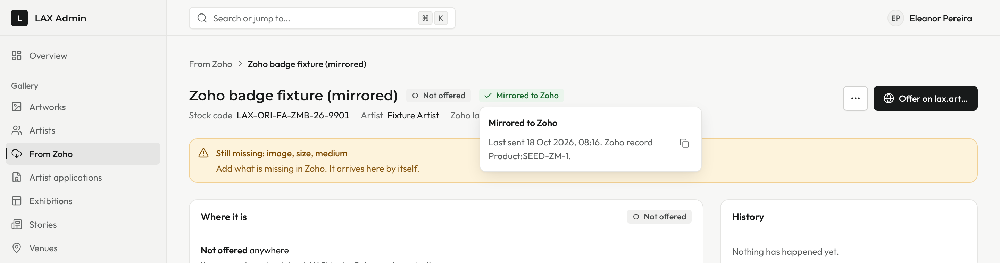

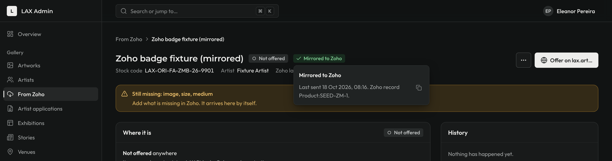

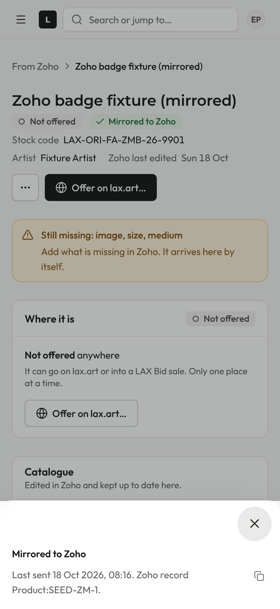 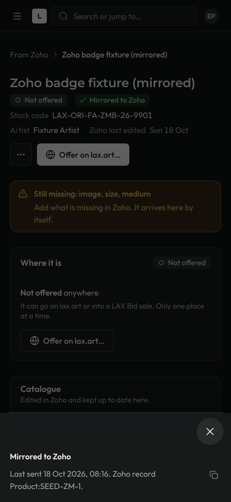

**Artwork record: Sending to Zoho**

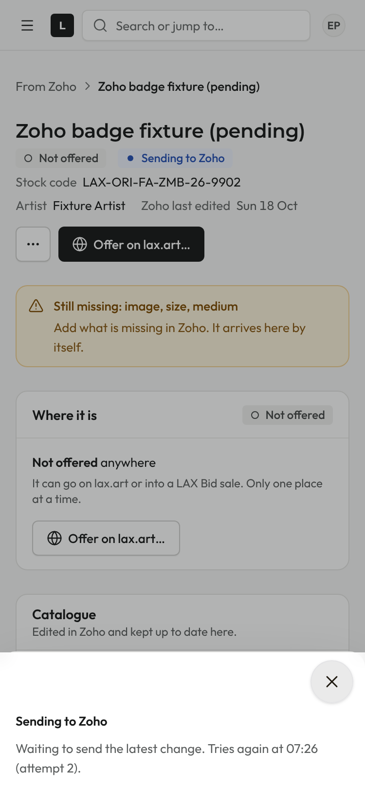 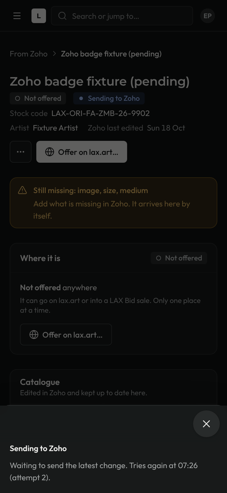

**Artwork record: Not in Zoho**

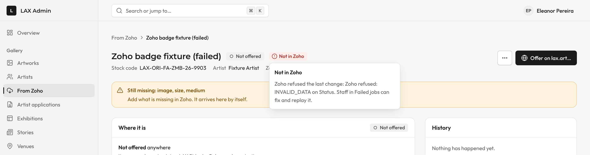

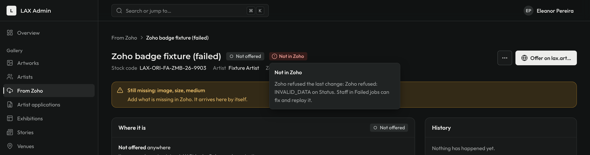

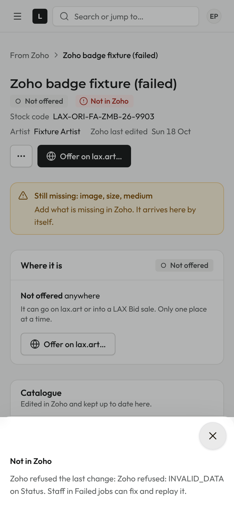 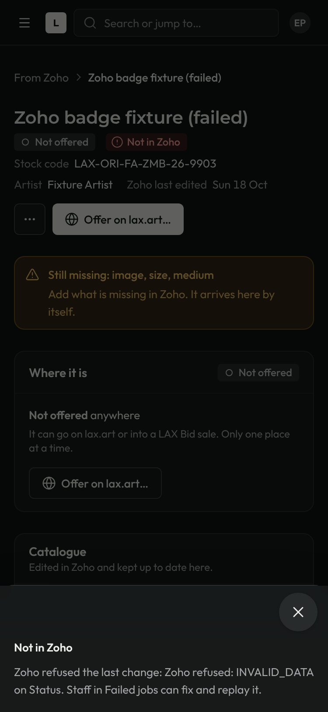

**Artwork record: Zoho dry run**

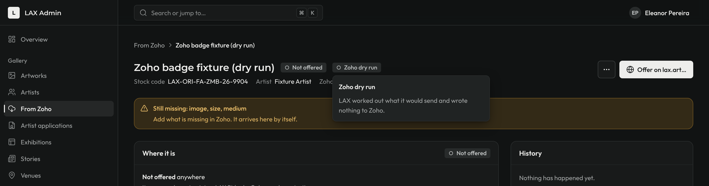

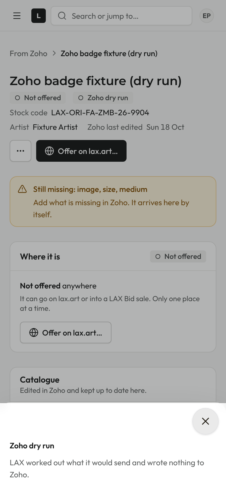 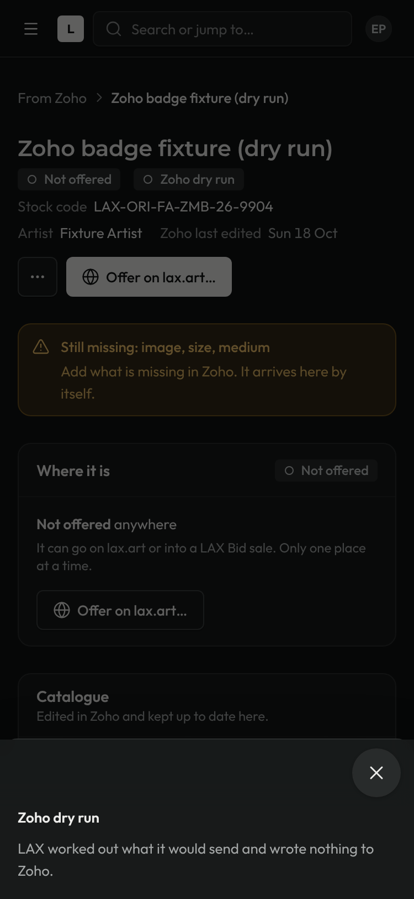

**Artwork record: Nothing to mirror (no badge)**

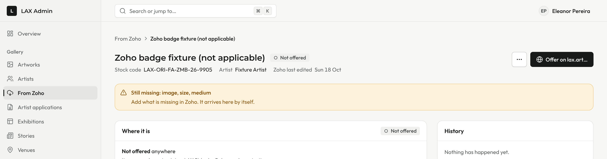

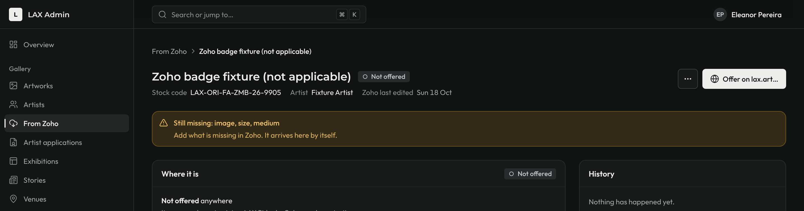

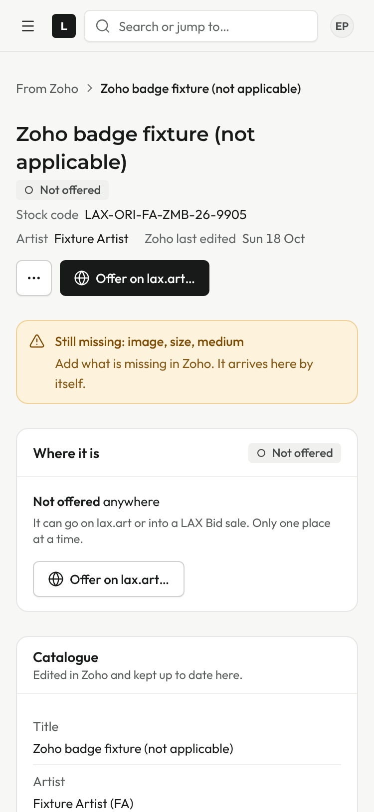 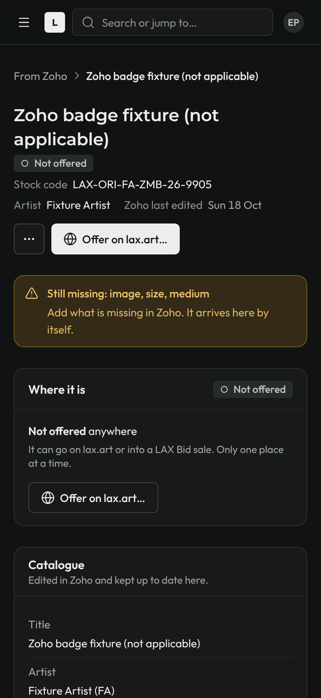

**Orders list: Zoho column hidden by default (Display menu)**

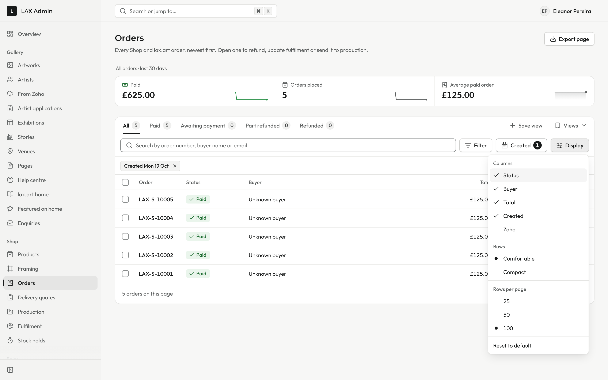

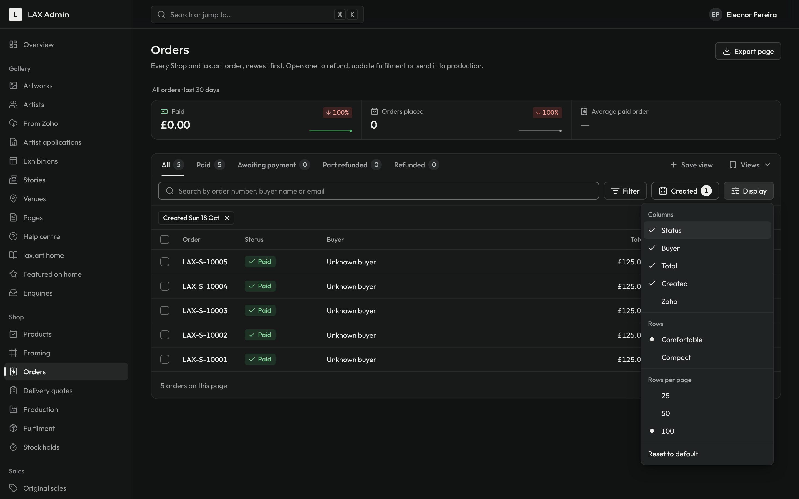

**Orders list: Zoho column shown, every state**

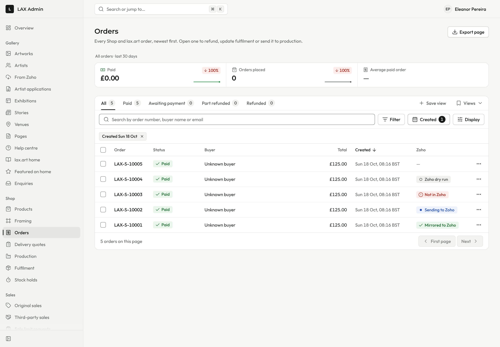

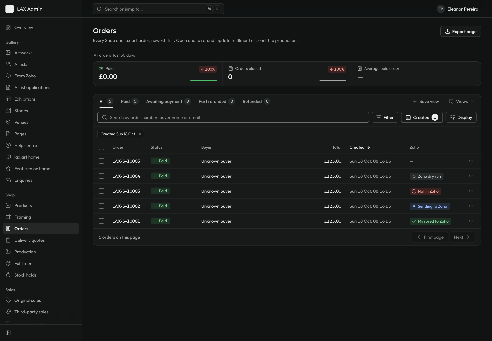

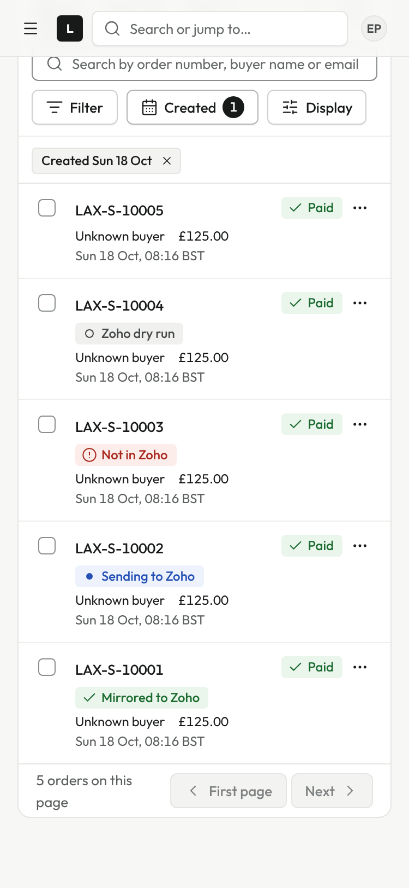 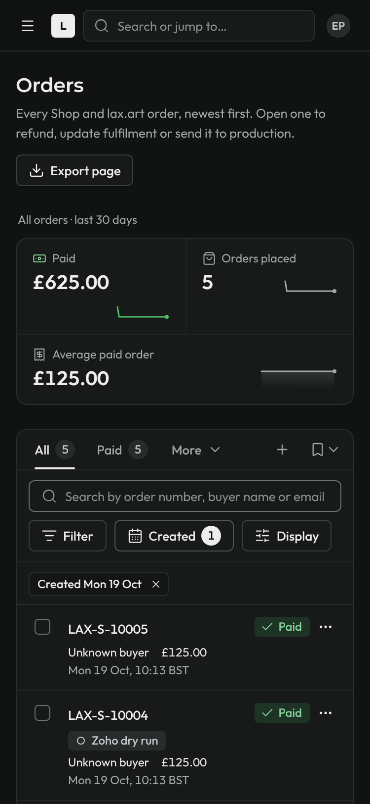
