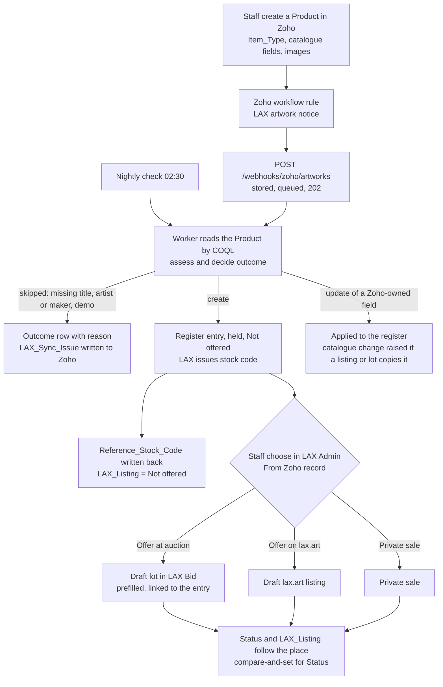
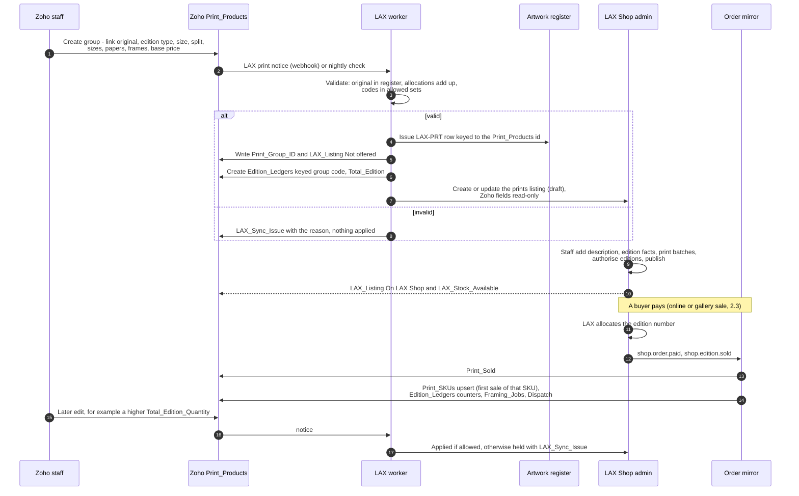
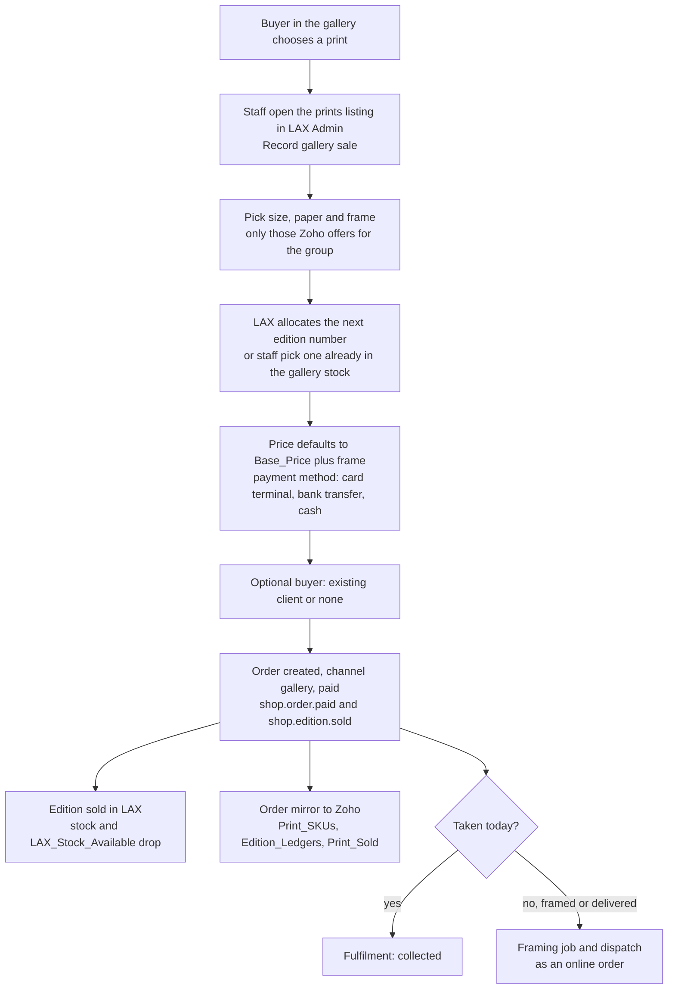
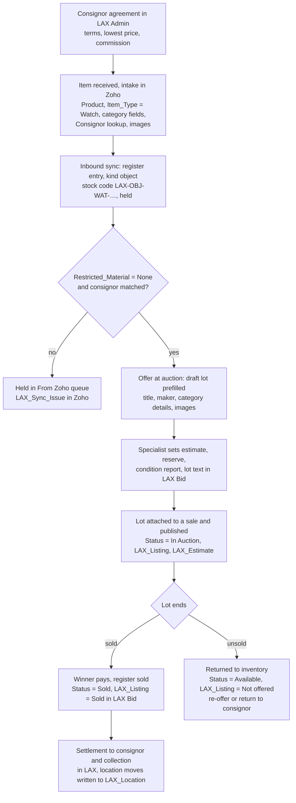

# Zoho CRM as catalogue master: originals, prints and editions, Bid items

Status: design, not built. Owner decision of 2026-11-19. No product code changes with this note.

Related: [Zoho CRM integration](../integrations/zoho.md), [stock location](stock-location.md),
[creating a Bid lot from a register entry](../integrations/artwork-register-bid-lot-from-entry.md),
[staff design standard](staff-design-standard.md).

## The decision

Zoho CRM is the master for **what an item is**:

- **Originals** (Zoho `Products`): already the case today.
- **Prints and editions**: print groups (`Print_Products`), the SKUs a group may be sold as, and the
  edition size and split.
- **Bid items that are not artworks**: watches, jewellery and objects (Zoho `Products`, by item type).

LAX owns **what happens to an item**: where it is offered (Bid, lax.art, LAX Shop, private sale),
whether it sold, stock and edition numbers, physical location, orders and fulfilment. LAX writes that
to Zoho in `LAX_*` fields, which Zoho field permissions make read-only for staff.

Rules that follow from it:

1. **One owner per field.** Every field has exactly one system that may change it. The other system
   shows a copy and offers no way to edit it.
2. **Status is the one guarded shared field** on `Products`. It keeps the existing compare-and-set
   (`ZohoStatusSync`, `decideStatusWrite`) and its conflicts. No new shared field is introduced.
3. **Edition numbers are allocated only by LAX.** Zoho never numbers a print; it sees counts and the
   numbers LAX allocated.
4. **Gallery print sales are recorded in LAX Admin**, not in Zoho. (Gallery sales of originals stay
   as they are: Zoho `Status` = `Sold`, recorded by LAX as sold in the gallery.)
5. **Identity codes are issued by LAX** (stock code, print group code, SKU), as today. Zoho shows them
   read-only.

This settles the "Owner decision pending: which system is master for prints" note in
[zoho.md](../integrations/zoho.md#print-orders-to-zoho-outbound). Today LAX makes print groups and SKUs
from LAX Shop listings and pushes them to Zoho; this design reverses the direction for the catalogue
fields and keeps LAX's counters and order mirror as they are.

## 1. Field ownership matrix

Legend: **Z** Zoho owns (staff edit in Zoho; LAX copies, read-only in LAX). **L** LAX owns (LAX writes;
read-only in Zoho for every profile except the integration user). **G** guarded shared field
(compare-and-set). **NEW** a field that does not exist in Zoho today and must be created by a Zoho
admin (LAX never creates Zoho fields). Field API names are taken from the code; where the code does
not name the field, the name is marked *(confirm)* and must be checked in the org's field list.

### 1.1 `Products`: originals (existing, unchanged in substance)

| Zoho field | Owner | LAX copy / source | Notes |
| --- | --- | --- | --- |
| `Product_Name` | Z | `artwork_register.title` | Copied to lax.art listing / Bid lot via the catalogue-change flow (`CATALOGUE_FIELDS`). |
| `Artist` (lookup to `Artists`: `Name`, `Artist_Code1`, `Artist_Code2`) | Z | `artist_zoho_id`, `artist_name`, `artist_code` | Required for an original (`missing_artist`). |
| `Medium` | Z | `medium` | |
| `Dimensions` | Z | `dimensions` | |
| `Year` | Z | `year` | |
| `Unit_Price` | Z | `zoho_price` | Reference price shown beside LAX's offer price; never copied into an offer. |
| Record image and attachments | Z | `image_refs`, `image_sources` | Existing image sync. |
| `Reference_Stock_Code` | L | `stock_code` | LAX issues; a Zoho edit is the existing stock-code conflict. |
| `Status` | **G** | `catalogue_status`, `catalogue_status_written` | Existing compare-and-set and "Zoho Status" conflict. Staff set `Sold` for a gallery sale of an original. |
| `LAX_Listing`, `LAX_Listing_Detail`, `LAX_Listing_Link`, `LAX_Listing_Updated` | L | computed from register, lots, lax.art | Existing. |
| `LAX_Location` | L | `artwork_location_move` (latest) | Existing. |
| `Item_Type` | Z | new register column `item_type` | **NEW** picklist: `Artwork`, `Watch`, `Jewellery`, `Object`. Backfilled to `Artwork` in Zoho before any non-art item is entered. Drives the Zoho layout. |
| `LAX_Sync_Issue` | L | from hold reasons (section 3) | **NEW** text (255). Why LAX could not take Zoho's latest change; empty when all is applied. |

### 1.2 `Products`: Bid items (watches, jewellery, objects)

Same module as originals, so the inbound sync, Status compare-and-set, `LAX_Listing`, `LAX_Location`
and images are reused unchanged. Per-category fields are in section 5.

| Zoho field | Owner | LAX copy | Notes |
| --- | --- | --- | --- |
| `Product_Name`, `Year`, `Dimensions`, `Unit_Price`, images | Z | as originals | `Medium` is reused as "Materials" on the object layouts. |
| `Item_Type` | Z | `item_type` | **NEW** (above). |
| `Maker` | Z | `maker` | **NEW** text. Brand, house or designer. Replaces `Artist` for non-art; `Artist` stays empty. |
| `Maker_Code` | Z | used in the stock code | **NEW** text (2 to 4 capitals or digits), optional; LAX uses `GEN` when empty. |
| Category fields (section 5) | Z | `category_details` (jsonb) | **NEW**, per layout. |
| `Condition_Summary` | Z | `condition_summary` | **NEW** multi-line. Full condition reports stay on the lot in LAX. |
| `Provenance` | Z | `provenance` | **NEW** multi-line. |
| `Restricted_Material` | Z | blocks offering | **NEW** picklist: `None`, `Ivory`, `Tortoiseshell`, `Other CITES`, `Unknown`. Anything but `None` blocks "Offer at auction" until a person with `artwork_register.review` clears it in LAX (the decision is LAX's; the fact is Zoho's). |
| `Consignor` | Z | matched to the LAX client by `crm_record_link` | **NEW** lookup to `Contacts` *(confirm name)*. The agreement terms (lowest price, commission) stay in LAX's consignor agreement. |
| `Reference_Stock_Code` | L | `stock_code` | Issued by LAX as `LAX-OBJ-{CAT}-{MAKER}-{YY}-{NNNN}`, e.g. `LAX-OBJ-WAT-GEN-26-0001` (`CAT` = `WAT`, `JWL`, `OBJ`). Fits the existing `STOCK_CODE_PATTERN` shape with a new `OBJ` kind segment. |
| `Status` | **G** | as originals | Same compare-and-set. |
| `LAX_Listing*`, `LAX_Location`, `LAX_Sync_Issue` | L | as originals | `LAX_Listing` places for objects: Not offered, Draft lot in LAX Bid, In a LAX Bid sale, In a private sale, Sold in LAX Bid, Sold privately, Sold in the gallery, Withdrawn. |
| `LAX_Estimate` | L | the open lot's estimate | **NEW** text (255), e.g. "£2,000–3,000 (sale 14 Dec)". Read-only visibility for Zoho users; empty when not in a sale. |

### 1.3 `Print_Products`: print groups

One record per print group (one main run of an original). Today LAX creates it; after the flip staff
create it in Zoho.

| Zoho field | Owner after flip | Owner today | LAX copy | Notes |
| --- | --- | --- | --- | --- |
| Record name (`Name` *(confirm)*) | Z | Zoho (not filled by LAX) | register `title` of the `LAX-PRT` row | Copied to the LAX Shop prints listing title. |
| `Linked_Original_Artwork` | Z | L | `source_original_id` | Must point at a Product already in the register as an original. Fixed once the group has a register row (changing it is a hold, section 3). |
| `Edition_Type` (`Numbered` / `Open`) | Z | L | `shop_artwork.run_kind` (`limited` / `open`) | Fixed after the first print is sold (hold). |
| `Total_Edition_Quantity` | Z | L | `run_size` | Hold if lower than the numbers LAX already allocated. |
| `Collector_Allocation` | Z | L | `alloc_buyer` | Hold if lower than collector prints already sold. |
| `Artist_Allocation` | Z | L | `alloc_artist` | Same rule per bucket. |
| `LAX_Allocation` | Z | L | `alloc_lax` | Same rule per bucket. A Zoho validation rule keeps the three equal to the total for `Numbered`. |
| `Print_Sizes` | Z | — | `print_size` | **NEW** multi-select: `A4`, `A3`, `A2`, `A1` (`PRINT_SIZE_CODES`). The sizes this group may be sold in. |
| `Print_Papers` | Z | — | `print_paper` | **NEW** multi-select: `COT`, `BAR`, `HAH`, `MUN` (`PRINT_PAPER_CODES`), shown with their names. |
| `Frames_Offered` | Z | — | allowed frame options | **NEW** multi-select: `UNF`, `FRB`, `FRW`, `FRN` (`PRINT_FRAME_CODES`). Frame prices stay in LAX (framing options). |
| `Base_Price` | Z | — | `print_price_pence` | **NEW** currency. Unframed price of one print (open question 9.1). |
| `Proofs_AP`, `Proofs_PP`, `Proofs_HC`, `Proofs_BAT` | Z | — | `proofs_kept_*` | **NEW** numbers, optional. How many proofs exist outside the run. |
| `Print_Group_ID` | L | L | register `stock_code` (`LAX-PRT-…`) | LAX derives it from the original's stock code (`printCodeForOriginal`) and writes it back on first import; staff leave it blank. Unique. |
| `Print_Sold` | L | L | order mirror | Unchanged. |
| `LAX_Listing`, `LAX_Listing_Link`, `LAX_Listing_Updated` | L | — | Shop listing state | **NEW** on this module: Not offered, Draft in LAX Shop, On LAX Shop, Sold out, Withdrawn. |
| `LAX_Stock_Available` | L | — | editions authorised, unsold, unreserved | **NEW** number. |
| `LAX_Sync_Issue` | L | — | hold reasons | **NEW** text (255). |

Edition facts (numbering on print or certificate, signature, certificate issuer and authority, stamp,
printed and published by: `shop_edition_facts`) stay **L** in v1. They are confirmed by a named person
in LAX, drive the public wording, and carry the certificate authority record; moving them is open
question 9.5. Zoho gets a read-only summary in `LAX_Edition_Facts` (**NEW**, multi-line) if the owner
wants it visible there.

### 1.4 `Edition_Ledgers`: one counter record per group (LAX-owned, unchanged)

| Zoho field | Owner | Notes |
| --- | --- | --- |
| `LAX_Mirror_Key` (`group:{code}`) | L | Unique. |
| `Linked_Print_Product_Group` | L | |
| `Total_Edition` | L | A copy of Zoho's own `Total_Edition_Quantity`, written by LAX once applied. Kept for existing reports. |
| `Assigned_To_Client`, `Assigned_To_Artist`, `Assigned_To_LAX`, `Print_Sold` | L | Prints sold on paid, unreleased orders, by holder. Unchanged. |

The whole module becomes read-only (no create, edit or delete) for staff profiles.

### 1.5 `Print_SKUs`: the sellable variants (LAX-written index of a Zoho-defined offer)

The owner made Zoho the master for SKUs. The design keeps that meaning without asking staff to create
many records per group by hand (12 for one size and paper with four frames and three holders, up
to 192 with every size and paper):

- **Zoho defines which SKUs may exist**: `Print_Sizes`, `Print_Papers`, `Frames_Offered` on the group.
  The holder part (`COL`, `ART`, `LAX`) is not a choice: it is whose edition LAX allocated, which is
  LAX's.
- **LAX writes the SKU record** the first time a SKU is sold (as the order mirror does today), only
  when every part is in the group's Zoho-defined offer. A listing or framing choice outside the offer
  cannot be published or sold in LAX Shop (section 3).
- The SKU code and format are unchanged: `LAX-PRT-{group}-{SIZE}-{PAPER}-{FRAME}-{ALLOC}`
  (`buildPrintSku`). No existing SKU is renamed or merged.

| Zoho field | Owner | Notes |
| --- | --- | --- |
| `SKU` | L | Unique (existing requirement). |
| `Linked_Print_Product_Group` | L | |
| `Size`, `Paper`, `Frame` | L (values constrained by Z) | Always one of the group's `Print_Sizes` / `Print_Papers` / `Frames_Offered`. |
| `Allocation_Bucket` | L | Who holds the edition sold. |
| `Edition_Type` | L | Copy of the group's. |

Staff profiles: read only, no create. If the owner later wants staff to create SKU records directly,
see the rejected alternative in section 4.6.

### 1.6 `Framing_Jobs`, `Dispatch_Fulfilments` (unchanged)

These are what happens to an order, so they stay LAX-written exactly as in
[Print orders to Zoho](../integrations/zoho.md#print-orders-to-zoho-outbound), including the
forward-only status rule that leaves Zoho's QC steps and `In Transit` to staff in Zoho. They are not
catalogue records and this design does not touch them.

### 1.7 LAX side: where each copy lives and what staff can edit

| LAX record | Fields copied from Zoho (read-only in LAX) | Fields LAX owns (editable in LAX) |
| --- | --- | --- |
| `artwork_register` (original, print, object) | title, artist / maker, medium, dimensions, year, images, `catalogue_status`, `zoho_price`, `item_type`, category details | stock code, kind, offer state, location, conflicts and holds |
| `shop_artwork` (lax.art original) | title, artist, medium, dimensions, year, images, via the existing catalogue-change flow | price, description, SEO, publish / withdraw |
| `shop_artwork` (LAX Shop prints listing) | title, `run_kind`, `run_size`, `alloc_*`, `print_size`, `print_paper`, allowed frames, `print_price_pence`, `proofs_kept_*`, `source_original_artwork_id` | description, SEO, `print_price_floor_pence`, edition facts, open-run batches, publish / withdraw |
| `shop_edition` | none | everything: edition number, stock ref, allocation, listing and custody status, storage location |
| `lot` (Bid) | title, maker, category details via prefill and the catalogue-change flow | estimate, reserve, lot number, sale, description, condition report |

## 2. Flows

### 2.1 Intake in Zoho → LAX register → offered

Originals may go to any place. Bid items (`Item_Type` not `Artwork`) offer only "Offer at auction" and
private sale in v1. Prints are never offered from this screen: their group goes to LAX Shop (2.2).

### 2.2 Print group and SKU lifecycle

### 2.3 A gallery sale of a print (recorded in LAX Admin)

Zoho staff never mark a print sold in Zoho. A print group has no `Status`; the Status write-back
already leaves print groups alone (`print_group_not_a_product`).

### 2.4 A Bid item from consignment to sold

## 3. Conflict rules and what staff see

### 3.1 Rules

| Situation | What LAX does | What staff see in LAX Admin | What staff see in Zoho |
| --- | --- | --- | --- |
| Zoho-owned field changed in Zoho | Applies it. If a lax.art listing, Shop listing or Bid lot copies the field, raises the existing catalogue change so staff decide whether the copy follows (live lots and paid orders are never changed silently). | "Catalogue changes" section on the record (existing `CatalogueChanges`). | Their edit, as saved. |
| Zoho-owned field edited in LAX | Not possible: no input is drawn, and the admin APIs refuse the field for a Zoho-linked record with `409 managed_in_zoho`. | Field shown as `SourcedField` with source "Managed in Zoho" and an "Open in Zoho" button. | — |
| `LAX_*` field edited in Zoho | Only possible for Administrator or the integration user (field permissions). The next event or nightly pass writes LAX's value back, as the listing and location passes already do. Logged as drift. | Nothing new; drift count in Sync health. | Value returns to LAX's. |
| Identity code (`Reference_Stock_Code`, `Print_Group_ID`, `SKU`) changed in Zoho | Never applied. Existing stock-code conflict card; for `Print_Group_ID` and `SKU` the same card with that field name. | Conflict card (existing `ConflictCard`): "Keep LAX's" or, for the stock code only, "Accept Zoho's". | Read-only for staff, so normally impossible. |
| `Status` | Existing compare-and-set, unchanged. | Existing "Zoho Status" conflict. | Existing behaviour. |
| Zoho value LAX cannot apply (a **hold**) | Keeps the last applied value, writes the reason to `LAX_Sync_Issue`, raises one open hold per field and value. Closed automatically when Zoho is corrected. | Hold card in the From Zoho record and an item in the From Zoho queue (same `ConflictCard` and `AttentionList` patterns): "Zoho says X, LAX keeps Y because …", with "Open in Zoho". No "accept" button: the fix is in Zoho. | `LAX_Sync_Issue`, e.g. "Edition size 20 is below the 24 numbers already allocated. LAX keeps 25." |
| Record deleted in Zoho | Existing `zoho-product-gone` handling for Products. For a print group with editions or orders: hold, nothing deleted in LAX, listing withdrawn from sale. | Hold card. | Recycle bin; restore to clear. |

Holds for prints (all checked before applying, per field):

- `Total_Edition_Quantity` below the highest allocated edition number, or a bucket allocation below
  the prints of that holder already sold.
- `Edition_Type` changed after the first print is sold.
- `Linked_Original_Artwork` changed once the group has a register row, or pointing at a Product that is
  not an original in the register.
- A size, paper or frame removed from the offer while an unsold, authorised edition or an open basket
  uses it (the listing stops offering it for new sales; existing reservations complete).
- Allocations that do not add up to the total for a numbered run (also a Zoho validation rule).
- Two `Print_Products` linked to the same original as main runs (`original_has_several_main_runs`,
  already a fatal reason in the mirror).

Holds for Bid items: `Item_Type` changed after a lot was created; `Restricted_Material` not `None`;
consignor not matched to a LAX client.

### 3.2 Staff UI (existing staff-ui kit, no new visual design)

- **Read-only fields:** `SourcedField` / `SourceMark` from `packages/staff-ui/src/display/sourced-field.tsx`,
  with `source="Managed in Zoho"` and `emptyText="Not in Zoho yet"`. A record page groups them in one
  `Section` ("Catalogue", description "Edited in Zoho and kept up to date here.", as on the From Zoho
  record today).
- **Open in Zoho:** the existing secondary `StaffButton` with the external-link icon on the From Zoho
  record (today labelled "Edit in Zoho"). Use one label everywhere: **Open in Zoho**. Add the same
  button to the LAX Shop prints listing and the Bid lot detail when the item is Zoho-linked.
- **Conflicts and holds:** `ConflictCard` on the record, From Zoho queue rows, `Notice tone="warning"`
  for a blocking hold ("This print can't be sold in A2 yet: A2 is not in the group's sizes in Zoho").
- **Edit forms:** LAX-owned fields stay normal inputs in `FormPage` / `StaffFormDialog`; Zoho-owned
  fields render as `SourcedField` in the same grid position, so the form keeps its shape.
- **Where it is / Mirrored to Zoho:** existing `WhereItIsChip` and `ZohoMirrorBadge`.
- **Zoho layout:** a section "LAX (read-only)" at the bottom of each layout holding every `LAX_*`
  field and the identity code, so Zoho users see where an item is without opening LAX.

Copy follows the staff design standard: plain words, the system named, the fix stated ("Change it in
Zoho. It arrives here by itself.").

## 4. Migration of existing print groups and SKUs

Originals need no migration (already Zoho-master). Bid items are new. Prints were created by LAX and
mirrored to Zoho, so the job is to make Zoho's records complete and correct, link them, and then
reverse the direction, without creating a second record for anything.

### 4.1 Inventory and match keys

| Thing | LAX side | Zoho side | Match on |
| --- | --- | --- | --- |
| Print group | main-run `shop_artwork` with `source_original_artwork_id`; register `LAX-PRT` row (`zoho_product_id` = `Print_Products` id) | `Print_Products` | 1. register row's `zoho_product_id` = record id; 2. `Print_Group_ID` = `printCodeForOriginal(original stock code)`; 3. `Linked_Original_Artwork` = original's `zoho_product_id` |
| Ledger | — | `Edition_Ledgers` | `LAX_Mirror_Key` = `group:{code}` |
| SKU | SKUs on paid order lines (`buildPrintSku`) | `Print_SKUs` | `SKU` |

### 4.2 Dry-run report first

A worker script `zoho:catalogue-master-migrate --dry-run` (shape of `zoho:catch-up-after-live`) reads
LAX and Zoho, writes nothing to either, and records one row per group in a report table (shape of
`zoho_artwork_sync_outcome`, run id `migrate:dry_run:<date>`) plus a CSV. Each group gets one class:

| Class | Meaning | Action on apply |
| --- | --- | --- |
| `matched` | One Zoho record by all keys, Zoho-owned fields agree | Link only. |
| `matched_fill` | Matched; Zoho has blanks LAX can fill (new fields `Print_Sizes`, `Print_Papers`, `Frames_Offered`, `Base_Price`, proofs) | One last LAX → Zoho write of the blank fields only. |
| `matched_differs` | Matched; a Zoho-owned field differs and is not blank in Zoho | Nothing written. Listed with both values for staff to settle in Zoho before the flip. |
| `lax_only` | No Zoho record (mirror was off or in dry run) | Created in Zoho from LAX, keyed on `Print_Group_ID` (upsert, so a rerun cannot duplicate). |
| `zoho_only` | Zoho record with no LAX listing | Adopted by the inbound sync after the flip if valid; reported. |
| `ambiguous` | Several Zoho records for one original or code | Nothing. Staff merge in Zoho. |
| `blocked` | Several main runs, unusable stock code, original not in the register | Nothing. Staff fix in LAX. |

Also reported: ledgers missing or orphaned, SKUs sold in LAX but missing in Zoho, SKUs in Zoho with
parts outside the group's (to-be-seeded) offer, and duplicate SKU records.

### 4.3 Apply, then flip

1. Zoho admin creates the new fields (section 6) in the sandbox; run the dry run; review.
2. Settle `matched_differs`, `ambiguous` and `blocked` until the dry run shows only `matched`,
   `matched_fill`, `lax_only`, `zoho_only`.
3. Apply (`--apply`): fill blanks, create `lax_only` records, link. Rerun the dry run: everything
   `matched`.
4. Freeze: LAX Shop admin stops accepting edits to the Zoho-owned print fields (flag
   `PRINT_CATALOGUE_MASTER=zoho`; edits refused with `managed_in_zoho`).
5. Zoho admin applies field permissions and the `LAX print notice` workflow rule.
6. Inbound print sync `ZOHO_PRINT_CATALOGUE_MODE=dry_run`: a full pass must report zero changes.
   Then `live`.
7. Retire the outbound group mirror (4.4).
8. Repeat 1 to 7 in production with the owner's go.

Rollback before step 7: set the mode to `off` and the flag back; nothing was deleted on either side.

### 4.4 The existing print-group-mirror consumer

- The `group` trigger kind (`shop.editions.allocated`, `shop.artwork.updated` in
  `FULFILMENT_TRIGGER_KINDS`, `packages/types/src/zoho-mirror.ts`) is removed, behind the same flag.
  `PrintGroupMirror.deliver` no longer upserts `Print_Products` catalogue fields.
- Its other two jobs move: issuing the `LAX-PRT` register row goes to the inbound print sync (2.2), and
  creating the `Edition_Ledgers` record goes to the inbound sync too (still LAX-owned, still keyed on
  `LAX_Mirror_Key`).
- The `zoho_fulfilment` consumer stays for orders: `Print_Sold`, `Print_SKUs`, ledger counters,
  framing and dispatch are unchanged, except that the SKU write first checks the parts against the
  group's Zoho offer (a part outside it fails the order for staff, as an unmappable part does today).
- Pending or dead-lettered group deliveries are closed as skipped `superseded_by_zoho_master` by the
  migration script; the "Mirrored to Zoho" badge and the skip-reason contract test
  (`zoho-mirror-skip-reasons.contract.test.ts`) learn the new reason.

### 4.5 Existing LAX Shop prints seed Zoho

Yes, once (open question 9.4): `matched_fill` and `lax_only` above are that seed. After the flip LAX
never writes a Zoho-owned print field again.

### 4.6 Rejected alternative: staff create every SKU in Zoho

Staff would create each `Print_SKUs` record (size, paper, frame, holder) and LAX would only fill the
code. Rejected for v1: 12 to 192 records per group, a holder part that is really LAX's allocation, and a
new duplicate-parts conflict. The chosen design gives Zoho the same control (which variants exist)
with three fields on the group.

## 5. Bid item categories and fields

First categories (open question 9.3): **Watches**, **Jewellery**, **Objects**. Each is an `Item_Type`
value with its own Zoho Products layout. All fields are **Z** and **NEW**; LAX stores them in
`category_details` and maps the marked ones into the lot prefill.

Common to all three: `Maker`, `Maker_Code`, `Year` (or "circa" in `Period`), `Dimensions`, `Medium`
(as Materials), `Condition_Summary`, `Provenance`, `Restricted_Material`, `Consignor`, `Unit_Price`
(reference value), images.

| Category | Fields (API name, type) | In the lot prefill |
| --- | --- | --- |
| Watches (`WAT`) | `Watch_Model` text; `Watch_Reference` text; `Serial_Number` text (internal, never published); `Movement` picklist (Automatic, Manual, Quartz, Other); `Case_Material` text; `Case_Diameter_mm` number; `Bracelet_Strap` text; `Box_And_Papers` picklist (Box and papers, Box only, Papers only, Neither); `Service_History` multi-line | Maker, model, reference, movement, case, diameter, box and papers |
| Jewellery (`JWL`) | `Jewellery_Type` picklist (Ring, Necklace, Bracelet, Earrings, Brooch, Other); `Metal` picklist (Yellow gold, White gold, Rose gold, Platinum, Silver, Other); `Hallmark` text; `Gemstones` multi-line; `Total_Carat_Weight` decimal; `Gem_Certificate` text (lab and number); `Ring_Size` text; `Weight_g` decimal | Type, metal, hallmark, gemstones, carat weight, certificate, size, weight |
| Objects (`OBJ`) | `Object_Type` picklist (Furniture, Ceramics, Glass, Silver, Sculpture, Design, Other); `Period` text; `Origin` text; `Marks` text; `Weight_kg` decimal | Type, maker, period, origin, materials, marks, dimensions |

The Bid lot's category is chosen from the `Item_Type` (and sub-type) through a fixed map to LAX Bid
`category` slugs held in LAX, so Zoho picklist labels can be reworded without breaking lot categories.

## 6. Zoho admin setup checklist

Sandbox (`laxintegrationtest`) first, then production. LAX never creates Zoho fields.

**Fields**

- [ ] `Products`: `Item_Type` (picklist, default `Artwork`; mass-update existing Products to
      `Artwork`), `Maker`, `Maker_Code`, `Condition_Summary`, `Provenance`, `Restricted_Material`,
      `Consignor` (lookup), category fields (section 5), `LAX_Estimate`, `LAX_Sync_Issue`.
- [ ] `Print_Products`: `Print_Sizes`, `Print_Papers`, `Frames_Offered` (multi-select, values exactly
      the LAX codes, display labels may add the name), `Base_Price` (currency), `Proofs_AP`,
      `Proofs_PP`, `Proofs_HC`, `Proofs_BAT`, `LAX_Listing`, `LAX_Listing_Link`,
      `LAX_Listing_Updated`, `LAX_Stock_Available`, `LAX_Sync_Issue`, optional `LAX_Edition_Facts`.
- [ ] Confirm `Print_Sold` is a number on `Print_Products` and `Edition_Ledgers`; confirm the record
      name API name on `Print_Products`.

**Layouts**

- [ ] `Products`: four layouts (Artwork, Watch, Jewellery, Object) selected by `Item_Type`; each ends
      with a "LAX (read-only)" section.
- [ ] `Print_Products`: one layout; "Edition" section (type, total, allocations, proofs), "Offer"
      section (sizes, papers, frames, base price), "LAX (read-only)" section.

**Field permissions**

- [ ] Every `LAX_*` field, `Reference_Stock_Code`, `Print_Group_ID`: read-only for every profile except
      the integration user's (Administrator keeps settings access by design).
- [ ] `Edition_Ledgers` and `Print_SKUs`: module read-only for staff profiles (no create, edit,
      delete).
- [ ] `Framing_Jobs`, `Dispatch_Fulfilments`: unchanged (staff keep QC and In Transit steps).

**Uniqueness and validation**

- [ ] Unique: `Products.Reference_Stock_Code`, `Print_Products.Print_Group_ID`,
      `Print_SKUs.SKU`, `Edition_Ledgers.LAX_Mirror_Key`, `LAX_Order_Ref` (existing requirement).
- [ ] Confirm in the sandbox that a unique field accepts several blank values (`Print_Group_ID` is
      blank until LAX writes it). If it does not, LAX matches new groups by record id only and
      uniqueness is added after the backfill.
- [ ] Validation rule on `Print_Products`: for `Numbered`, `Collector_Allocation + Artist_Allocation +
      LAX_Allocation = Total_Edition_Quantity`; `Linked_Original_Artwork` required.
- [ ] Validation rule on `Products`: `Maker` required when `Item_Type` is not `Artwork`.

**Automation and access**

- [ ] Workflow rule `LAX print notice` on `Print_Products` (created or edited), same shape as
      `LAX artwork notice`, to a new route with its own shared secret.
- [ ] No workflow, blueprint or function may write a `LAX_*` field or an identity code.
- [ ] OAuth: the refresh token already reads custom modules (`ZohoCRM.modules.custom.READ`) and
      writes them for the mirror; check `Print_Products` read and update are covered and regenerate the
      token if scopes are added.

## 7. Risks and test plan

**Risks**

| Risk | Mitigation |
| --- | --- |
| A duplicate group or SKU during the flip | Upserts keyed on unique fields; dry-run report must be clean before apply; `ambiguous` never auto-resolved. |
| A Zoho edit lowers an edition below what was sold | Hold, LAX keeps its value, `LAX_Sync_Issue` explains; tested per bucket. |
| Staff keep editing in LAX Shop out of habit | Fields drawn read-only with "Open in Zoho"; API refuses with `managed_in_zoho`. |
| Gallery print sale and an online checkout take the same edition | Allocation stays inside LAX's existing edition reservation transaction; the gallery path uses it. |
| Price changes in Zoho during an open basket | The basket keeps the price it was priced at (existing snapshot); new baskets take the new price. |
| API credits at the first full pass | Batched COQL (as the listing pass); run the first pass at night; check credits first. |
| Residual race on Status | Unchanged and documented in zoho.md. |
| Category picklist labels renamed in Zoho | LAX maps codes, not labels; unknown value is a hold, not a crash. |

**Test plan**

1. **Unit** (pure, in `@auction/artwork-register-contracts`): ownership table per item type and
   module; hold rules (edition size, type, original link, offer removal); SKU-in-offer check;
   `OBJ` stock codes; migration classifier on fixture pairs.
2. **Integration** (worker, real Postgres, fake Zoho gateway): inbound print sync create, update,
   hold, recover; ledger creation; order mirror refusing a SKU outside the offer; migration dry run
   writes nothing; apply is idempotent on rerun.
3. **Sandbox end to end** (`laxintegrationtest`, test env pointed at the sandbox): create an original
   and its print group in Zoho; see the register row, Shop draft listing and `Print_Group_ID`; publish;
   buy online and record a gallery sale; check `Print_SKUs`, ledger counters, `LAX_Stock_Available`;
   lower the edition size below sold and see the hold in both systems; create a watch, offer at
   auction, run a test sale to sold and to unsold; try to edit a `LAX_*` field as a staff profile and
   confirm Zoho refuses.
4. **Test env dry run against production-shaped data**: run the migration dry run on the test copy;
   the report is reviewed by the owner before any apply.
5. **Production**: dry run, owner review, apply, flip, spot-check ten groups and their SKUs.

## 8. PR plan

Each PR is small, behind an `off` default, and leaves today's behaviour unchanged until its mode is
switched.

| # | Scope | Acceptance |
| --- | --- | --- |
| 1 | **Contracts.** Ownership table per module and item type in `field-ownership.ts`; hold rules for prints; SKU-in-offer check; `item_type` and `OBJ` stock-code kind; `managed_in_zoho` error code. No wiring. | Pure tests cover every row of section 1 and every hold in 3.1; existing tests unchanged. |
| 2 | **Inbound print sync, dry run.** `Print_Products` reader (COQL), webhook route and nightly pass, outcome table, Last check view; `ZOHO_PRINT_CATALOGUE_MODE` (`off` / `dry_run` / `live`), live path not reachable yet. | Sandbox dry run reports create, update, hold and skip outcomes for seeded groups; writes nothing. |
| 3 | **Migration script and flip.** `zoho:catalogue-master-migrate` (dry run, apply); live inbound print sync (register row, Edition_Ledgers creation, Shop listing fields, `Print_Group_ID`, `LAX_*` and `LAX_Sync_Issue` write-back); retire the `group` trigger and close superseded deliveries; order mirror checks SKUs against the offer. | Sandbox: dry run clean, apply idempotent, a full live pass changes nothing, mirror badge reads correctly; rollback by mode works. |
| 4 | **Staff UX.** `SourcedField` "Managed in Zoho" and "Open in Zoho" on the LAX Shop prints listing, From Zoho record (label change) and Bid lot detail; API refusals; hold cards and queue items; **Record gallery sale** for prints in LAX Admin (channel `gallery`, payment method, optional client). | Playwright: fields read-only, button opens the record, hold shown; gallery sale allocates a number, emits `shop.order.paid` and mirrors to Zoho in the sandbox; light, dark, 375 px. |
| 5 | **Bid items.** Inbound sync reads `Item_Type`, maker and category fields; register kind object and `LAX-OBJ` codes; `Restricted_Material` and consignor holds; "Offer at auction" prefill with the category map; `LAX_Estimate` write-back. | Sandbox: a watch goes from Zoho intake to a draft lot with prefilled fields, to sold and to unsold, with Status and `LAX_Listing` correct at each step. |

Docs (`docs/integrations/zoho.md`) are updated in the PR that changes each behaviour.

## 9. Open questions, with recommended defaults

1. **Who owns the print base price?** *Recommended: Zoho* (`Base_Price` on `Print_Products`), the
   catalogue price like `Unit_Price` on originals. LAX Shop sells at it; frame prices, delivery and
   the artist price floor (`print_price_floor_pence`) stay in LAX. A Zoho price below the floor is a
   hold.
2. **Estimates and reserves: in LAX per sale?** *Recommended: yes.* They are decided per lot by the
   specialist and can differ between sales of the same item. Zoho shows the current one read-only in
   `LAX_Estimate`; the reserve is never sent to Zoho.
3. **First Bid categories?** *Recommended: Watches, Jewellery, Objects*, as in section 5. Handbags,
   wine and others later, each as a new `Item_Type` value and layout.
4. **Do existing LAX Shop prints seed Zoho?** *Recommended: yes, once*, through the migration
   (`matched_fill` and `lax_only`), then never again.
5. **Do edition facts (signature, certificate, numbering) move to Zoho?** *Recommended: not in v1.*
   They carry a named confirmation and the certificate authority record in LAX; Zoho gets a read-only
   summary if wanted.
6. **Stock code for Bid items.** *Recommended:* `LAX-OBJ-{WAT|JWL|OBJ}-{Maker_Code or GEN}-{YY}-{NNNN}`.
7. **Who may clear a `Restricted_Material` hold?** *Recommended:* Administrator only, with a reason
   and a recent sign-in, as the existing gallery-sale reopen.
