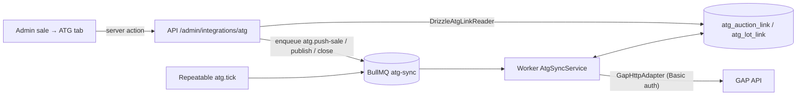

# ATG (Global Auction Platform) integration

LAX pushes sales, lots and lot images to its ATG White Label through the GAP API and polls
ATG for lot status, bids, results and winners. The integration ships on `release` behind
`ATG_SYNC_ENABLED` (off by default) and runs only in the worker; the API only enqueues jobs.

- GAP API: `https://api.globalauctionplatform.com` (HTTP Basic Auth, email + password)
- Swagger (OpenAPI 2): `https://api.globalauctionplatform.com/swagger/docs/v1`
- White Label preview: `https://lax-preview.atgportals.net`

## Architecture

| Layer | Module |
| --- | --- |
| Port | `apps/worker/src/integrations/atg/atg-gateway.ts` (`AtgGateway`, `AtgGatewayError`) |
| HTTP adapter | `gap-http-adapter.ts` (timeouts, retryable classification, ServiceStack errors) |
| Mapping | `atg-mappers.ts` (pure; sale → auction, lot → lot, image URLs, payload hash) |
| Orchestration | `atg-sync-service.ts` (push, publish, close, poll, tick) |
| Persistence port / adapter | `atg-sync-store.ts` / `drizzle-atg-sync-store.ts` |
| Composition root | `apps/worker/src/index.ts` (`loadAtgRuntimeConfig` → service, queue, worker) |
| Jobs | `packages/queues` `ATG_SYNC_QUEUE_NAME`, `ATG_SYNC_JOB_NAMES`, `atgSyncJobId` |
| API | `routes/atg-admin.ts`, `services/admin/atg-admin.service.ts`, `repositories/drizzle-atg-link.reader.ts` |
| Admin UI | sale detail **ATG** tab (`tabs/atg-tab.tsx`), lot overview `AtgLotStatus` |
| Schema | `packages/db/src/schema/atg-sync.ts`, migration `0132_atg_sync_links.sql` |

### Jobs

| Job | Trigger | Behaviour |
| --- | --- | --- |
| `atg.push-sale` | Admin "Push to ATG" | Create or update the auction, then create / update / delete lots and append images. Refuses closed auctions. |
| `atg.publish-sale` | Admin "Publish on ATG" | Push first, optionally `ApproveAuction` (`ATG_APPROVE_BEFORE_PUBLISH`), then `PublishAuction`. Idempotent. |
| `atg.close-sale` | Admin "Close on ATG" | `CloseAuction`, then one results poll. |
| `atg.delete-lot` | API only (`DELETE /admin/integrations/atg/lots/:id`) | `DeleteLot` for one linked lot (404 from ATG counts as done). |
| `atg.tick` | Repeatable, every `ATG_POLL_INTERVAL_MS` | Re-push linked, non-closed sales with catalogue changes; poll lots and results for published sales and sales closed in the last 7 days. |

Job IDs are `<job name>__<target id>` (BullMQ rejects `:` in custom IDs), so repeated clicks
de-duplicate while a job is waiting. Jobs are removed on completion and on final failure so the
next click can enqueue again. Mapping errors, precondition errors and non-retryable ATG
responses become `UnrecoverableError` (no retries); network errors, 408/425/429 and 5xx (except
501) get up to four attempts with exponential backoff starting at 30 s.

### Automatic re-sync (design note)

The plan described enqueueing a push from API sale/lot update paths. The release build instead
lets `atg.tick` detect changes: a linked sale is re-pushed when `sale.updated_at`, or any
lot's `updated_at` / `deleted_at` (lots in the sale or previously linked to it), is newer than
`atg_auction_link.last_synced_at`. This keeps the many sale/lot write paths free of ATG
coupling, survives Redis outages, and catches edits made outside the API. The cost is up to one
poll interval of delay (default 2 minutes). `last_synced_at` is the time a push *started*, so
edits made during a push are picked up next tick.

## Endpoints used

| Operation | Method and path |
| --- | --- |
| Create auction | `POST /Auction/CreateAuction` |
| Update auction | `PUT /Auction/UpdateAuction` (full replace; we always send every mapped field) |
| Approve / publish / close | `POST /Auction/ApproveAuction`, `/Auction/PublishAuction`, `/Auction/CloseAuction` |
| Create lot | `POST /Lot/CreateLot` |
| Update lot | `PATCH /Lot/UpdateLot` |
| Delete lot | `DELETE /Lot/DeleteLot?request.lotId=<id>` |
| Add image | `POST /Lot/AddUrlImageToLot` |
| Lot status and bids | `GET /Lot/v2/GetLots/<auctionId>` |
| Results | `GET /Lot/GetSaleResults/<auctionId>` |

Not used: `GetWinners` (returns bidder personal data we do not need), `PushLive`,
`UpdateLotCatalogue`, `RemoveLotImage` (see image gotcha).

## Field mapping

**Sale → auction.** `Title` (max 250), `ClientsAuctionId` = sale UUID, `SaleDates` and (timed
formats) `TimedStart` / `TimedFirstLotEnds` from the sale schedule, `TimezoneId` (Windows ID
from `ATG_TIMEZONE`), `Currency` GBP, `CountryCode` UK, `IncrementSetId`, optional `ClientId`,
`BuyersPremium` as a percentage (LAX stores `0.2500` → `25`), venue address fields (clipped to
GAP limits), `ImportantInformation` = sale description, `Terms`. One `AuctionListings` entry
with `PlatformCode`, `AuctionTypeAndListing` (`ATG_AUCTION_TYPE`), `CategoryName`
(`ATG_DEFAULT_CATEGORY`) and `Private` (`ATG_LISTING_PRIVATE`).

**Lot → lot.** `LotNumber` (required; lots without a number fail with a visible error),
`Title` (max 100, artist prefix when `ATG_ARTIST_PLACEMENT=title_prefix`), `LongDescription`
(artist, title, medium, dimensions, then description; max 8000), `CategoryName`, `Quantity` 1,
`SequenceNumber` (lot order), `LowEstimate` / `HighEstimate` (skipped when the estimate is in
another currency or inverted), `OpeningPrice`, `Reserve`, `BuyItNowPrice` (only when > 0),
`BuyersPremiumPercent` only when it differs from the sale, `EndTimeUtc` for timed formats.

**Images.** Up to 20 per lot, as public CDN URLs (`S3_PUBLIC_BASE_URL` + storage key, or the
stored absolute URL), named `1`, `1-1`, `1-2`, … in LAX order.

**Polling → LAX.** `GetLots` updates `atg_lot_link` (`current_max_bid`, `number_of_bids`,
`sold`, `hammer_price`, `winning_bidder_id`, `status`). `GetSaleResults` rows are stored in
`atg_auction_link.results_snapshot` with bidder names removed. Results are **not** written
back to LAX bids, invoices or Xero in this release.

## Gotchas

- **Images are append-only.** GAP has no endpoint that returns `LotImageId`, which
  `RemoveLotImage` needs. We record sent image names per lot and only send new positions, so
  reordering or removing images in LAX does not change ATG. Fix manually in the ATG admin until
  ATG answers question 8.
- **Unchanged payloads are skipped.** Auction and lot updates are only sent when the sha256 of
  the mapped payload changes (`payload_hash`).
- **Partial pushes.** Lot failures do not stop the push; the auction link's `last_error` lists
  up to five (`Lot N: message`). If any failure was retryable the job retries; otherwise the
  error stays visible on the ATG tab until the lot is fixed.
- **Closed is final.** Pushes are refused once LAX recorded the auction as closed, because ATG
  has no reopen or unpublish endpoint.
- **Dates.** GAP returns `/Date(ms±zzzz)/`; `gap-date.ts` parses that and ISO strings.
- **No fixed outbound IP.** If ATG requires IP allowlisting, the worker needs egress through a
  static IP first.

## Configuration

| Variable | Service | Default | Notes |
| --- | --- | --- | --- |
| `ATG_SYNC_ENABLED` | api, worker | `false` | Must match in both. Off: no queue, no worker, routes return 503. |
| `ATG_API_BASE_URL` | worker | `https://api.globalauctionplatform.com` | |
| `ATG_API_USERNAME` / `ATG_API_PASSWORD` | worker | — | Secret. Required when enabled. |
| `ATG_CLIENT_ID` | worker | — | UUID; optional. |
| `ATG_PLATFORM_CODE` | worker | — | Required when enabled. |
| `ATG_INCREMENT_SET_ID` | worker | — | UUID. Required when enabled. |
| `ATG_DEFAULT_CATEGORY` | worker | — | Required when enabled. |
| `ATG_AUCTION_TYPE` | worker | `Timed` | `Timed`, `CatalogueTimed`, `Live`, `CatalogueLive`. |
| `ATG_LISTING_PRIVATE` | worker | `true` | White Label only, not the-saleroom marketplace. |
| `ATG_ARTIST_PLACEMENT` | worker | `description` | Or `title_prefix`. |
| `ATG_APPROVE_BEFORE_PUBLISH` | worker | `false` | Call `ApproveAuction` before publishing. |
| `ATG_TIMEZONE` | worker | `Europe/London` | IANA; must have a Windows mapping. |
| `ATG_POLL_INTERVAL_MS` | worker | `120000` | 30000–240000 (queue readiness goes stale after 5 minutes). |
| `ATG_WHITE_LABEL_BASE_URL` | api | — | Link shown on the ATG tab. |

The worker also needs `S3_PUBLIC_BASE_URL` when enabled. Production values come from
`auction-infra` (`terraform/ephemeral/prod`, variables `atg_*`). `terraform-apply-prod.yml`
(on both `release` and `main`, since GitHub runs the copy on the dispatched branch) passes
GitHub secrets `ATG_API_USERNAME` / `ATG_API_PASSWORD` and repository variables
`ATG_SYNC_ENABLED`, `ATG_CLIENT_ID`, `ATG_PLATFORM_CODE`, `ATG_INCREMENT_SET_ID`,
`ATG_DEFAULT_CATEGORY`, `ATG_LISTING_PRIVATE`, `ATG_WHITE_LABEL_BASE_URL` and
`ATG_WHITE_LABEL_DNS_ENABLED` (persistent layer) as `TF_VAR_atg_*`.

## Production runbook

1. **Deploy dark.** Merge to `release` with `ATG_SYNC_ENABLED=false`. Migration 0132 runs in
   the migrate job; `db:roles` grants `worker_app` the two new tables. Check `/admin/sales/<id>/atg`
   shows "ATG sync is turned off".
2. **Configure.** Merge the `auction-infra` change (branch `feat/atg-prod-env`). When ATG
   supplies the hard-blocker answers (questions 1–4), set the GitHub secrets and repository
   variables above, keep `ATG_LISTING_PRIVATE` unset or `true`, set `ATG_SYNC_ENABLED=true`,
   and run "Terraform apply prod" for the ephemeral layer.
3. **Verify readiness.** The worker logs `atg-sync enabled`; the `atg-sync` queue appears in the
   queue dashboard and its heartbeat refreshes after each tick.
4. **Smoke test.** On a throwaway draft sale with two numbered lots and images: Push → confirm
   the ATG auction ID and lot links on the ATG tab and in the ATG admin. Edit a lot title and
   wait one poll interval → confirm the update. Do **not** publish unless ATG confirmed private
   test auctions are invisible (question 3).
5. **First real sale.** Push, review on the White Label preview, Publish, watch bids on the ATG
   tab, Close after the sale ends, and confirm the results snapshot.
6. **Roll back.** Set `ATG_SYNC_ENABLED=false` and apply the ephemeral layer. Links and history
   stay in the database; nothing is deleted on ATG.

**DNS.** Only after the decision record below is resolved in favour of `auctions.lax.bid`, set
`ATG_WHITE_LABEL_DNS_ENABLED=true` and apply the persistent layer. It creates ATG's two
DNS-only CNAMEs (ACM validation and `auctions` → `prod-whitelabel-3.globalauctionplatform.com`).

**Troubleshooting.** The ATG tab shows the last error per sale and per lot, and failures are
reported to Sentry. Admin-triggered jobs are removed after their final failure, so retry by
clicking the action again (or wait for the tick to re-push changed sales); the last 50 failed
ticks stay in the queue dashboard. Lots without a lot number and unknown timezones fail
permanently until fixed in LAX; foreign-currency estimates are skipped, not failed.

## Staging (later)

ATG's docs mention testing against a staging stack (`st-gaplive-eu`), but neither the staging
base URL nor credentials have been supplied. Once they are, run the worker locally with
`ATG_API_BASE_URL` pointed at staging and the staging credentials, and repeat the smoke test with
publishing enabled. No code change is needed. `main`'s test environment can get the same
variables when this work is ported to `main`.

## Zoho Inventory (Phase 2, not built)

Recommendation: do not build until LAX confirms Zoho Inventory is the system of record for
stock (today only Zoho Campaigns / CRM keys exist, and CRM sync is `off` in production). If
confirmed, the shape would mirror this integration: a worker-only `ZohoInventoryGateway` port,
`lot → Item` on publish (SKU = lot UUID), `won lot → Sales Order` when a LAX or ATG result is
final, an additive link table, and its own `zoho-inventory` queue behind a flag. Questions
first: which Zoho org and region (EU), whether items exist before consignment, and whether
Xero or Zoho owns invoicing.

## Release-only notes (porting to `main`)

This integration was built on `release` (production) because `main` (test) carries unmerged
features. When `main` absorbs `release`:

- migration `0132_atg_sync_links` uses journal `when` **`1788000007500`**: after release
  `0131` (`1788000007000`) and before `main`'s `0132_domain_event_delivery`
  (`1788000008000`). The migrator only applies migrations newer than the last recorded
  `created_at`, so sharing `main`'s timestamp would have made production skip `main`'s 0132
  after an upgrade. `main` must add this SQL file with **identical bytes and the same `when`**,
  placed in journal order between its `0131` and `0132` entries (the journal test requires
  strictly increasing `when`), so the production row's hash matches; the lineage
  normalization step must expect this extra release row. The SQL is additive and idempotent
  (`IF NOT EXISTS`);
- `WORKER_FULL_TABLES` in `packages/db/src/migrate-roles.ts` must keep both ATG tables;
- the sale detail `ATG` tab and `admin.ts` route mount may conflict with `main`'s admin changes;
- `main`'s `terraform-apply-prod.yml` carries the same `TF_VAR_atg_*` block (branch
  `docs/atg-release-parity`), so prod applies dispatched from either branch keep ATG settings.

These items are tracked in `docs/engineering/release-main-parity.md` on `main`.

## Decision record: White Label hostname vs. `.lax.bid` cookies

**Status: open — needs a product/security decision before the DNS records are created and
before ATG Step 7 sign-off.** ATG's CNAME instructions expire about 48 hours after
Oct 12, 21:00.

**Context.** Production sets `COOKIE_DOMAIN=.lax.bid` (`auction-infra`
`terraform/ephemeral/prod/main.tf`, `local.cookie_domain`), which api, auth and web use for
session cookies. If `auctions.lax.bid` is a CNAME to
`prod-whitelabel-3.globalauctionplatform.com`:

- browsers send every `.lax.bid` cookie, including LAX session cookies, to ATG's servers;
- ATG's servers can set `.lax.bid` cookies that `lax.bid`, `api.lax.bid` and `auth.lax.bid`
  then receive (cookie tossing / session fixation surface).

**Options.**

| Option | Effort | Residual risk |
| --- | --- | --- |
| A. Use a host outside `lax.bid` (e.g. `londonartexchange.atgportals.net` or a separate registrable domain) | DNS/ATG config only | None from cookies; brand URL differs |
| B. Keep `auctions.lax.bid`, scope LAX auth cookies to their own host (drop `Domain=.lax.bid`) | Auth change across api/auth/web; cross-subdomain session sharing must be re-designed | Low once shipped; blocks DNS until done |
| C. Keep `auctions.lax.bid` and accept the exposure | None | ATG receives LAX session cookies; needs written security sign-off |

**Recommendation.** Option A for go-live, with option B as a later migration if the
`auctions.lax.bid` brand URL is required. Do not create the CNAMEs until this is decided.

**Related: header login link.** The cloned White Label header's "Log in" link points at
`lax.bid/login`, which does not sign users into the White Label. ATG only allows header
changes once a year after Step 7, so the link must be settled during Steps 3–4 (point it at
the White Label's own login until SSO, Step 9, exists).

## Questions for ATG

Answers already in the docs/Swagger are not repeated here (auth method, endpoint list,
lot fields, read endpoints for ClientId / increment sets / categories, no webhooks, OIDC
login on `secure-login.globalauctionplatform.com`).

### Hard blockers — no production call can be made without these

1. **Production API user.** Basic Auth credentials for a dedicated API user (not a staff
   login) with permission for our White Label platform.
2. **White Label `PlatformCode`.** The value for `AuctionListings[].PlatformCode`, plus the
   increment set and default category we should use.
3. **Testing in production.** May we create test auctions with `Private: true` and keep them
   unpublished? Are they invisible on the White Label and on ATG marketplaces? How are test
   auctions removed, given the API has no delete-auction endpoint?
4. **Engineering contact.** A technical contact for API errors during go-live.

### Blockers before the first real auction

5. **Approval and publishing.** Can our API user call `ApproveAuction`, `PublishAuction` and
   `PushLive`, or does ATG approve each auction? How is a published auction taken down
   (there is no unpublish endpoint)?
6. **Auction formats.** Which `AuctionTypeAndListing` values are enabled for our White Label
   (Timed, CatalogueTimed, Live, CatalogueLive)? Is live bidding (`LiveAppType: GAP`)
   included?
7. **Edit rules.** Does PATCH `UpdateLot` change only the fields sent? How does it differ
   from `UpdateLotCatalogue`? Is PUT `UpdateAuction` a full replace? Which fields lock after
   publish, after the first bid, and after close? When is `DeleteLot` allowed?
8. **Lot images.** No endpoint returns the `LotImageId` that `RemoveLotImage` needs — how do
   we replace or reorder images? Does `ImageName` ("1", "1-1") set the order? Size/format
   limits? Must the source URL stay reachable after upload?
9. **Rate limits and IP allowlist.** Request limits and an acceptable polling interval for
   `v2/GetLots` and `GetSaleResults`? Do you allowlist caller IPs? (Our worker has no fixed
   outbound IP today.)
10. **Cross-listing.** Do API-created auctions appear only on the White Label, or also on ATG
    marketplaces (the-saleroom and others)?
11. **Winners and payment.** Who invoices and collects payment from White Label winners, ATG
    or LAX? Is a card required to register?
12. **Data mapping.** Where should the artist go (there is no artist field)? Is banded
    buyer's premium supported? Can we set `ClientsAuctionId` to our sale UUID, and is there
    any field for our lot ID?

### Not blocking today (SSO, Step 9)

13. Can your IdentityServer federate our tenant to `https://auth.lax.bid` (OIDC,
    authorization code + PKCE)? Which redirect URI do we register, and which claims do you
    need?
14. Can native sign-up and password login be disabled on our tenant? Will you create GAP
    customers just-in-time with our `sub` as `ExternalReference`? How should logout work?
