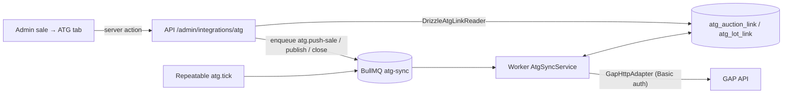

# ATG (Global Auction Platform) integration

LAX pushes sales, lots and lot images to its ATG White Label through the GAP API and polls
ATG for lot status, bids, results and winners. The integration is behind `ATG_SYNC_ENABLED`
(off by default) and runs only in the worker; the API only enqueues jobs. It was first built on
`release` (production) and is re-expressed on `main` in `main`'s layers; see
`docs/engineering/release-main-parity.md` for the lineage.

- GAP API: `https://api.globalauctionplatform.com` (HTTP Basic Auth, email + password)
- Swagger (OpenAPI 2): `https://api.globalauctionplatform.com/swagger/docs/v1`
- White Label preview: `https://lax-preview.atgportals.net`

## Architecture

| Layer | Module |
| --- | --- |
| Port | `apps/worker/src/integrations/atg/atg-gateway.ts` (`AtgGateway`, `AtgGatewayError`) |
| HTTP adapter | `gap-http-adapter.ts` (timeouts, retryable classification, ServiceStack errors) |
| Mapping | `atg-mappers.ts` (pure; sale → auction, lot → lot, image URLs, payload hash) |
| Orchestration | `atg-sync-service.ts` (push, publish, close, poll, tick, approval check, lost-create reconciliation) |
| Lot sync | `atg-lot-syncer.ts` (create, update, adopt, delete lots; bid-lock and image checks) |
| Startup check | `atg-config-check.ts` (increment set and default category against ATG) |
| Persistence port / adapter | `atg-sync-store.ts` / `drizzle-atg-sync-store.ts` |
| Composition | `apps/worker/src/container/create-atg-sync-runtime.ts` (`loadAtgRuntimeConfig` → service) and `workers/register-atg-sync-worker.ts` (queue, consumer, tick) |
| Jobs | `packages/queues` `ATG_SYNC_QUEUE_NAME`, `ATG_SYNC_JOB_NAMES`, `atgSyncJobId`; the queue is registered only while the flag is on |
| Image check | `atg-image-inspector.ts` (`HEAD` each new image URL: JPG, under 10 MB) |
| API | `apps/api/src/routes/admin/atg.routes.ts` → `services/admin/atg-admin.service.ts` → `IAtgLinkReader` and `IAtgSaleSettingsWriter` (`DrizzleAtgLinkReader`, `DrizzleAtgSaleSettingsWriter` in `packages/persistence`) |
| Admin UI | `apps/web`: sale detail **ATG** tab (`components/admin/sale-detail/tabs/atg-tab.tsx`, `components/admin/atg/atg-settings-section.tsx`), lot overview `AtgLotStatus` |
| Schema | `packages/db/src/schema/atg-sync.ts`, migrations `0131a_atg_sync_links.sql` (release `0132_atg_sync_links`) and `0234_atg_sale_settings.sql` |

### Jobs

| Job | Trigger | Behaviour |
| --- | --- | --- |
| `atg.push-sale` | Admin "Push to ATG" | Create or update the auction, then create / update / delete lots and append images. Refuses closed auctions and cancelled sales. |
| `atg.publish-sale` | Admin "Publish on ATG" | Push first; if any lot failed, stop without publishing and list the lots. Otherwise `PublishAuction`. ATG staff approve every auction in Toolbox first; LAX never calls `ApproveAuction`. A rejected publish is recorded as "awaiting ATG approval". Idempotent. |
| `atg.close-sale` | Admin "Close on ATG" | `CloseAuction`, then one results poll. |
| `atg.delete-lot` | API only (`DELETE /admin/integrations/atg/lots/:id`) | `DeleteLot` for one linked lot (404 from ATG counts as done). |
| `atg.tick` | Repeatable, every `ATG_POLL_INTERVAL_MS` | Re-push linked, non-closed sales with catalogue changes; for pushed, unpublished auctions read `GetAuctionById` to record ATG's approval (`atg_approved_at`) and to notice an auction published directly in Toolbox; poll lots and results for published sales and sales closed in the last 7 days. |

Job IDs are `<job name>__<target id>` (BullMQ rejects `:` in custom IDs), so repeated clicks
de-duplicate while a job is waiting. Jobs are removed on completion and on final failure so the
next click can enqueue again. Mapping errors, precondition errors and non-retryable ATG
responses become `UnrecoverableError` (no retries); network errors, 408/425/429 and 5xx (except
501) get up to four attempts with exponential backoff starting at 30 s.

### One platform per sale (ownership)

A sale may take bids on **either** lax.bid **or** ATG, never both. Ownership is computed from
`sale.status`, `atg_auction_link.remote_status`, and whether any `atg_lot_link.sold` row exists
(no stored flag, no migration). SSOT: `resolveSaleSellingPlatform()` in
`packages/types/src/atg.ts`.

| State | lax.bid publish | ATG push / publish |
| --- | --- | --- |
| Free | allowed | allowed |
| LAX-owned (`scheduled` / `active` / `ended`) | already on LAX | **409 `sale_on_lax`** |
| ATG-owned (`published`, or `closed` with ≥1 sold lot) | **409 `sale_on_atg`** | push re-syncs |
| Cancelled | not allowed | **409 `sale_cancelled`** |

Release from ATG: **Close** with zero lots sold → free again. If any lot sold on ATG, the sale
stays ATG-owned; duplicate the sale in LAX to relist unsold lots.

**Guards (409 unless noted):**

| Code | Where |
| --- | --- |
| `sale_on_atg` | sale publish, cancel and soft delete (single and bulk) while the sale is ATG-owned |
| `sale_on_lax` | ATG admin push / publish / close enqueue |
| `lot_on_atg` | lot sale change, detach, cancel and soft delete (single and bulk), only when the lot is linked on ATG **and** has bids or sold; lots without bids can still be moved or removed |
| `queue_unavailable` | ATG enqueue (**503**) |

Guard messages say what to do next: a live auction must be closed on ATG first; a sale or lot
that sold on ATG stays as it is and is settled manually
([ATG manual settlement](../runbooks/atg-manual-settlement.md)). SSOT:
`apps/api/src/services/sale-channel-guards.ts`, called from the sale publish pipeline
(`services/sale/sale-publish.pipeline.ts`), sale cancel (`sale-publish.service.ts`), lot detach
(`sale/sale-lot-membership.ts`), lot cancel and sale move (`lot/lot-lifecycle.ts`,
`lot/lot-update.ts`) and the soft-delete services. The admin sale page and the sales list keep
Publish, Cancel and Delete visible but disabled for ATG-owned sales, with the reason, following
the same summary as the badge below.

**Admin "where this sells" badge.** The sale and lot headers show where bidding happens, as a
second kit `StatusBadge` in the header's status slot; ATG badges link to the sale's ATG tab, and
every badge explains itself in a `StaffTooltip` and to screen readers. Labels come from
`atgSaleSellingBadge()` / `atgLotSellingBadge()` in `packages/types/src/atg.ts`, which read the
same ownership inputs as the guards; tones come from `staffSellingPlatformStatus()` in
`apps/web/src/lib/admin/staff-kit-status.ts` (lax.bid neutral, ATG info, a lot sync error danger):

| Sale state | Badge |
| --- | --- |
| Unlinked draft, or cancelled | none |
| LAX-owned (`scheduled` / `active` / `ended`) | lax.bid |
| Linked, not published (approved once `atg_approved_at` is set) | ATG · Draft / ATG · Approved |
| ATG-owned, published | ATG · Live |
| ATG-owned, closed with ≥1 sold lot | ATG · Ended |
| Closed with nothing sold (free again) | ATG · Closed |

A lot pushed to ATG shows "On ATG · <status>" with the GetLots labels, or "On ATG · Sync error";
a lot in a LAX-owned sale shows "lax.bid". The sales and lots lists add a compact **ATG** marker
beside the status of rows with an ATG badge; only draft rows are looked up. Data comes from
`GET /admin/integrations/atg/selling/sales?ids=` and `/selling/lots?ids=` (`auction.manage`, up
to 200 ids, one request per page), which work while ATG sync is off, so ownership still shows
when links exist. The reader is
`DrizzleAtgLinkReader.getSaleSellingSummaries` / `getLotSellingSummaries` in
`packages/persistence`; the web reads it through `apps/web/src/lib/data/http/atg.server.ts`.

**Public lax.bid:** ATG-owned sales stay LAX `draft` but appear in the catalogue as read-only.
Public reads add `sellingPlatform` and `atgAuctionState` (`live` while published, `ended`
once closed with sales) to the sale, `atgSold` to its lots after it ends, and `atgSaleState` to
lots in public lot lists. Status filters include them (`scheduled`/`active` → live on ATG,
`ended` → ended on ATG). The web shows them as upcoming, live or ended
(`apps/web/src/lib/catalog/atg-catalog-display.ts`), hides LAX register, telephone and bid
UI, and links to `ATG_WHITE_LABEL_BASE_URL` (default `https://auctions.lax.bid`; the web app
reads it server-side). Lot cards show "On ATG" or Sold / No sale instead of LAX prices. SQL
helpers: `packages/persistence/src/repositories/atg-public-catalog.sql.ts`; visibility in code:
`isPublicCatalogSale` / `isPublicCatalogLot` in `@auction/validators`.

**Worker:** run a **single** `atg-sync` consumer at **concurrency 1** (BullMQ job de-duplication
relies on stable job ids). Tick failures for one sale are logged and sent to Sentry
(`atg-sync-tick`) without stopping the tick for other sales.

**Startup check.** When sync is enabled the worker compares `ATG_INCREMENT_SET_ID` with the
client's increment sets (`GetIncrementDetails`, needs `ATG_CLIENT_ID`) and `ATG_DEFAULT_CATEGORY`
with `GetSupportedCategories`. It runs once, in the background, and never blocks the worker. A
value ATG does not know is logged as an error and sent to Sentry (`atg-config-check`); a check
that cannot run (network failure, no client id) is logged as a warning only.

**Images:** `AddUrlImageToLot` returns a `LotImageId`, but GAP has **no** endpoint to list a
lot's images, and the worker does not store the returned ids. It tracks sent `ImageName` values
and sends only new positions (append-only; see Gotchas).

**White Label login:** the production White Label already uses `/Membership/SignUpOrIn` for
sign-up and login.

### Automatic re-sync (design note)

Enqueueing a push from the API sale and lot update paths was considered and rejected. Instead
`atg.tick` detects changes: a linked sale is re-pushed when `sale.updated_at`, or any
lot's `updated_at` / `deleted_at` (lots in the sale or previously linked to it), is newer than
`atg_auction_link.last_synced_at`. This keeps the many sale/lot write paths free of ATG
coupling, survives Redis outages, and catches edits made outside the API. The cost is up to one
poll interval of delay (default 2 minutes). `last_synced_at` is the time a push *started*, so
edits made during a push are picked up next tick.

## Endpoints used

| Operation | Method and path |
| --- | --- |
| Create auction | `POST /Auction/CreateAuction` |
| Update auction | `PUT /Auction/UpdateAuction` (full replace; we always send every mapped field) |
| Publish / close | `POST /Auction/PublishAuction`, `/Auction/CloseAuction` |
| Create lot | `POST /Lot/CreateLot` |
| Update lot | `PATCH /Lot/UpdateLot` |
| Delete lot | `DELETE /Lot/DeleteLot?request.lotId=<id>` |
| Add image | `POST /Lot/AddUrlImageToLot` |
| Lot status and bids | `GET /Lot/v2/GetLots/<auctionId>` |
| Results | `GET /Lot/GetSaleResults/<auctionId>` |

Not used: `ApproveAuction` (ATG staff approve), `GetWinners` (returns bidder personal data we
do not need), `PushLive`, `UpdateLots` (batch, up to ~100 lots; not needed at current sale
sizes), `UpdateLotCatalogue`, `RemoveLotImage` (see image gotcha).

## Field mapping

**Sale → auction.** `Title` (max 250), `ClientsAuctionId` = sale UUID (ATG does not support custom IDs; nothing relies on it), `SaleDates` and (timed
formats) `TimedStart` / `TimedFirstLotEnds` from the sale schedule, `TimezoneId` (Windows ID
from `ATG_TIMEZONE`), `Currency` GBP, `CountryCode` UK, `IncrementSetId`, optional `ClientId`,
`BuyersPremium` as a percentage (LAX stores `0.2500` → `25`), venue address fields (clipped to
GAP limits), `ImportantInformation` = sale description, `Terms`. One `AuctionListings` entry
with `PlatformCode`, `AuctionTypeAndListing` (the sale's ATG auction type), `CategoryName`
(`ATG_DEFAULT_CATEGORY`) and `Private` (true unless the sale's distribution is
`public_marketplace`). ATG takes one flat buyer's premium per auction: banded premiums fail the
push before anything is sent.

**Per-sale ATG settings** (`atg_auction_link.auction_type`, `.distribution`; ATG tab → "ATG
settings"; `PUT /admin/integrations/atg/sales/:id/settings`, `auction.manage`):

| Setting | Values | Default | Locked |
| --- | --- | --- | --- |
| Auction type | `Timed`, `Live` (the only types ATG allows LAX) | `Timed` | once ATG has the auction |
| Distribution | `private_test` → `Private: true`; `public_marketplace` → `Private: false` (White Label **and** The Saleroom) | `private_test` | once published or closed |

Moving to `public_marketplace` needs explicit confirmation (`confirmPublic: true`; 409
`public_confirmation_required` otherwise). Locks are enforced twice: by the service (409
`atg_settings_locked`) and inside the upsert's `WHERE`, so a publish racing a settings change
cannot be overridden. Saving a linked sale queues a push. Each change records
`settings_updated_by` / `settings_updated_at` and logs `atg_sale_settings_updated` with the
before and after values. There is no "White Label only" choice: ATG says auctions are mirrored
to both sites and has not given a wire value for anything else.

**Lot → lot.** `LotNumber` (required; lots without a number fail with a visible error),
`Title` (max 100, artist prefix when `ATG_ARTIST_PLACEMENT=title_prefix`), `LongDescription`
(artist, title, medium, dimensions, then description; max 8000), `CategoryName`, `Quantity` 1,
`SequenceNumber` (lot order), `LowEstimate` / `HighEstimate` (skipped when the estimate is in
another currency or inverted), `OpeningPrice`, `Reserve`, `BuyItNowPrice` (only when > 0),
`EndTimeUtc` for timed auctions. The request schemas have no `Status` field, so we never send one: ATG starts every lot at `0`
(WaitingToBeOffered) and moves it itself. A lot whose buyer's premium differs from the sale's fails with a lot
error (no lot-level premium is sent).

**Images.** Up to 20 per lot, as public CDN URLs (`S3_PUBLIC_BASE_URL` + storage key, or the
stored absolute URL), named `1.jpg`, `1-1.jpg`, `1-2.jpg`, … in LAX order (ATG orders by name and rejects a name without an image extension). ATG only
accepts JPG under 10 MB, but LAX also accepts PNG and WebP uploads, so before any lot write
the worker `HEAD`s each image not yet on ATG and fails the lot (`image 2 must be a JPG (is
image/png)`) unless the media origin reports `image/jpeg` and a size under 10,000,000 bytes.

**Polling → LAX.** `GetLots` updates `atg_lot_link` (`current_max_bid`, `number_of_bids`,
`sold`, `hammer_price`, `winning_bidder_id`, `status`). `GetSaleResults` rows are stored in
`atg_auction_link.results_snapshot` with bidder names removed. Results are **not** written
back to LAX bids, invoices, Xero or seller payouts in this release: finance settles ATG winners
by hand ([ATG manual settlement](../runbooks/atg-manual-settlement.md)).

## Gotchas

- **Images are append-only.** `RemoveLotImage` needs a `LotImageId`. `AddUrlImageToLot`
  returns one, but we do not store it, and GAP cannot list a lot's images to recover ids.
  We record sent image names per lot and only send new positions, so reordering or removing
  images in LAX does not change ATG. Fix manually in Toolbox until ATG answers open question 7.
- **Unchanged payloads are skipped.** Auction and lot updates are only sent when the sha256 of
  the mapped payload changes (`payload_hash`).
- **Locked after the first bid.** ATG refuses changes to a lot's description, reserve,
  estimates and opening price once it has a bid. `atg_lot_link.locked_fields_hash` stores a hash
  of those fields; when the last poll saw bids and they changed, the push fails that lot ("has
  bids on ATG … Undo the edit in LAX") without calling ATG. Other edits (end time, order, buy
  now) are still sent, re-sending the locked fields unchanged, because `UpdateLot` replacement
  semantics are unconfirmed and a rejected request is safer than a silently cleared field.
  Bids placed since the last poll (up to `ATG_POLL_INTERVAL_MS`) are not known yet; ATG then
  rejects the update and the error shows on the lot. `DeleteLot` has no ATG restriction, but
  LAX still refuses to move or remove a lot with bids (`lot_on_atg`).
- **Approval is ATG's.** ATG staff approve every auction in Toolbox. Until they do,
  `PublishAuction` is rejected. The tick reads `IsApproved` and `IsPublished` from
  `GetAuctionById` for pushed, unpublished auctions: the ATG tab shows "Awaiting ATG approval"
  until `atg_approved_at` is set, then "Approved by ATG — ready to publish". An auction
  published directly in Toolbox is recorded as published on the next tick. A rejected publish's
  error still says to ask ATG.
- **Partial pushes.** Lot failures do not stop the push; the auction link's `last_error` lists
  up to five (`Lot N: message`). If any failure was retryable the job retries; otherwise the
  error stays visible on the ATG tab until the lot is fixed.
- **Closed is final.** Pushes are refused once LAX recorded the auction as closed, because ATG
  has no reopen or unpublish endpoint. The API returns 409 `atg_closed`.
- **Cancelled lots and sales.** Cancelled and deleted lots are not sent; if a cancelled lot was
  already on ATG, the next push deletes it there. A cancelled sale is never pushed or published
  (API 409 `sale_cancelled`); staff can still close its ATG auction.
- **Publishing is all-or-nothing.** If any lot fails during the publish job's push, the auction
  is not published and `last_error` starts with "Not published: fix these lots first."
- **Lost create responses.** A timeout or 5xx on `CreateAuction` is never blindly retried: ATG
  may have created the auction. When `ATG_CLIENT_ID` is set, the worker reconciles on its own: it
  lists the client's auctions from one day earlier (`GetAuctionsByClientId`), finds the one whose
  `ClientsAuctionId` is the sale id, links it and carries on. If none matches, or the lookup
  fails, or no client id is set, the push stops and the ATG tab asks staff to check the ATG
  admin before pushing again. The next push for that sale searches the last 30 days the same way
  before creating, adopts a match, and stops (without creating) if the search fails. For lots, a
  retry first reads
  `GetLots` and adopts an unlinked ATG lot with the same lot number instead of creating a
  duplicate.
- **Lots moved between sales.** When a lot moves from one ATG-linked sale to another, the push
  deletes the copy on the old ATG auction before creating it on the new one.
- **Lots deleted in the ATG admin.** Not detected: later updates fail with an ATG error on that
  lot. Remove the lot in LAX (or ask ATG to restore it).
- **Lot status codes.** `GetLots` `Status` is stored in `atg_lot_link.status`. ATG documented
  `0` WaitingToBeOffered, `1` Offered, `2` NotSold and `4` Sold (`GetSaleResults` uses those
  names). The ATG tab shows Waiting, Offered, Not sold or Sold. Any other integer, including
  `3`, stays hidden and the badge falls back to sold / bid count. We never send `Status`: the
  request schemas have no such field and ATG starts each lot at `0`.
- **Dates.** GAP returns `/Date(ms±zzzz)/`; `gap-date.ts` parses that and ISO strings.
- **No fixed outbound IP.** If ATG requires IP allowlisting, the worker needs egress through a
  static IP first.

## Configuration

| Variable | Service | Default | Notes |
| --- | --- | --- | --- |
| `ATG_SYNC_ENABLED` | api, worker | `false` | Must match in both. Off: no queue, no worker, routes return 503. |
| `ATG_API_BASE_URL` | worker | `https://api.globalauctionplatform.com` | |
| `ATG_API_USERNAME` / `ATG_API_PASSWORD` | worker | — | Secret. Required when enabled. |
| `ATG_CLIENT_ID` | worker | — | UUID; optional. Enables automatic reconciliation of lost auction creates and the increment set startup check. |
| `ATG_PLATFORM_CODE` | worker | — | Required when enabled. Production White Label value: `SR`. |
| `ATG_INCREMENT_SET_ID` | worker | — | UUID. Required when enabled. |
| `ATG_DEFAULT_CATEGORY` | worker | — | Required when enabled. |
| `ATG_ARTIST_PLACEMENT` | worker | `description` | Or `title_prefix`. |
| `ATG_TIMEZONE` | worker | `Europe/London` | IANA; must have a Windows mapping. |
| `ATG_POLL_INTERVAL_MS` | worker | `120000` | 30000–240000 (queue readiness goes stale after 5 minutes). |
| `ATG_WHITE_LABEL_BASE_URL` | api, web | — (web: `https://auctions.lax.bid`) | Link shown on the ATG tab and on public ATG sale and lot pages. Production: `https://auctions.lax.bid` once the hostname is live (see below). |

`ATG_AUCTION_TYPE`, `ATG_LISTING_PRIVATE` and `ATG_APPROVE_BEFORE_PUBLISH` are retired: the
first two are per-sale settings now, and ATG approves auctions itself. The worker ignores them
if still set. The workflows no longer pass `atg_listing_private`; the variable can be removed
from `terraform/ephemeral/prod` (and the `release` mirror) separately.

The worker also needs `S3_PUBLIC_BASE_URL` when enabled. Production values come from the
`atg_*` Terraform variables in `terraform/ephemeral/prod`. "Terraform apply prod" runs the copy
of the workflow on the dispatched branch, and the two branches read different Terraform:

- dispatched from `release`: the `infra/terraform` mirror in that branch;
- dispatched from `main`: `auction-infra` `main`, which carries the ATG settings, the
  `atg-white-label` module and the `atg-cookie-shield` Worker.

Both write the same state, so the two copies must stay identical. The workflow passes
GitHub secrets `ATG_API_USERNAME` / `ATG_API_PASSWORD` and repository variables
`ATG_SYNC_ENABLED`, `ATG_CLIENT_ID`, `ATG_PLATFORM_CODE`, `ATG_INCREMENT_SET_ID`,
`ATG_DEFAULT_CATEGORY` and `ATG_WHITE_LABEL_BASE_URL` as
`TF_VAR_atg_*`; "Terraform apply test" reads the same names from the `test` environment. Two more repository variables drive the persistent layer:
`ATG_ACM_VALIDATION_ENABLED` and `ATG_WHITE_LABEL_ENABLED` (see "White Label hostname" below).

## Production runbook

1. **Deploy dark.** Deploy with `ATG_SYNC_ENABLED=false`. Migrations `0131a` and `0234` run in
   the migrate job (see "Migration lineage" below); `db:roles` grants `worker_app` the two tables (`api_app` already has
   full access, which the settings endpoint needs). Check `/admin/sales/<id>/atg` shows "ATG
   sync is turned off" and that the ATG settings can be saved.
2. **Create the API user.** An authorised LAX operator adds a dedicated user in GAP Toolbox →
   Settings → Users. ATG uses its email and password as the API login; the user must not be used
   for anything else (Toolbox event logs attribute API changes to it). Put the email and password
   straight into the GitHub production secrets `ATG_API_USERNAME` / `ATG_API_PASSWORD`, never
   in chat, tickets, source or docs.
3. **Choose the increment set and category.** In Toolbox → Settings, pick the increment set for
   LAX sales and note its ID (or list them through the GAP read endpoint with the new user), and
   pick the default category name. Set `ATG_INCREMENT_SET_ID` and `ATG_DEFAULT_CATEGORY`, plus
   `ATG_CLIENT_ID`, `ATG_PLATFORM_CODE` and `ATG_WHITE_LABEL_BASE_URL=https://auctions.lax.bid`,
   as repository variables. Apply the ephemeral layer with sync still off and confirm the
   services restart cleanly.
4. **Enable.** Set `ATG_SYNC_ENABLED=true` and apply the ephemeral layer again. The worker logs
   `atg-sync enabled`; the `atg-sync` queue appears in the queue dashboard and its heartbeat
   refreshes after each tick (default 2 minutes). Run exactly one worker consumer.
5. **Private end-to-end test.** On a throwaway draft sale (two numbered lots, one flat premium,
   JPG images under 10 MB, ATG settings `Timed` + `Private test`): Push and confirm the auction
   and lot IDs on the ATG tab match Toolbox; edit a lot title and confirm the update after one
   poll; ask ATG Seller Support to approve; Publish; place one bid from a test bidder account on
   the White Label; edit the lot's estimate and confirm the push fails with the "has bids on
   ATG" error while a title edit still syncs; Close; confirm results on the ATG tab; rehearse
   [manual settlement](../runbooks/atg-manual-settlement.md) without sending the invoice. See ATG's
   "How to create a test (private) auction" article for how ATG hides and removes test events.
6. **First real sale.** Set the distribution to `Public: White Label + The Saleroom` (it appears
   on both sites), push, review in Toolbox, have ATG approve, Publish, watch bids on the ATG tab,
   Close after the sale ends, then settle manually.
7. **Roll back.** Set `ATG_SYNC_ENABLED=false` and apply the ephemeral layer. Links and history
   stay in the database; nothing is deleted on ATG. Published auctions keep running on ATG; take
   one down by making it private in Toolbox or with ATG Seller Support.

**Lost auction creates.** With `ATG_CLIENT_ID` set the worker finds the auction itself (by
`ClientsAuctionId`, searching the last day) and links it, so a repeated push needs no action. If
the ATG tab still says a create may have reached ATG (no client id, no match, or the lookup
failed), find the auction in Toolbox by title and date before pushing again; if it exists, ask
engineering to link it rather than creating a duplicate.

**White Label hostname.** See "White Label hostname (`auctions.lax.bid`)" below.

**Troubleshooting.** The ATG tab shows the last error per sale and per lot, and failures are
reported to Sentry. Admin-triggered jobs are removed after their final failure, so retry by
clicking the action again (or wait for the tick to re-push changed sales); the last 50 failed
ticks stay in the queue dashboard. Lots without a lot number and unknown timezones fail
permanently until fixed in LAX; foreign-currency estimates are skipped, not failed.

## Staging (later)

ATG's docs mention testing against a staging stack (`st-gaplive-eu`), but neither the staging
base URL nor credentials have been supplied. Once they are, run the worker locally with
`ATG_API_BASE_URL` pointed at staging and the staging credentials, and repeat the smoke test with
publishing enabled. No code change is needed. `main`'s test environment can be given the same
variables, with `ATG_SYNC_ENABLED=true` on both the API and the worker.

## Zoho Inventory (not built)

Recommendation: do not build until LAX confirms Zoho Inventory is the system of record for
stock (today only Zoho Campaigns / CRM keys exist, and CRM sync is `off` in production). If
confirmed, the shape would mirror this integration: a worker-only `ZohoInventoryGateway` port,
`lot → Item` on publish (SKU = lot UUID), `won lot → Sales Order` when a LAX or ATG result is
final, an additive link table, and its own `zoho-inventory` queue behind a flag. Questions
first: which Zoho org and region (EU), whether items exist before consignment, and whether
Xero or Zoho owns invoicing.

## Migration lineage

Release applied `0132_atg_sync_links` in production with journal `when` **`1788000007500`**:
after release `0131` (`1788000007000`) and before `main`'s `0132_domain_event_delivery`
(`1788000008000`). The migrator only applies migrations newer than the last recorded
`created_at`, so sharing `main`'s timestamp would have made production skip `main`'s 0132.

`main` registers the **byte-identical** SQL as `0131a_atg_sync_links` at the same `when`, between
its `0131` and `0132` entries, so production's ledger row matches by hash. `main`'s own
databases were migrated before that entry existed, so the migrator would otherwise stop with
"Migration history is missing 1788000007500 before applied timestamp ...".
`packages/db/src/late-registered-migrations.ts` lists the stamp; the runner applies it in place
(the SQL is additive and idempotent) and records the ledger row, while a row with a different
hash still fails closed. On promotion, ledger normalisation archives production's release row
and the runner adopts `0131a` without running it again
(`packages/db/src/release-lineage-mapping.ts`); see `docs/engineering/release-main-parity.md`.

`WORKER_FULL_TABLES` in `packages/db/src/migrate-roles.ts` keeps both ATG tables.

Per-sale settings (`0234_atg_sale_settings`) land on `main` first, with journal `when`
**`1795593600000`**, after `0233_shop_order_reference_and_progress`. The SQL is additive and
idempotent (`IF NOT EXISTS`; the constraint `DO` blocks ignore `duplicate_object`). A backport to
`release` must carry the **byte-identical** SQL and the same `when`, so production's ledger row
matches `main`'s when `main` is promoted; see `docs/engineering/release-main-parity.md`.

## White Label hostname (`auctions.lax.bid`)

`infra/terraform/modules/atg-white-label` (mirrored in `auction-infra`), used by
`terraform/persistent/prod`, creates four resources behind two repository variables:

| Variable | Creates |
| --- | --- |
| `ATG_ACM_VALIDATION_ENABLED` | ATG's ACM validation CNAME (DNS-only; browsers never visit it) |
| `ATG_WHITE_LABEL_ENABLED` | Worker `atg-cookie-shield`, route `auctions.lax.bid/*`, then `auctions` CNAME → `prod-whitelabel-3.globalauctionplatform.com`, **proxied** |

Terraform creates the record only after the Worker route exists and deletes it first; a
contract test (`atg-white-label.tftest.hcl`) fails if the record is ever DNS-only.

**Before the first apply.**

- The `CLOUDFLARE_API_TOKEN` secret needs **Account → Workers Scripts: Edit** and
  **Zone → Workers Routes: Edit** on `lax.bid`, in addition to its DNS and ruleset permissions.
- Put the Cloudflare account on **Workers Paid**. On the free plan, requests beyond 100,000 a
  day fail with error 1027 (closed, so no cookie leak, but the auction site is down).

**Go live.**

1. Set both variables to `true` and run "Terraform apply prod" (persistent layer).
2. Until ATG attaches its certificate to `auctions.lax.bid`, the site returns Cloudflare error
   526 (the zone validates origin certificates strictly). That is expected.
3. When ATG confirms the certificate, smoke test:
   - `curl -sI https://auctions.lax.bid/` returns `x-lax-cookie-shield: 1`;
   - no `Set-Cookie` from `auctions.lax.bid` carries a `Domain` attribute (browser DevTools →
     Application → Cookies shows them under `auctions.lax.bid` only);
   - register, sign in and bid on a private test auction, including real-time bid updates;
   - signing in to `lax.bid` and using the admin still work in the same browser.
4. Set `ATG_WHITE_LABEL_BASE_URL=https://auctions.lax.bid` and apply the ephemeral layer.

**Status (19 Oct 2026).** Live and proxied. Cloudflare shows `auctions.lax.bid` proxied to
`prod-whitelabel-3.globalauctionplatform.com` with Worker route `atg-cookie-shield`.
Verified in the browser and with `curl`:

- `/` → 301 `/auctions`; `/auctions` → 200 "Upcoming Auctions"; desktop and 390×844 mobile
  both render the LAX White Label shell (search, sign-in, empty upcoming list).
- Every checked response includes `server: cloudflare`, `cf-ray`, and `x-lax-cookie-shield: 1`.
- Sign-in at `/Membership/SignUpOrIn` redirects to ATG's
  `secure-login.globalauctionplatform.com` OIDC login (`tenantId=auctions.lax.bid`) with a
  "sign up now" link. ATG `Set-Cookie` values on the hop are host-only (no `Domain=`),
  `Secure`, `HttpOnly`, `SameSite=None`, path `/signin-oidc`.
- [auction-infra #45](https://github.com/LAX-UK/auction-infra/pull/45) is closed unmerged and
  `ops/atg-direct-validation` is deleted.

Still to do: register/bid on a published private test auction, including real-time updates, and
confirm a lax.bid admin session in the same browser is unaffected.

**Roll back.** Set `ATG_WHITE_LABEL_ENABLED=false` and apply the persistent layer (record first,
then route and Worker). In an emergency, delete the `auctions` record in the Cloudflare
dashboard. Never set the record to DNS-only or remove the Worker route while the record exists:
either sends LAX cookies straight to ATG.

## Decision record: White Label hostname vs. `.lax.bid` cookies

**Status: decided (Oct 13, 2026) — option D.** Keep `auctions.lax.bid` and production's shared
`.lax.bid` sessions, with a cookie-shield proxy in front of ATG.

**Context.** Production sets `COOKIE_DOMAIN=.lax.bid` (`auction-infra`
`terraform/ephemeral/prod/main.tf`, `local.cookie_domain`). Better Auth on `auth.lax.bid` sets
the session cookie with `Domain=.lax.bid`, and the `lax.bid` web app and `api.lax.bid` both
read it, so the domain cannot be dropped without redesigning sign-in. If `auctions.lax.bid`
pointed straight at ATG:

- browsers would send every `.lax.bid` cookie, including LAX session cookies, to ATG's servers;
- ATG's servers could set `.lax.bid` cookies that `lax.bid`, `api.lax.bid` and `auth.lax.bid`
  then receive (cookie tossing / session fixation surface).

**Options.**

| Option | Effort | Residual risk |
| --- | --- | --- |
| A. Use a host outside `lax.bid` (e.g. `londonartexchange.atgportals.net`) | DNS/ATG config only | None from cookies; brand URL differs |
| B. Host-only LAX sessions (`main`'s D15: OIDC sign-in plus `__Host-` BFF sessions) | Large; not production-ready on `main` | Lowest |
| C. Point `auctions.lax.bid` straight at ATG and accept the exposure | None | ATG receives LAX session cookies |
| **D. Proxied `auctions.lax.bid` with a cookie-shield Worker** | Infra only | See below |

**Decision: D.** The Worker (`infra/workers/atg-cookie-shield/shield.js`, mirrored in
`auction-infra` `workers/`):

- removes LAX cookies from every request before it reaches ATG;
- drops ATG `Set-Cookie` headers with a LAX name and strips `Domain` from the rest, so ATG can
  only set cookies on `auctions.lax.bid`;
- fails closed: an exception returns 502 and, if the Worker cannot run, the route returns
  Cloudflare error 1027. It never forwards an unfiltered request.

**Cookie naming rule.** Every cookie LAX sets with `Domain=.lax.bid` must match
`^(__Secure-|__Host-)?(better-auth[.-]|lax[_-]|_lax_)` (case-insensitive). Today the shared
cookies are the Better Auth cookies (`__Secure-better-auth.*`), `lax_acting_legal_entity_id`,
`lax_consent` and `_lax_attr`; host-only cookies such as `lax_theme` never reach
`auctions.lax.bid`. A shared cookie outside the pattern reaches ATG; rename it or extend the
pattern and the Worker tests.

**Residual risk (accepted).**

- ATG's own JavaScript runs on a `lax.bid` subdomain. It cannot read the session cookies
  (HttpOnly), but it can read non-HttpOnly shared cookies (`lax_consent`, `_lax_attr`, the
  acting-entity cookie, Google Analytics cookies) and write `.lax.bid` cookies through
  `document.cookie`, which the Worker never sees. Exploiting that needs malicious or
  compromised ATG frontend code, and the impact is session fixation (planting a session for an
  attacker's account), not session theft. Host-only `__Host-` sessions remove it.
- Third-party analytics cookies (`_ga*`, `_gcl_*`) still reach ATG. They are not credentials.
- `lax.bid` zone settings apply to the White Label: security level "medium" (some bidders may see a
  challenge), strict origin TLS, and Workers plan limits.
- ATG sees Cloudflare IPs unless it reads `CF-Connecting-IP` (open question 10).

**On `main`.** `main`'s sessions are host-only (`__Host-lax-bid-session`), so they never reach
`auctions.lax.bid`, and the acting-entity cookie `lax_acting_legal_entity_id` is host-only too
(`apps/web/src/lib/legal-entity/`). A lingering `Domain=.lax.bid` copy from older deployments is
expired by the client on the next page load. Once `main` is production, the Worker is defence in
depth. Tracked in `docs/engineering/release-main-parity.md`.

**Related: header login link.** The White Label header's login already goes to its own
`/Membership/SignUpOrIn` page, not `lax.bid/login`. ATG only allows header changes once a year
after Step 7, so keep it that way until SSO (Step 9) exists.

## What ATG confirmed (Oct 2026)

| Topic | ATG's answer | What LAX does |
| --- | --- | --- |
| API user | Created by LAX in Toolbox → Settings → Users; its email and password are the API login; use it only for the API | Production runbook step 2 |
| ClientId, PlatformCode | ATG corrected PlatformCode to `SR` (an earlier `londonart` value was wrong) | `ATG_PLATFORM_CODE=SR` |
| Increment set, category | Chosen in Toolbox; category is a `CategoryName` string | Production runbook step 3 |
| Testing | Use a private test auction (ATG support article "How to create a test (private) auction") | Distribution `private_test` |
| Approval | ATG staff approve every auction; the API may publish once approved | No `ApproveAuction`; "awaiting ATG approval" state |
| Take-down | Make the auction private (`UpdateAuction` with `Private: true`) | Distribution locked after publish in LAX; take down in Toolbox |
| Auction types | Only `Live` and `Timed`; catalogue-only types need commercial approval | Per-sale setting, two values |
| Locks | Description, reserve, estimates and start price lock after the first bid; `DeleteLot` is unrestricted | Bid-lock check; LAX keeps its stricter move/delete guard |
| Images | `.jpg`, under 10 MB; order by file name (`1` is the main image unless reordered in Toolbox) | Pre-push `HEAD` check; append-only names |
| Throughput | Throttle client-side with backoff, watch for 503s; typical timeouts ~3 s single, ~8 s batch; `UpdateLots` takes ~100 lots | One worker at concurrency 1, exponential backoff; batching not needed yet |
| Visibility | The White Label mirrors The Saleroom: public auctions appear on both | `public_marketplace` = both sites; no White-Label-only option |
| Invoicing | LAX (the auction house) invoices; registration rules and deposits are set in Toolbox | [Manual settlement](../runbooks/atg-manual-settlement.md) |
| Premium | Single rate only in Toolbox | Banded or per-lot rates fail the push |
| Artist | Anywhere in the title or description | `ATG_ARTIST_PLACEMENT` |
| IDs | Custom auction and lot IDs are not supported; ATG returns its own IDs | Links store ATG's IDs; `ClientsAuctionId` is still sent but nothing relies on it |
| Lost creates | Check Toolbox | Automatic lookup by `ClientsAuctionId` when `ATG_CLIENT_ID` is set; otherwise runbook "Lost auction creates" |
| Technical contact | ATG Seller Support (seller.support@auctiontechnologygroup.com, +44 20 3725 5556) | |
| Certificate | Attached; `auctions.lax.bid` is live | Proxy restored |

**SSO (Step 9, deferred).** ATG sent its standard SSO parameters: tenant `https://auctions.lax.bid`,
an issuer URL and client name, a shared secret, and a callback of the form
`https://www.[DOMAIN]/account/authorise/`. That flow is ATG-specific and undocumented here; it
is not the OIDC authorization code + PKCE federation we asked about. The shared secret was sent
by email, so it is treated as exposed: ATG must rotate it, and the new value goes only into the
production secret manager when Step 9 starts, never into source, docs, tickets or chat. Nothing
is built until ATG documents the protocol (discovery or endpoints, signing and client
authentication, claims, redirect URIs, logout).

## Open questions for ATG

1. **Secret rotation.** Rotate the SSO shared secret sent by email; share the new one only
   through a secure channel when Step 9 starts.
2. **White Label only.** Is there any public mode that lists on `auctions.lax.bid` but not on
   The Saleroom? If so, what `AuctionListings` value selects it?
3. **Lot status.** ATG documented GetLots `Status`: `0` WaitingToBeOffered, `1` Offered,
   `2` NotSold, `4` Sold. `CreateLot` and `UpdateLot` have no `Status` field in the Swagger, so
   we send none; the lot starts at `0` on ATG's side. Code `3` is undocumented.
4. **Approval state.** `GetAuctionById` returns `IsApproved`, `IsPublished` and
   `AuctionStatusCode`, which the tick uses. Is there a rejected state, and what do the status
   codes mean (so the ATG tab can show more than approved or not)?
5. **Update semantics.** Does PATCH `UpdateLot` change only the fields sent, or replace the lot?
   Is PUT `UpdateAuction` a full replace?
6. **Distribution after publish.** May a published auction move between private and public, and
   what happens to bids and watchers?
7. **Images.** Names need an image extension: ATG answered `Invalid image extension` to `1`, so
   we send `1.jpg`, `1-1.jpg` (Oct 2026). Still open: must the source URL stay
   reachable after upload, or does ATG copy the file? How do we remove or reorder images added
   by the API?
8. **Timeout reconciliation.** Is there any API lookup to find an auction created by a request
   that timed out (`GetAuctionByReference`, `GetAuctionsByClientId`)?
9. **SSO protocol.** Protocol and discovery document, redirect URI on our side, claims, logout,
   and how our side authenticates (see the SSO note above).
10. **Proxy.** Requests reach ATG from Cloudflare IP ranges with `Host: auctions.lax.bid`: do any
    allowlists, rate limits or bot rules need Cloudflare's ranges? Which header carries the
    bidder's IP for fraud checks (Cloudflare sends `CF-Connecting-IP`)?
11. **Real-time bidding.** Which hostnames do bidding updates use (WebSockets, SSE or polling)?
12. **Cookies.** Confirm the White Label never sets cookies named `lax_*`, `lax-*`, `_lax_*` or
    `better-auth*` and does not rely on `Domain=` attributes (the proxy drops or strips them).

## Open items

1. **White Label SSO.** Registering ATG as an OIDC client in
   `packages/identity-contracts/src/clients.ts` needs the redirect URIs and claims ATG will use
   (questions 13 and 14). They have not been supplied, so no client is registered yet.
2. **Product questions.** The deep-link URL pattern and `Terms` length are still open with ATG
   (see "Open questions for ATG").

### Robustness (not blocking)

15. **Lot status `3`.** ATG documented `0`, `1`, `2` and `4` for `GetLotResponse.Status`. What
    does `3` mean?
16. **Idempotent creates.** Can we look up an auction by `ClientsAuctionId`, or is
    `CreateAuction` idempotent on it? What does `GetAuctionByReference` expect, and what does
    `GetAuctionsByClientId` return? This would let us retry a timed-out create safely.
