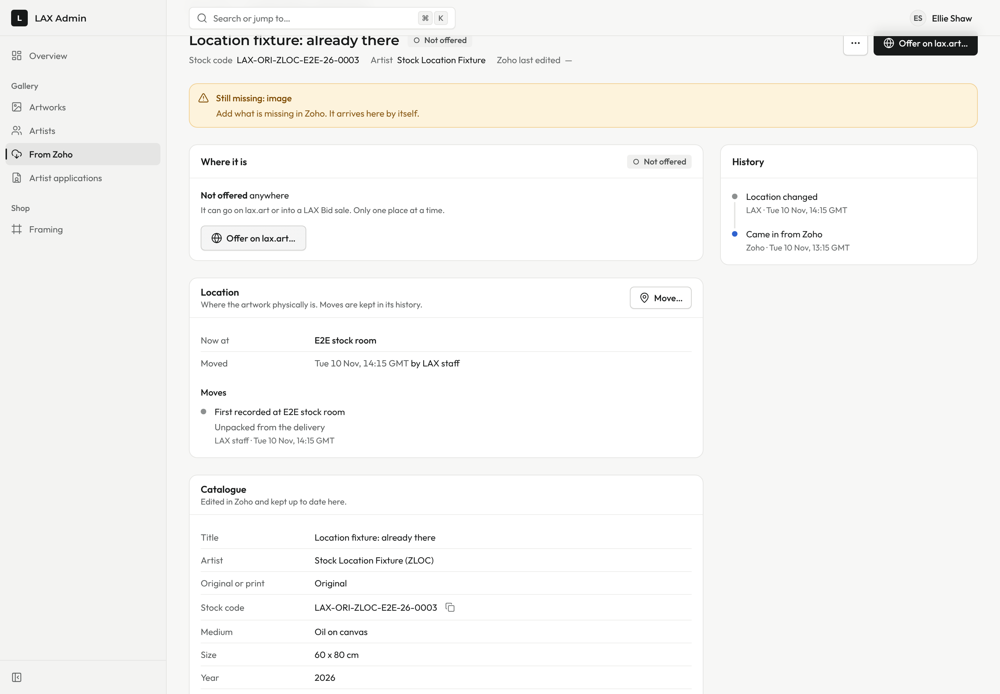
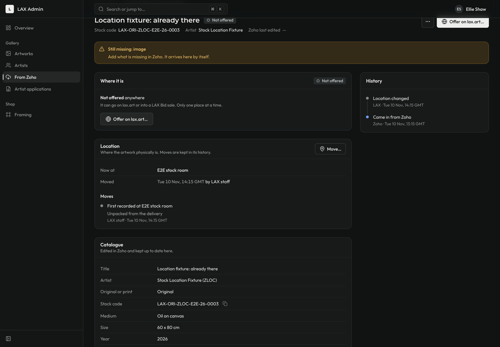
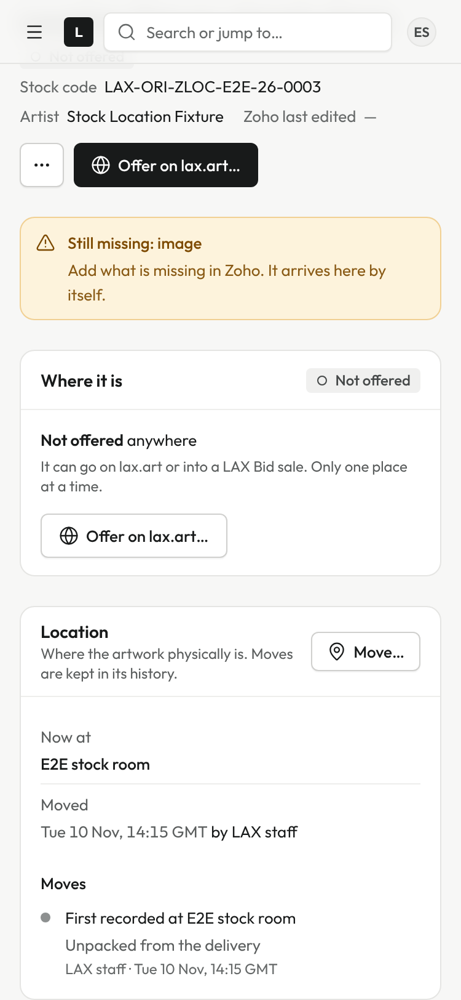
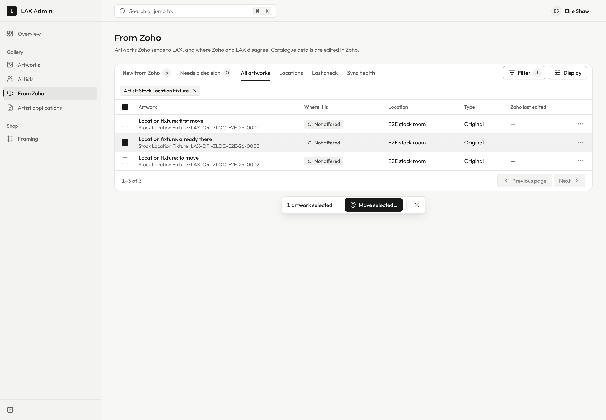
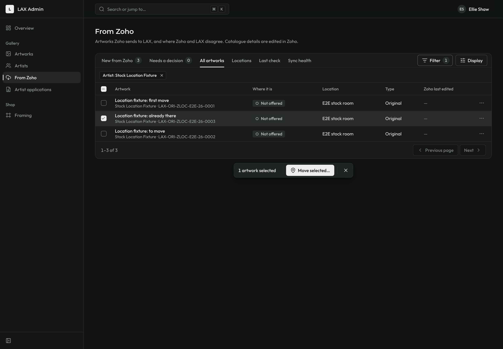
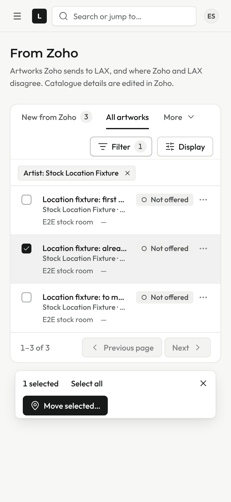
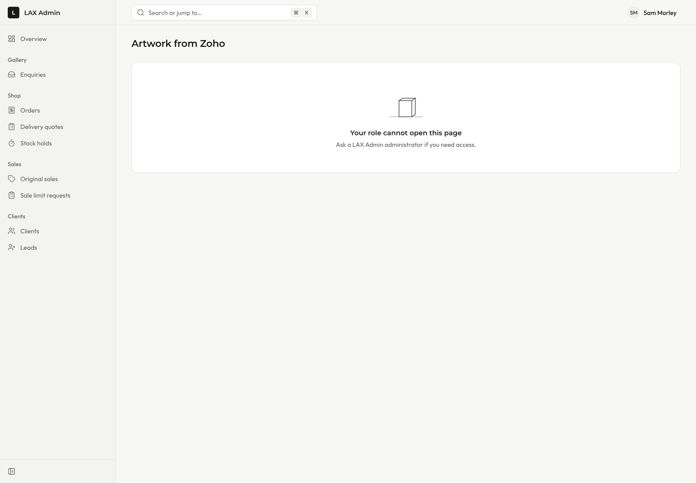
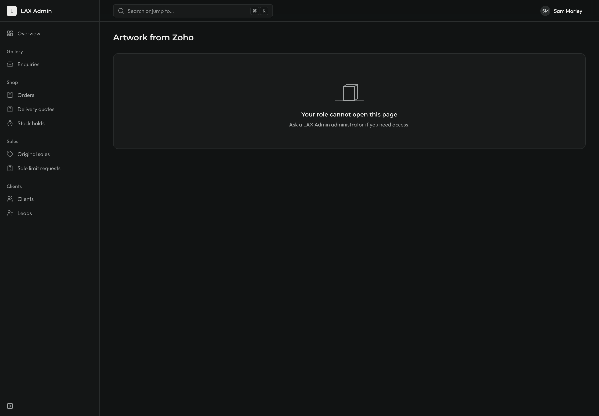
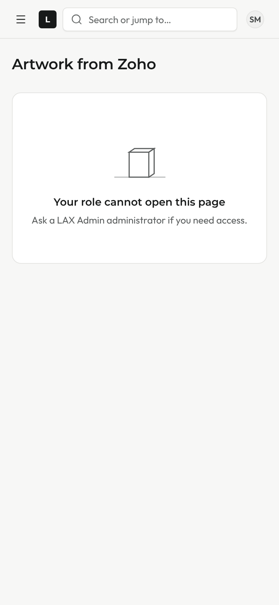

# Screenshots: catalogue editors move artworks (#1536)

Taken from a local stack (auth, shop-api and LAX Admin built from the PR branch, Postgres 16,
`seed:stock-location`) at 2× pixel density. Seed accounts: `lax-catalogue@lax.bid` (Catalogue
editor) and `lax-accounts@lax.bid` (Account manager). Artworks and places are made-up seed data.

| State | Light | Dark | 375 px |
| --- | --- | --- | --- |
| Catalogue editor: record, Location panel with **Move…** |  |  |  |
| Catalogue editor: All artworks, a row selected, **Move selected…** |  |  |  |
| Account manager: the same record. No From Zoho in the nav, the page is refused, no Move |  |  |  |
