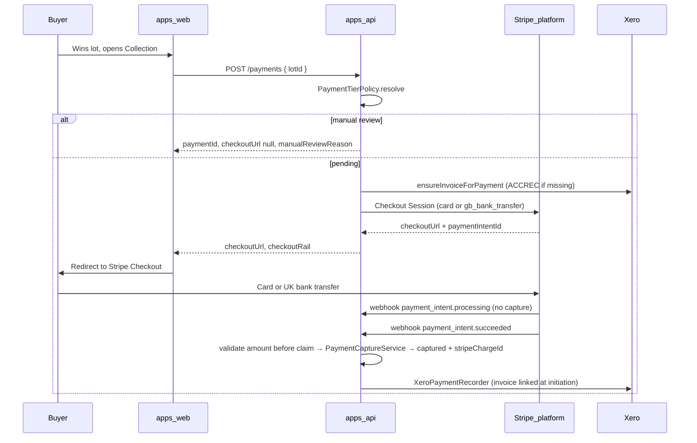

# Buyer payment flow (Stripe Checkout tiers + Xero ledger)

Buyers pay on the **LAX Stripe Connect platform account** via hosted **Stripe Checkout**. Xero is **ledger-only** (ACCREC invoice + payment sync) — not a buyer checkout rail.

## Tiered checkout

| Tier | Amount (default thresholds) | Rail |
|------|------------------------------|------|
| Card | ≤ £10,000 | Stripe card Checkout |
| Bank transfer | > £10,000 and < £500,000 | Stripe `gb_bank_transfer` |
| Manual review | ≥ £500,000 or archived seller | No URL until finance **Release for checkout** |
| Blocked | > £999,999.99 | `400 payment_amount_exceeds_limit` |

Env: `STRIPE_CARD_CHECKOUT_MAX`, `STRIPE_MANUAL_REVIEW_MIN`, `STRIPE_ABSOLUTE_MAX` (major GBP units).

## Journey (mermaid)

## Step-by-step

1. **Win:** Lot closes; buyer is `winnerId` on the lot.
2. **Checkout:** Buyer opens `/dashboard/checkout/[lotId]`. UI calls `POST /payments`.
3. **Tier policy:** Integer pence comparison — no float tier bugs.
4. **Xero invoice (when issuing checkout):** `ensureInvoiceForPayment` runs **only** when returning a checkout URL (not while `requires_manual_review`). Fails hard with `503 accounting_unavailable` when Xero is configured but invoice creation fails.
5. **Redirect:** Browser `window.location.assign(checkoutUrl)` when URL present.
6. **Stripe path:** `payment_intent.succeeded` → amount validated **before** event claim → capture + Xero invoice paid sync.

## Timing (record per environment)

| Hop | Typical observation | Notes |
|-----|---------------------|-------|
| POST /payments → checkout URL | 1–5 s | Stripe API latency |
| Stripe Checkout completion | user-dependent | Card: seconds; bank transfer: hours |
| DB `captured` after Stripe | seconds after webhook | Requires `STRIPE_PAYMENTS_WEBHOOK_SECRET` + `payment_intent.succeeded` |
| Bank transfer processing | hours | `payment_intent.processing` → status `authorized`; no capture until succeeded |
| Bank transfer underpaid | varies | `payment_intent.partially_funded` — stays uncaptured; domain event `payment.bank_transfer_partially_funded` |

## Troubleshooting

| Symptom | Check | Action |
|---------|-------|--------|
| No `checkoutUrl` | Amount tier / manual review | High value → finance release; archived seller → review queue |
| `503 accounting_unavailable` | Xero OAuth + invoice API | Fix Xero; no Stripe URL until invoice succeeds |
| Payment pending after Stripe pay | Payments webhook delivery | Verify `payment_intent.succeeded` subscribed |
| Amount mismatch | `payment_intent_amount_mismatch` metric | Fix payment row amount vs Stripe PI; webhook not claimed |
| Expired checkout link on retry | Same Stripe idempotency key returns stale session | API auto-renews with `:renewed:` key when session is expired |

## Finance task: bank transfer applied to another invoice

**What it is.** A buyer sent a bank transfer quoting one invoice's payment reference, and the payment provider applied the money to a different open bank-transfer payment of the same buyer. This happens when the invoice the reference belonged to was closed (we cancel its transfer when the buyer pays another way), or when a part-paid transfer is cancelled and its money moves to the buyer's oldest open transfer. The provider's automatic reconciliation is kept on deliberately: no money is lost, but it is recorded against the wrong invoice, and the other invoice may have been marked paid.

**How it appears.** A finance task (Work inbox, and an email to finance) reading "A bank transfer sent with invoice X's payment reference (reference R) was applied to invoice Y". It shows the amount, the invoice the reference was issued for (X), and the invoice or combined payment that received the money (Y). One task per application of money, so a second misapplied transfer is a second task. If X cannot be named (a payment from before references were kept) the task says "another invoice" and the reference to search for.

**What staff do.**

1. Open the payment named as Y in the task (the task links to it; a combined payment or a private sale deal opens the payments list or the deal) and compare it with X.
2. If Y is genuinely due and the buyer is content, leave it: Y is correctly paid, and X stays open for the buyer to pay again, or is closed.
3. If it is not right, refund the transfer from Y (the normal refund path; it reopens Y for payment) and ask the buyer to resend with the correct reference, or apply the funds to X from the provider's dashboard.
4. Tell the buyer which invoice now shows as paid.
5. Nothing is held automatically. If Y's seller has a payout in progress, hold that payout by hand until the invoices are right.

**What is detected (engineering).** The payments webhook endpoint must subscribe to `payment_intent.requires_action` and `customer_cash_balance_transaction.created`.

- When a bank-transfer payment first shows its transfer instructions (`payment_intent.requires_action`, also `processing` and `partially_funded`), the reference it tells the sender to quote (`next_action.display_bank_transfer_instructions.reference`) is kept in `payment_transfer_reference`, once per payment intent, with its buyer and the payment, combined payment or private sale deal it belongs to. Stripe stops showing it when the payment completes; the kept copy is what lets a transfer that fully pays the wrong invoice be recognised. Saving it is best effort: a failure is reported and never fails the payment event. Only references we issued are kept, never text the sender typed. They are issued codes, not personal data, and are kept with the payment's own records.
- On `customer_cash_balance_transaction.created` with `type = applied_to_payment`, the receiving payment's reference is the live one when still shown, else the kept one. The source of the money is found by reading the buyer's ledger back from that entry (up to 4 pages of 25, skipping other applications) to the first `funded` entry (its `funded.bank_transfer.reference`) or the first `unapplied_from_payment` entry (the payment the money was taken back from).
  - A transfer is a different invoice's when the text the sender quoted does not contain the receiving payment's own reference (letters and digits only, any case) and does contain a reference we issued to another payment of the same buyer.
  - Money taken back from a payment (cancelled while part funded) and applied elsewhere is reported, naming the payment it came from when its reference was kept.
  - Money taken back from a payment (cancelled while part funded) and applied elsewhere is reported, naming the payment it came from when its reference was kept. This does not need the receiving payment's own reference.
  - Not reported, each counted by a metric where noted:
    - the same invoice: the sent reference belongs to the same payment, the same private sale deal payment, the same combined payment, an invoice and the combined payment holding it, or two combined payments that share an invoice (the invoices a combined payment held are kept with its reference, because a combined payment that is let go holds none);
    - a transfer sent with no reference, or with text that is none of our references (`transfer_reference_not_ours`);
    - a trail that ends where the money left the balance (refunded, moved to the account balance, a return): `transfer_supply_interrupted`;
    - a source more than 100 ledger entries back: `transfer_supply_window_exceeded`;
    - a transfer applied to a payment whose reference was never kept and is no longer shown (payments from before this check, or invoices paid from an existing balance, which never show instructions): `transfer_application_check_skipped_no_reference`. These cannot name the intended invoice either.
  - Ambiguous text: text that contains both the receiving payment's own reference and another payment's is treated as a match and raises nothing.
- The task is one per ledger entry. The Work inbox titles it "Bank transfer applied to another invoice".

## Related

- [Xero + Stripe platform setup](./xero-stripe-payment-setup.md)
- [Stripe Connect go-live](./stripe-connect-go-live.md)
