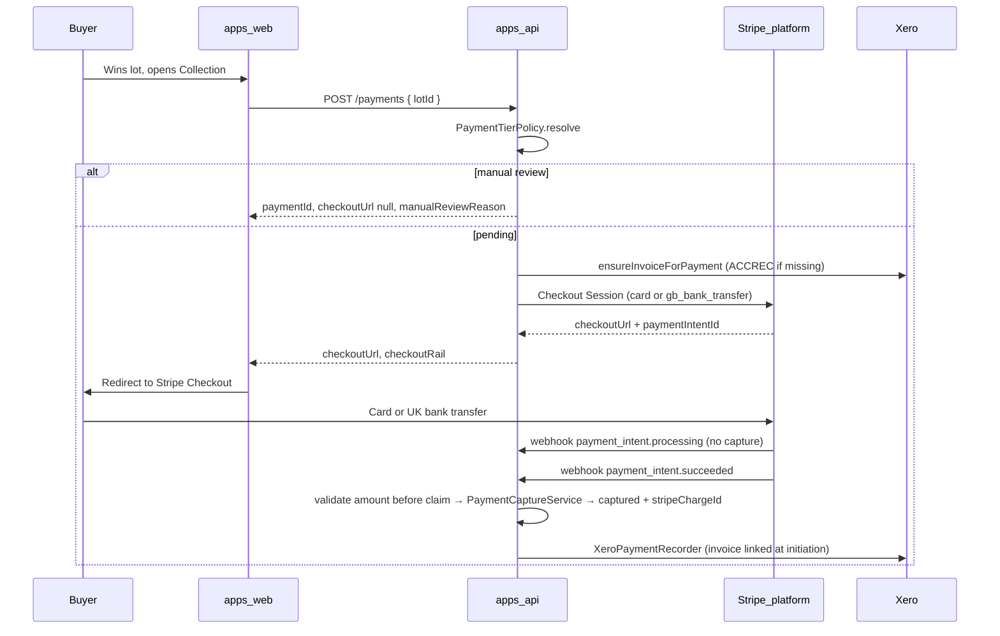

# Buyer payment flow (Stripe Checkout tiers + Xero ledger)

Buyers pay on the **LAX Stripe Connect platform account** via hosted **Stripe Checkout**. Xero is **ledger-only** (ACCREC invoice + payment sync) — not a buyer checkout rail.

## Tiered checkout

| Tier | Amount (default thresholds) | Rail |
|------|------------------------------|------|
| Card | ≤ £10,000 | Stripe card Checkout |
| Bank transfer | > £10,000 and < £500,000 | Stripe `gb_bank_transfer` |
| Manual review | ≥ £500,000 or archived seller | No URL until finance **Release for checkout** |
| Blocked | > £999,999.99 | `400 payment_amount_exceeds_limit` |

Env: `STRIPE_CARD_CHECKOUT_MAX`, `STRIPE_MANUAL_REVIEW_MIN`, `STRIPE_ABSOLUTE_MAX` (major GBP units).

## Journey (mermaid)

## Step-by-step

1. **Win:** Lot closes; buyer is `winnerId` on the lot.
2. **Checkout:** Buyer opens `/dashboard/checkout/[lotId]`. UI calls `POST /payments`.
3. **Tier policy:** Integer pence comparison — no float tier bugs.
4. **Xero invoice (when issuing checkout):** `ensureInvoiceForPayment` runs **only** when returning a checkout URL (not while `requires_manual_review`). Fails hard with `503 accounting_unavailable` when Xero is configured but invoice creation fails.
5. **Redirect:** Browser `window.location.assign(checkoutUrl)` when URL present.
6. **Stripe path:** `payment_intent.succeeded` → amount validated **before** event claim → capture + Xero invoice paid sync.

## Timing (record per environment)

| Hop | Typical observation | Notes |
|-----|---------------------|-------|
| POST /payments → checkout URL | 1–5 s | Stripe API latency |
| Stripe Checkout completion | user-dependent | Card: seconds; bank transfer: hours |
| DB `captured` after Stripe | seconds after webhook | Requires `STRIPE_PAYMENTS_WEBHOOK_SECRET` + `payment_intent.succeeded` |
| Bank transfer processing | hours | `payment_intent.processing` → status `authorized`; no capture until succeeded |
| Bank transfer underpaid | varies | `payment_intent.partially_funded` — stays uncaptured; domain event `payment.bank_transfer_partially_funded` |

## Troubleshooting

| Symptom | Check | Action |
|---------|-------|--------|
| No `checkoutUrl` | Amount tier / manual review | High value → finance release; archived seller → review queue |
| `503 accounting_unavailable` | Xero OAuth + invoice API | Fix Xero; no Stripe URL until invoice succeeds |
| Payment pending after Stripe pay | Payments webhook delivery | Verify `payment_intent.succeeded` subscribed |
| Amount mismatch | `payment_intent_amount_mismatch` metric | Fix payment row amount vs Stripe PI; webhook not claimed |
| Expired checkout link on retry | Same Stripe idempotency key returns stale session | API auto-renews with `:renewed:` key when session is expired |

## Finance task: bank transfer applied to another invoice

**What it is.** A buyer sent a bank transfer quoting one invoice's payment reference, and the payment provider applied the money to a different open bank-transfer payment of the same buyer. This happens when the invoice the reference belonged to was closed (we cancel its transfer when the buyer pays another way), or when a part-paid transfer is cancelled and its money moves to the buyer's oldest open transfer. The provider's automatic reconciliation is kept on deliberately: no money is lost, but it is recorded against the wrong invoice, and the other invoice may have been marked paid.

**How it appears.** A finance task (Work inbox, and an email to finance) with the reason "A bank transfer sent with one invoice's payment reference was applied to a different invoice". It shows the amount, the reference the sender quoted, and the payment or combined payment that received the money. One task per application of money, so a second misapplied transfer is a second task.

**What staff do.**

1. Open the payment named in the task and compare it with the buyer's other bank-transfer invoices (search the reference in the payment provider's dashboard to find the invoice it was issued for).
2. If the receiving invoice is genuinely due and the buyer is content, leave it: that invoice is correctly paid, and the invoice the transfer was meant for stays open for the buyer to pay again, or is closed.
3. If it is not right, refund the transfer from the receiving payment (this follows the normal refund path and reopens that invoice for payment) and ask the buyer to resend with the correct reference, or apply the funds to the intended invoice from the provider's dashboard.
4. Tell the buyer which invoice now shows as paid. Nothing here is refunded automatically, and a seller payout is not paid for an invoice until it is right.

**How it is detected (engineering).** On `customer_cash_balance_transaction.created` with `type = applied_to_payment`, the handler reads the receiving payment's own reference (`next_action.display_bank_transfer_instructions.reference`) and the buyer's latest 25 ledger entries. The transfer that supplied the money is the latest `type = funded` entry at or before the application; its `funded.bank_transfer.reference` is compared (case-insensitively) with the payment's own. A difference raises the task. Limits to know: the payment's own reference is only readable while it still awaits funding, so a transfer that completes the receiving payment in one step cannot be compared and raises no task (the `transfer_application_check_skipped_no_reference` metric counts these); a transfer sent with no reference is never reported.

## Related

- [Xero + Stripe platform setup](./xero-stripe-payment-setup.md)
- [Stripe Connect go-live](./stripe-connect-go-live.md)
