# PR #1375, Bid refunds as credit notes: buyer card screenshots

Branch `bk9-bid-refunds` at e97c9de5. Rendered by a temporary, uncommitted dev route: the real `PurchaseInvoiceCard` inside the real `PurchaseDetail`, fed by `purchaseInvoiceCard()` with fixture data only. `next dev`, Playwright, device scale 2, London time, cookie banner dismissed. The round badge at the bottom left is the Next.js dev overlay, not part of the page.

These states are shown to a buyer only once Bid is **live** on Books. In dry run and at the test organisation the card stays LAX's own invoice, as before.

No horizontal scroll in any state at 375px (scrollWidth == clientWidth, checked for all 12 shots).

| State | 1440x900 light | 1440x900 dark | 375x812 light | 375x812 dark |
|---|---|---|---|---|
| Refunded in part |  |  |  |  |
| Refunded in full (two refunds) |  |  |  |  |
| Cancelled after a default |  |  |  |  |

## Round 2: after review #1375 (F8)

Branch `bk9-bid-refunds` at d268da93. Rendered the same way (a temporary, uncommitted dev route: the real `PurchaseDetail` with `purchaseInvoiceCard()` and `withBooksRefund()`, fixture data only), `next dev`, Playwright, device scale 2, London time, cookie banner dismissed. The round badge at the bottom left is the Next.js dev overlay.

What changed since round 1:

- **Refunded in full**: the badge and the Payment card read **Refunded** (never "Paid" or "Total paid") once Books' refund credit notes credit the whole invoice.
- **Where a refund went**: "Refunded −£[amount] to your card" or "… to your bank account", by how the invoice was paid (a Pay several charge by its checkout's rail; one payment only when its checkout sessions all name the same rail). Nothing is said when it is not known.
- **No repeated number**: a default's credit note row is titled "Credit note CN-…" and its link reads "Download (PDF)".
- Books' own `refund_mode` for the refund from clearing is unchanged ("Stripe", from the Stripe clearing account): which mode and account a bank-transfer refund uses is still the accountant's question.

No horizontal scroll in any state at 375px (scrollWidth == clientWidth, checked for all 12 shots). The part-refund shot still reads "Total paid", by design: the buyer paid, and part of it came back.

| State | 1440x900 light | 1440x900 dark | 375x812 light | 375x812 dark |
|---|---|---|---|---|
| Refunded in part (card) | 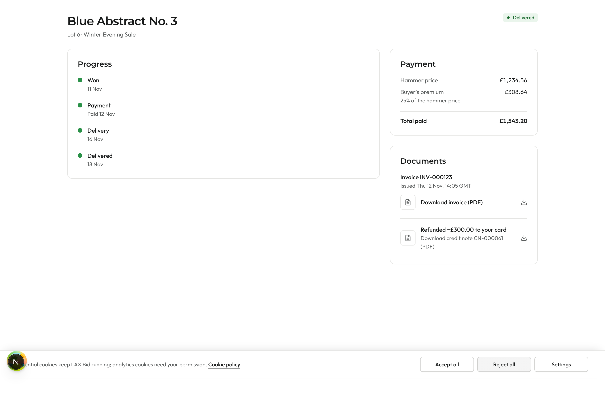 | 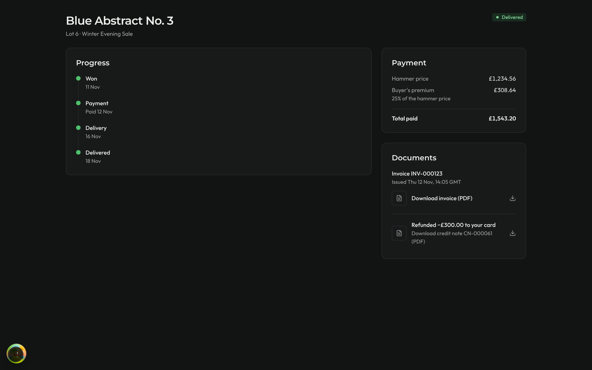 | 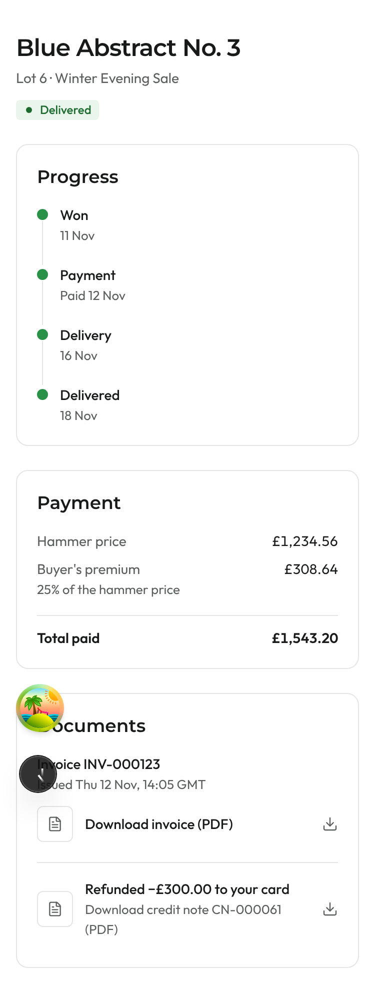 | 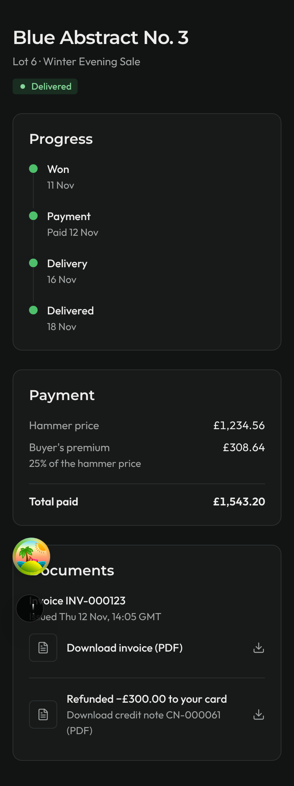 |
| Refunded in full (bank transfer, two refunds) | 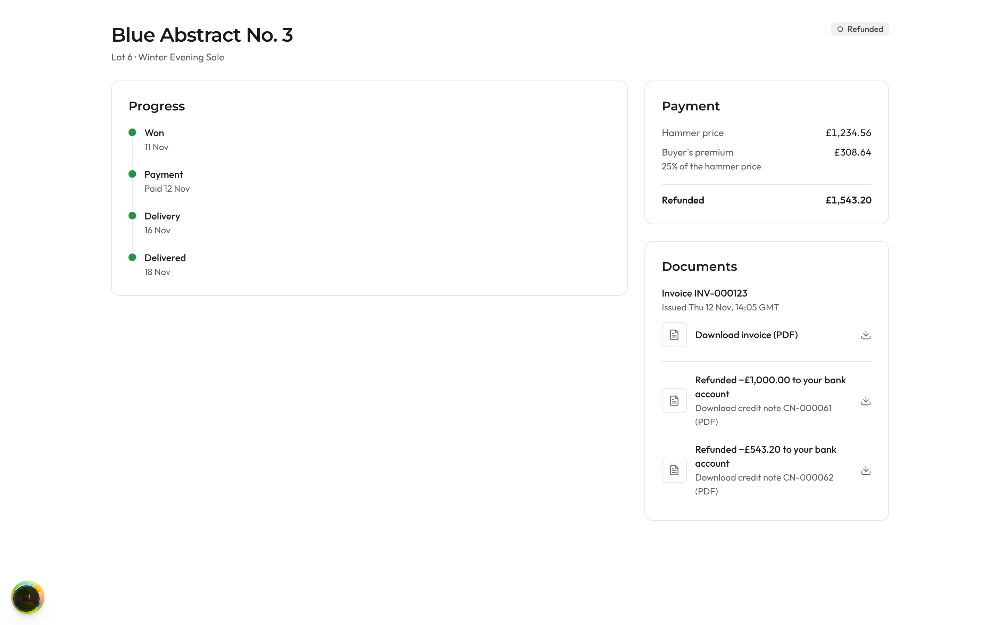 | 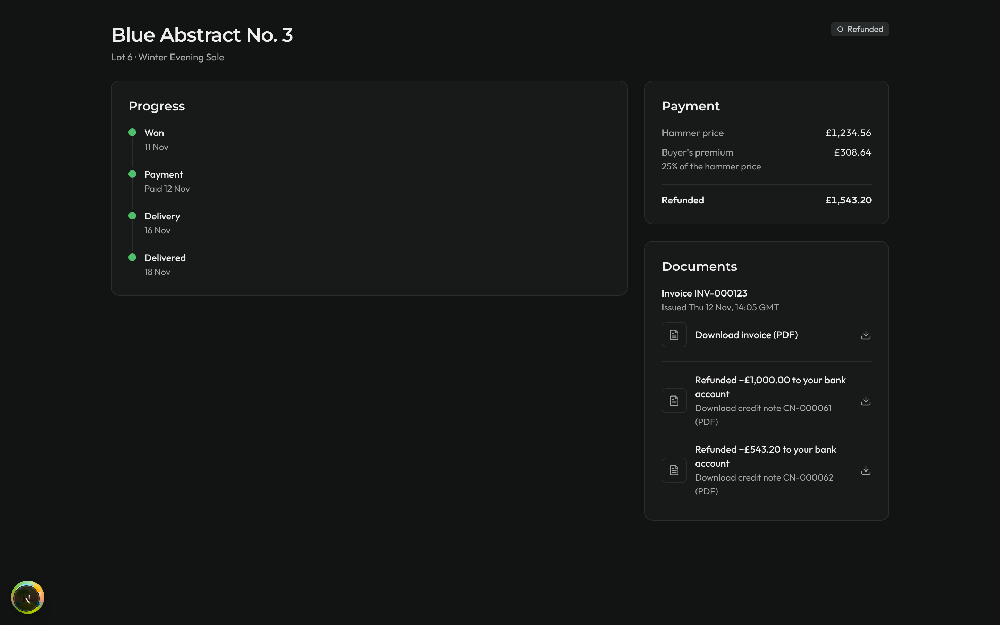 | 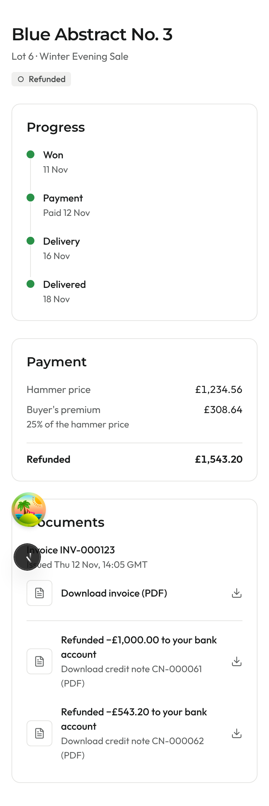 | 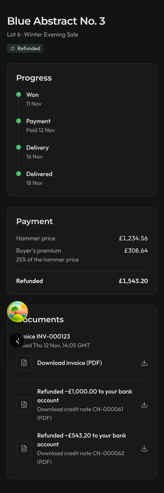 |
| Cancelled after a default | 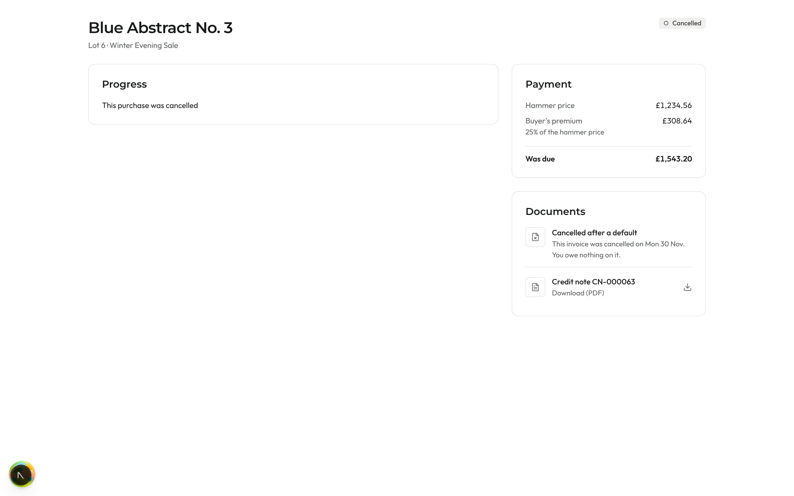 | 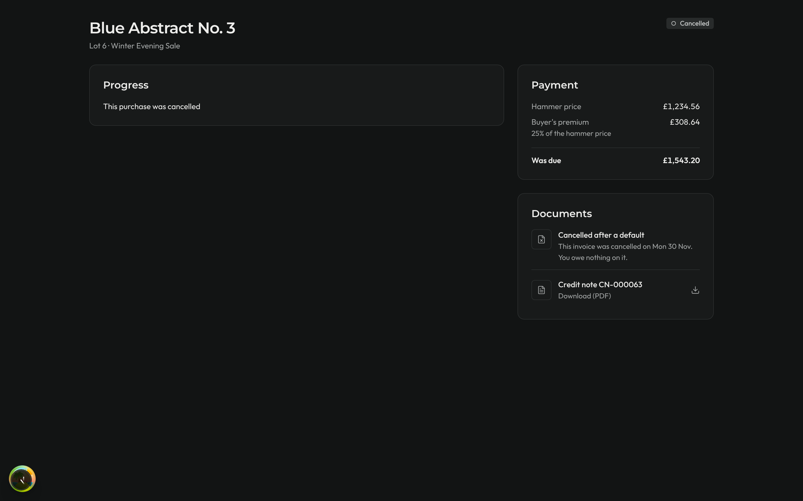 | 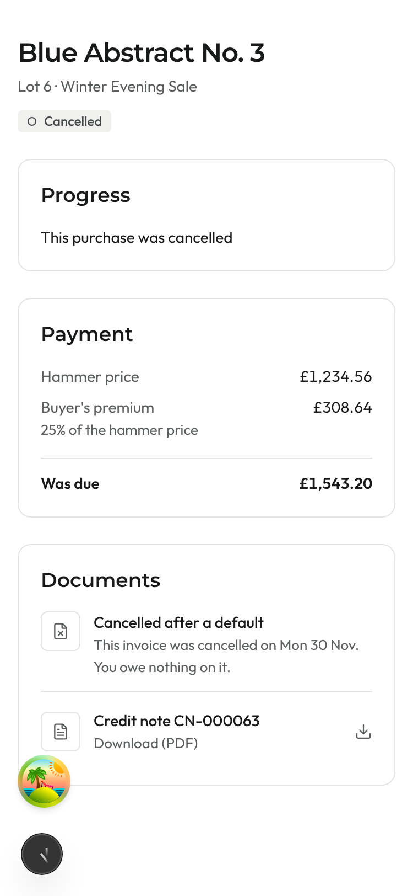 | 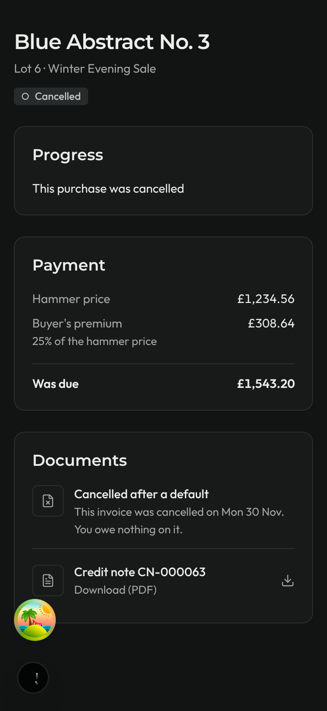 |
