# Bid admin: legal entity stats and payout reason copy

Rendered from the real components with fixture data (no live data). Before is `origin/main`; after is the PR branch.

| View | Before | After |
| --- | --- | --- |
| Legal entity overview, 1440 light | 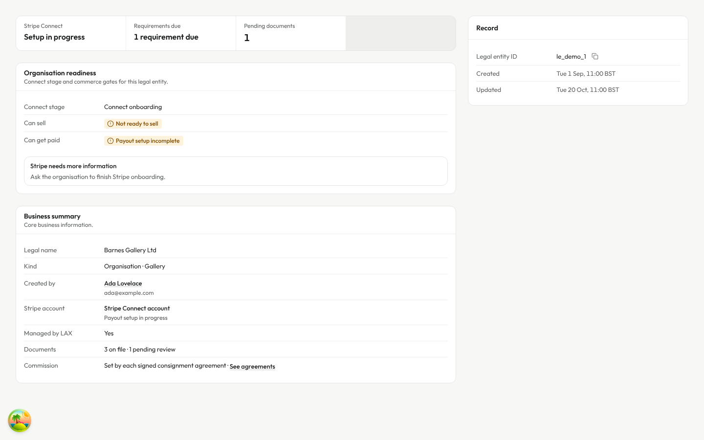 | 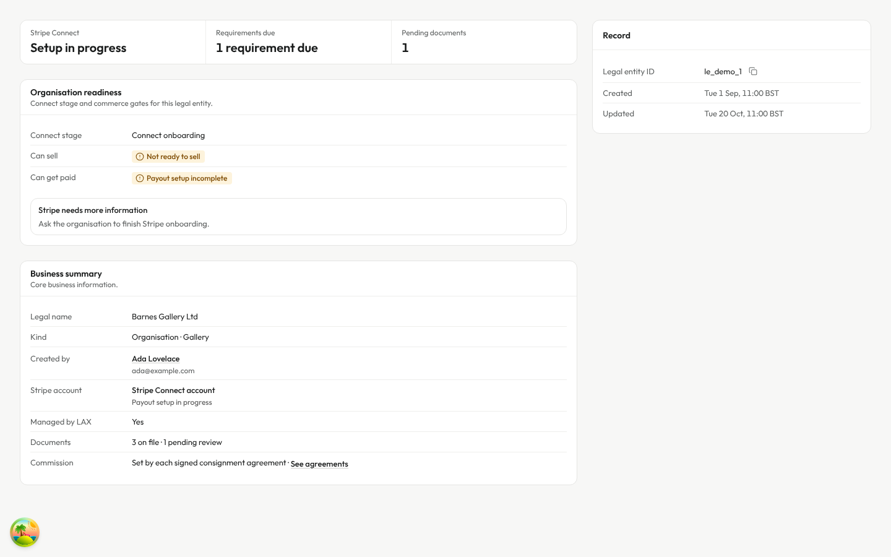 |
| Legal entity overview, 1440 dark | 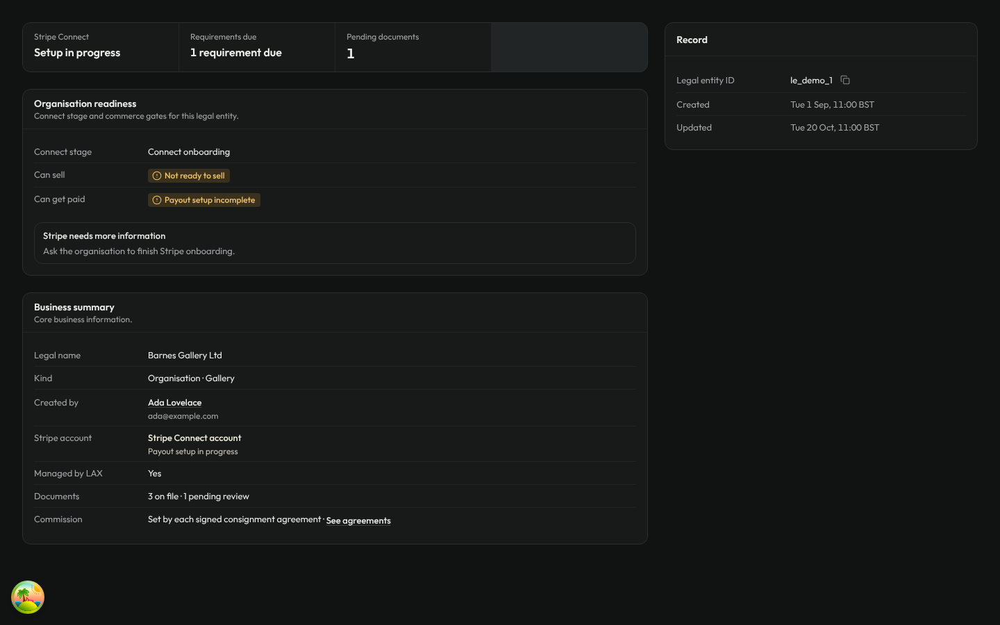 | 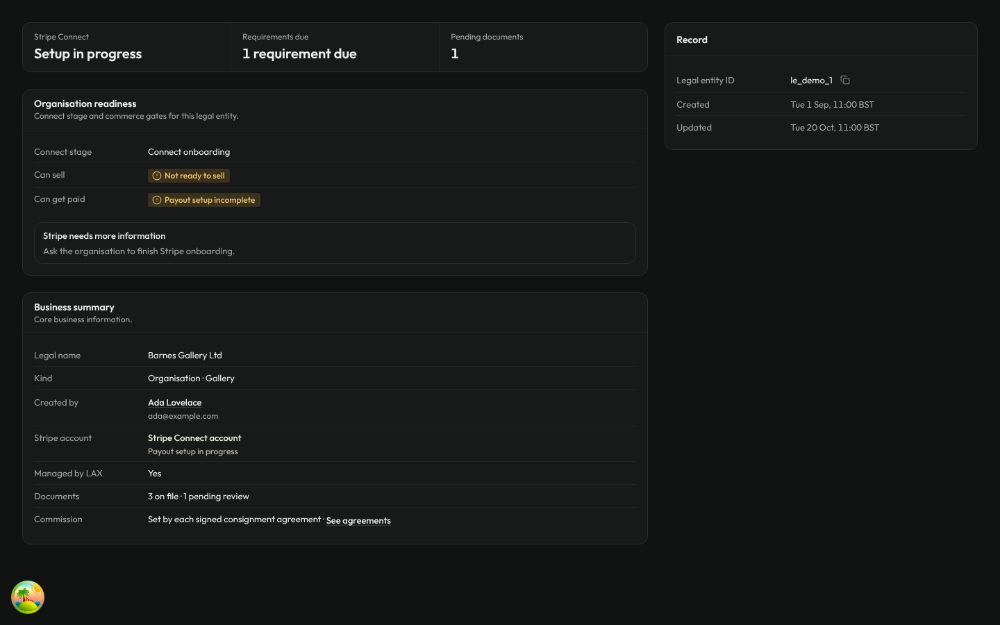 |
| Legal entity overview, 375 light |  | 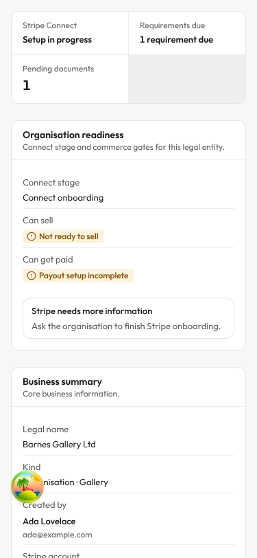 |
| Payout panel with failure notice, 1440 light | 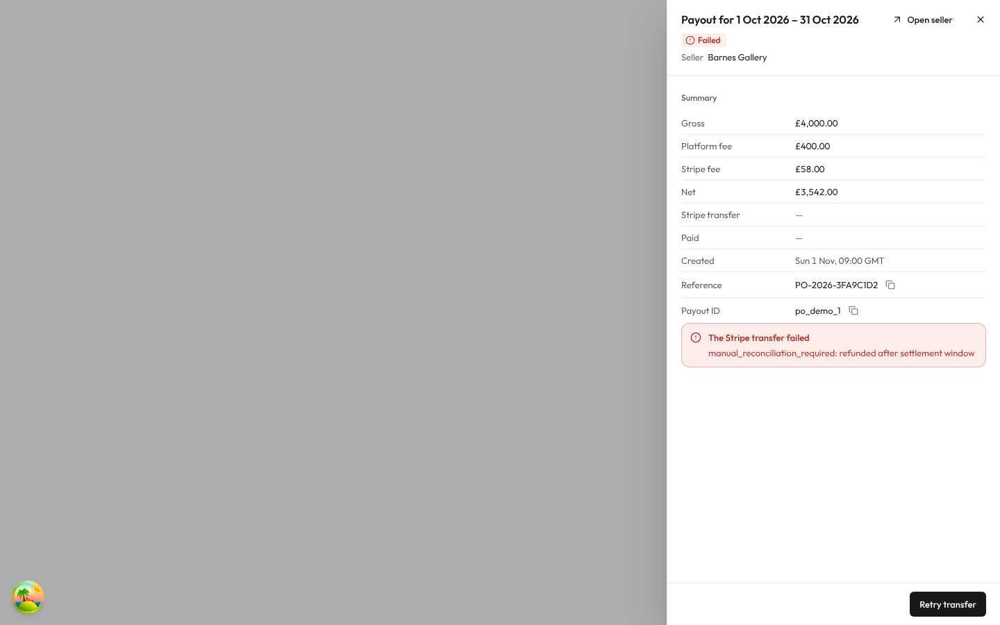 | 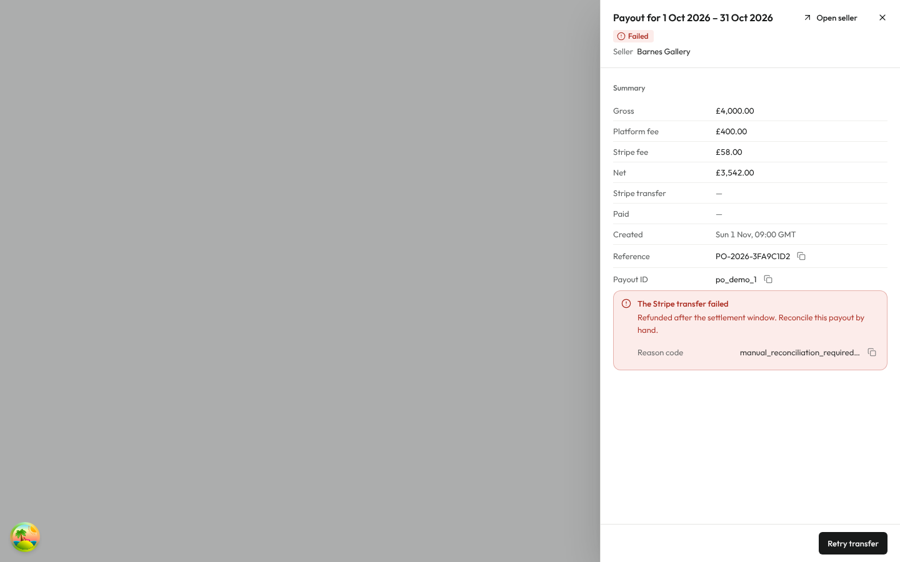 |
| Payout panel with failure notice, 1440 dark | 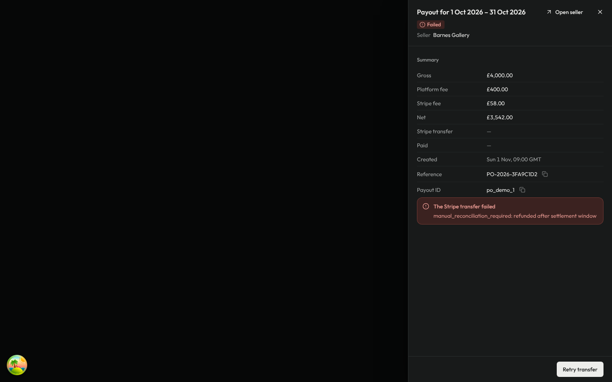 | 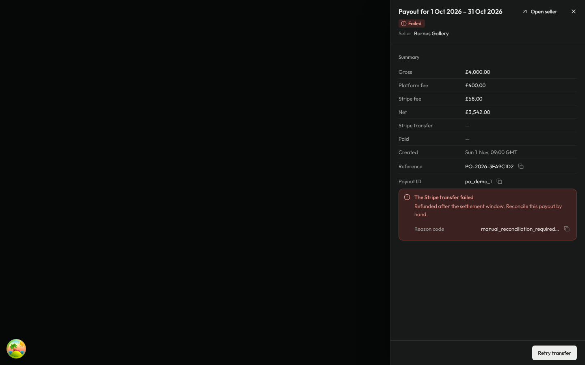 |
| Payout panel with failure notice, 375 light | 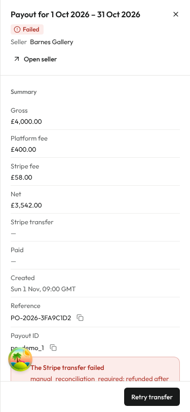 | 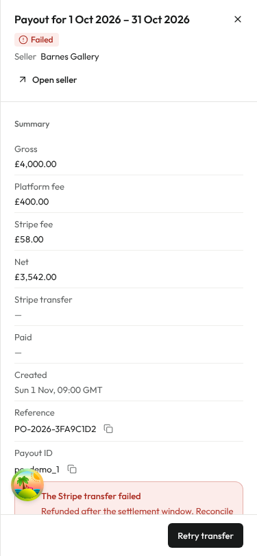 |

The overview strip drops its empty fourth tile and sizes to its three stats. The payout notice leads with plain copy; the raw value is a small copyable Reason code.
