# PR #1375, Bid refunds as credit notes: buyer card screenshots

Branch `bk9-bid-refunds` at e97c9de5. Rendered by a temporary, uncommitted dev route: the real `PurchaseInvoiceCard` inside the real `PurchaseDetail`, fed by `purchaseInvoiceCard()` with fixture data only. `next dev`, Playwright, device scale 2, London time, cookie banner dismissed. The round badge at the bottom left is the Next.js dev overlay, not part of the page.

These states are shown to a buyer only once Bid is **live** on Books. In dry run and at the test organisation the card stays LAX's own invoice, as before.

No horizontal scroll in any state at 375px (scrollWidth == clientWidth, checked for all 12 shots).

| State | 1440x900 light | 1440x900 dark | 375x812 light | 375x812 dark |
|---|---|---|---|---|
| Refunded in part | 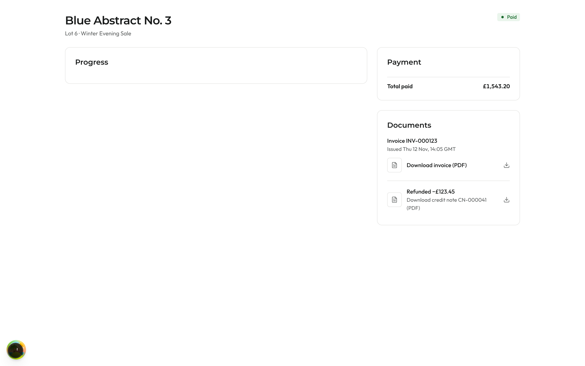 | 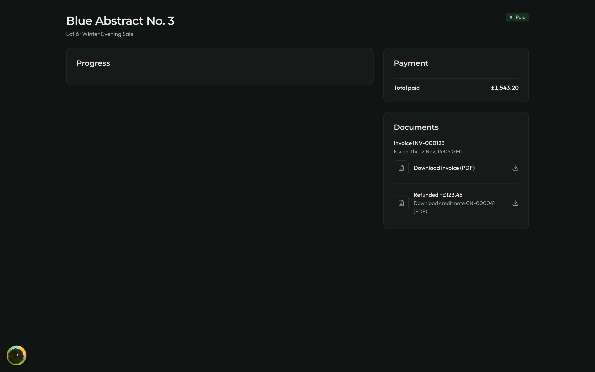 | 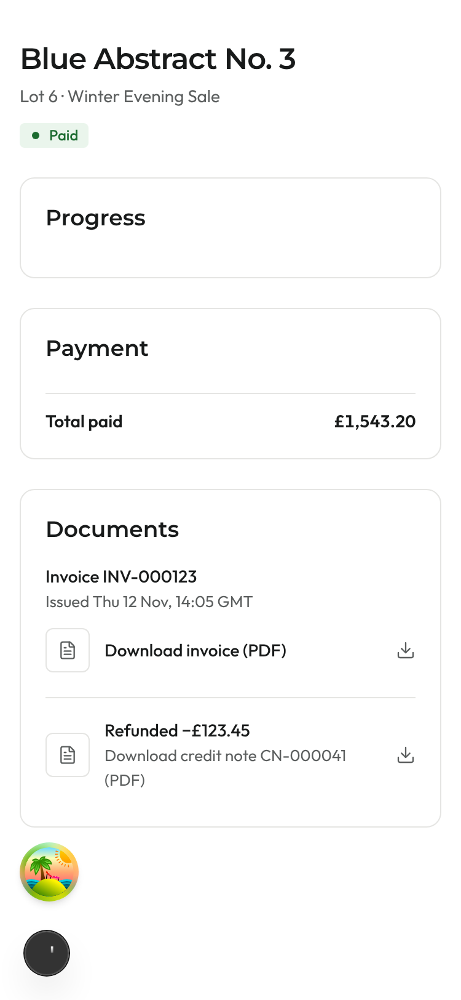 | 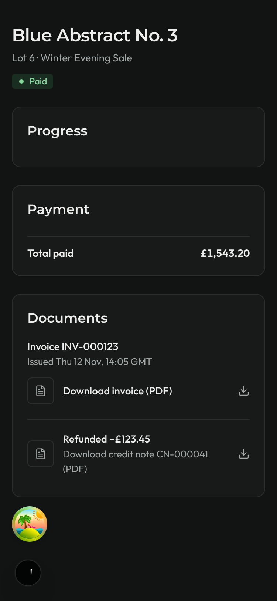 |
| Refunded in full (two refunds) | 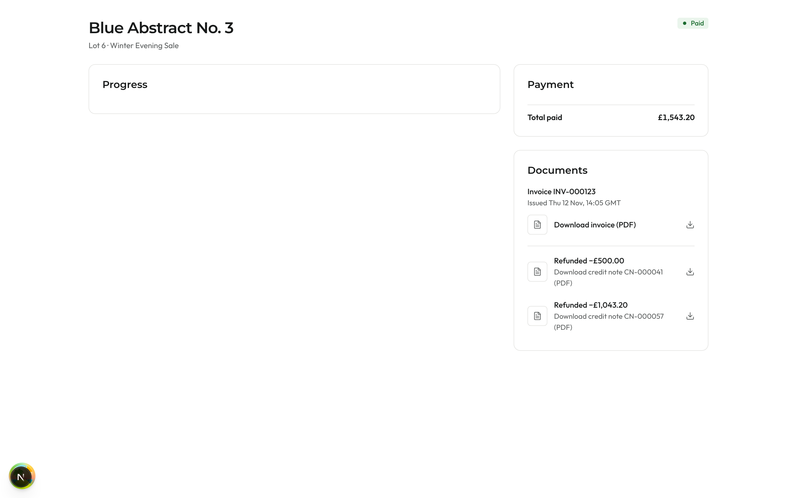 | 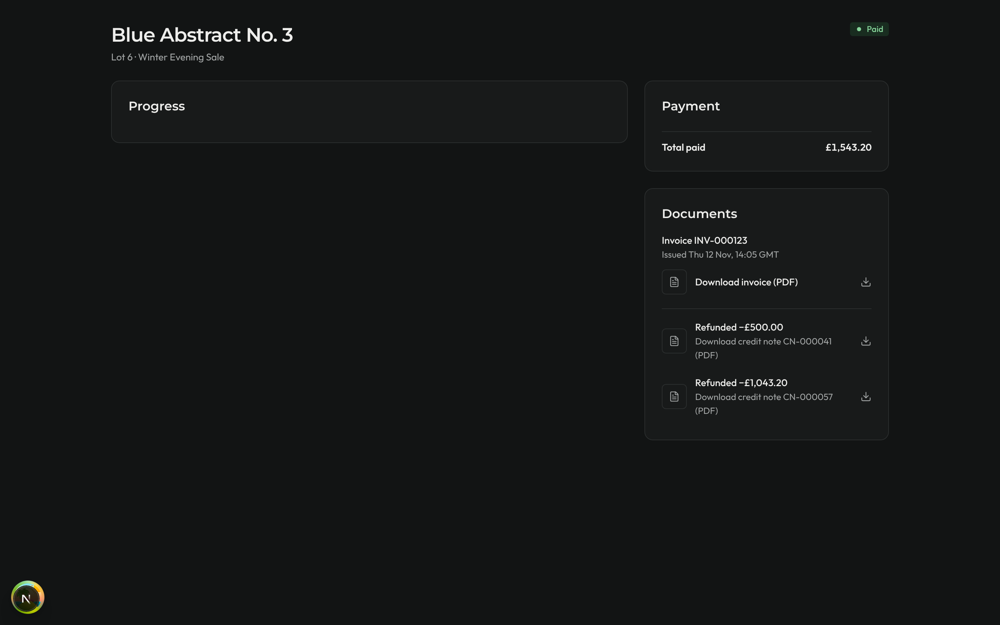 | 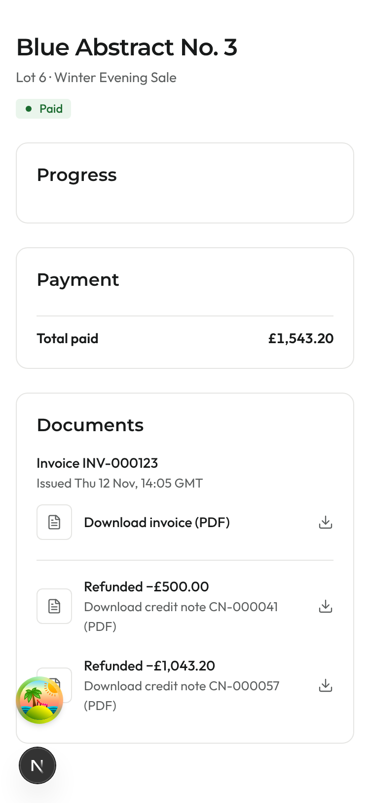 | 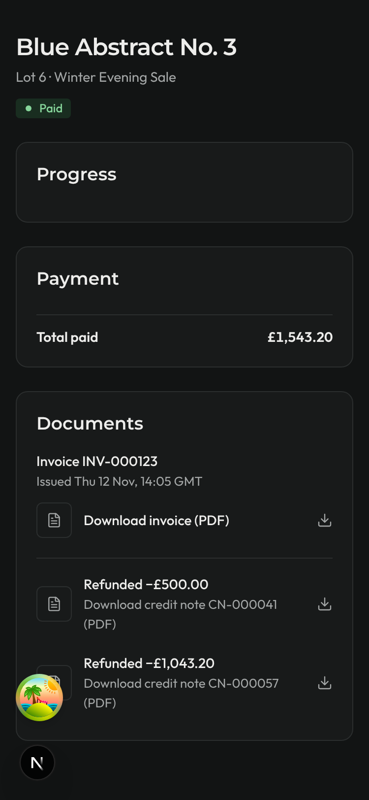 |
| Cancelled after a default | 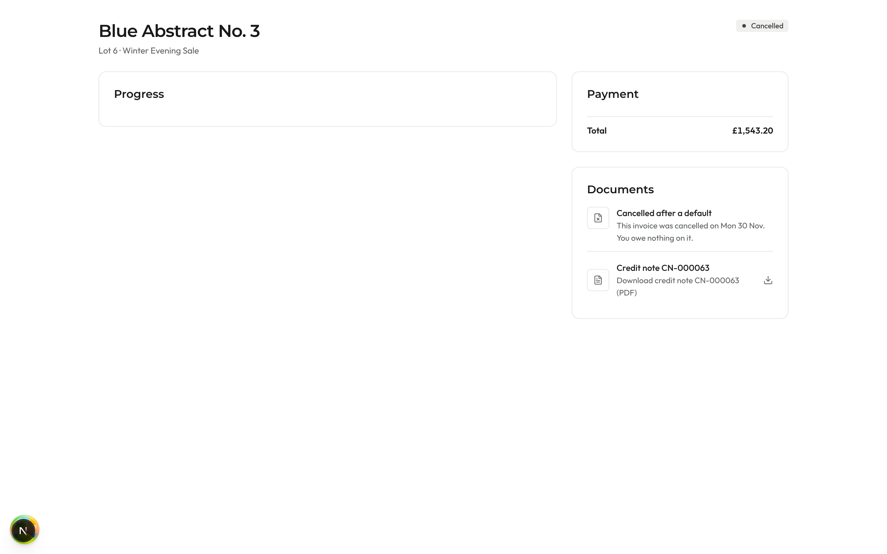 | 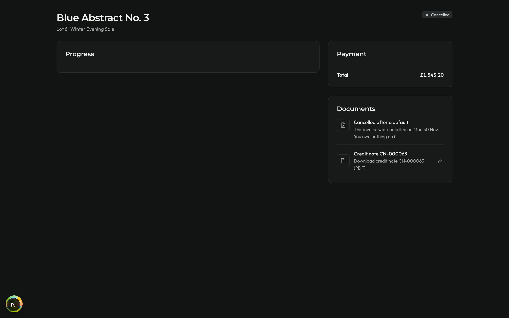 | 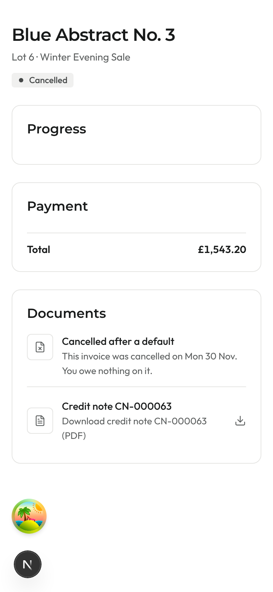 | 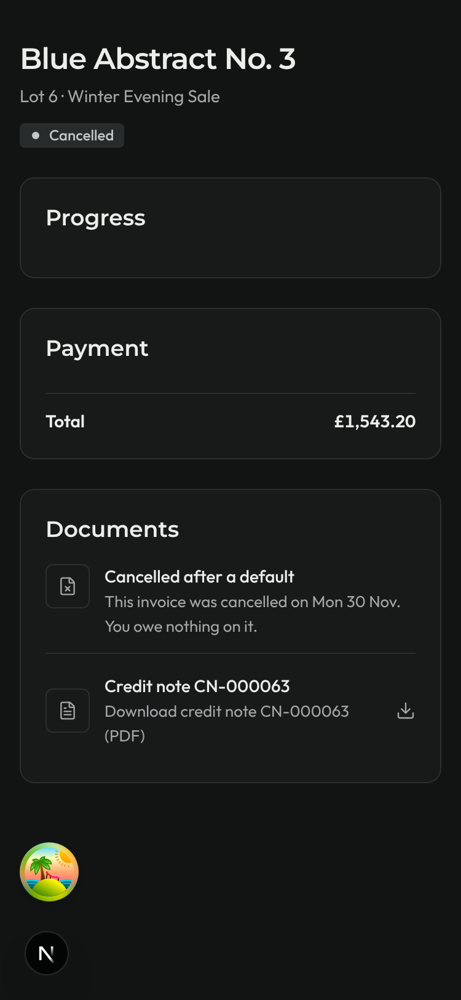 |
