# PR #1369: Bid admin work queues, round 1 screenshots

Seeded local stack (Postgres 16, `db:migrate`, `db:roles`, `db:seed:dev`), signed in as the seeded administrator. Shots are at 1440×900 in light and dark, and 375×812 in light, at 2× scale. The round "N" button in the bottom-left corner is the Next.js dev-server badge; it is not part of the app.

The seed has a single manual review hold. Four more were added to the throwaway local database to show a queue position past the first; nothing in the pull request depends on them.

| Panel | 1440 light | 1440 dark | 375 light (full screen, sticky footer) |
|---|---|---|---|
| Manual review hold, "3 of 5" (`?payment=`) | 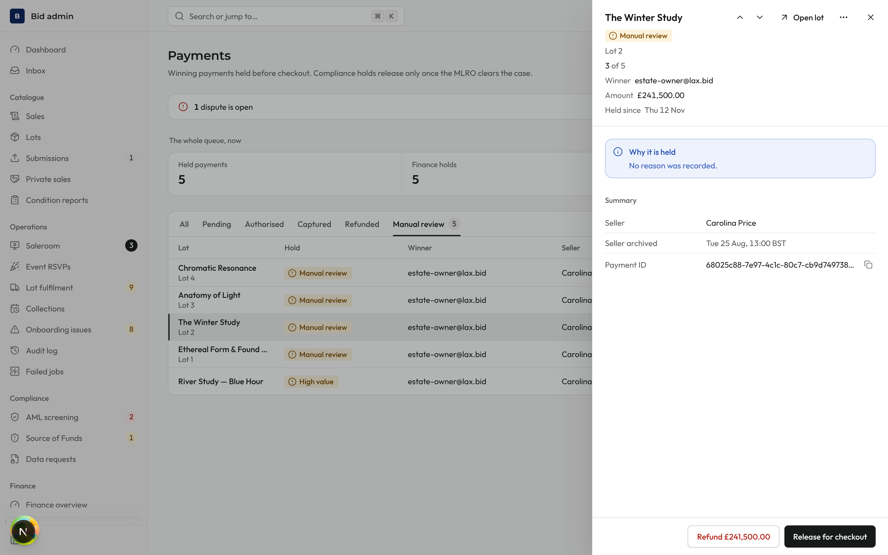 | 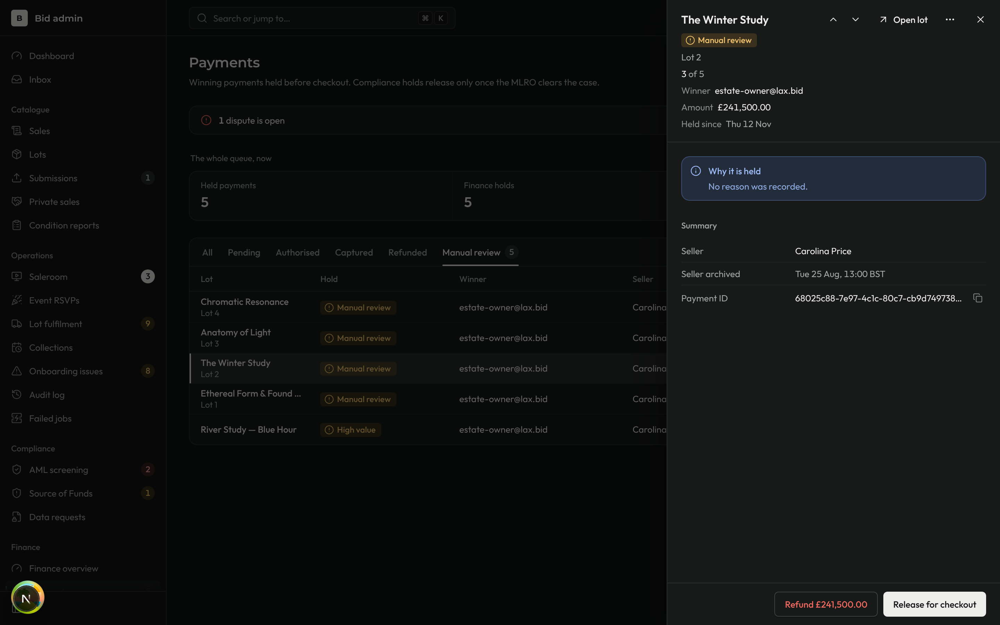 | 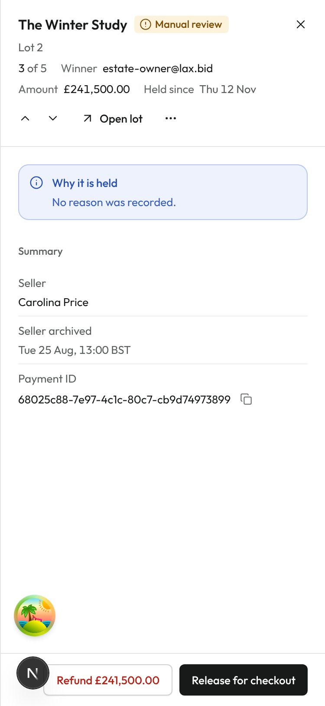 |
| AML screening (`?screening=`) | 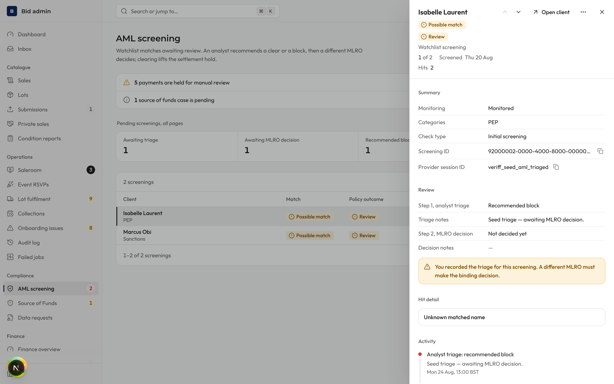 | 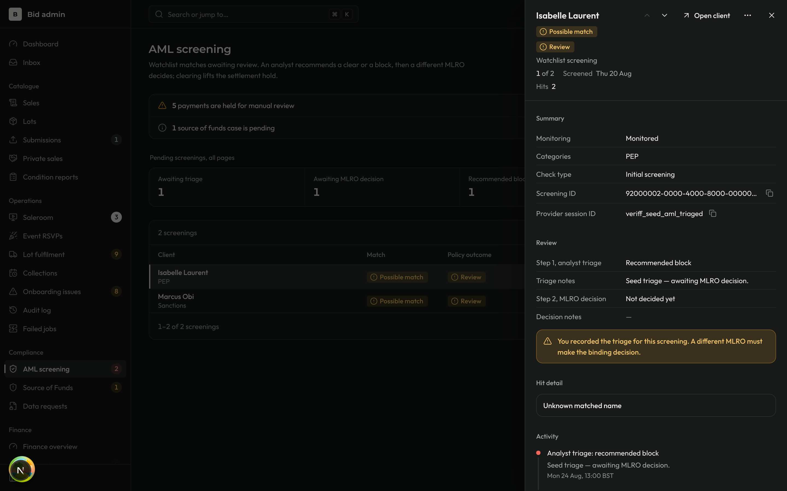 | 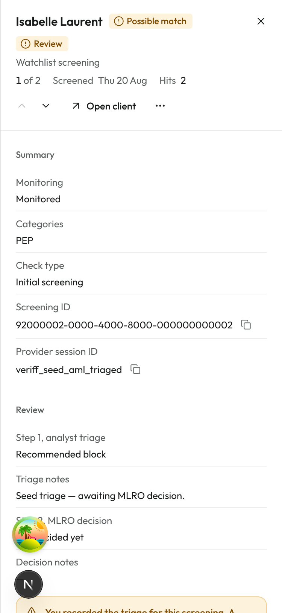 |
| Onboarding issue, new body: blocker, who it waits on, next step (`?item=`) | 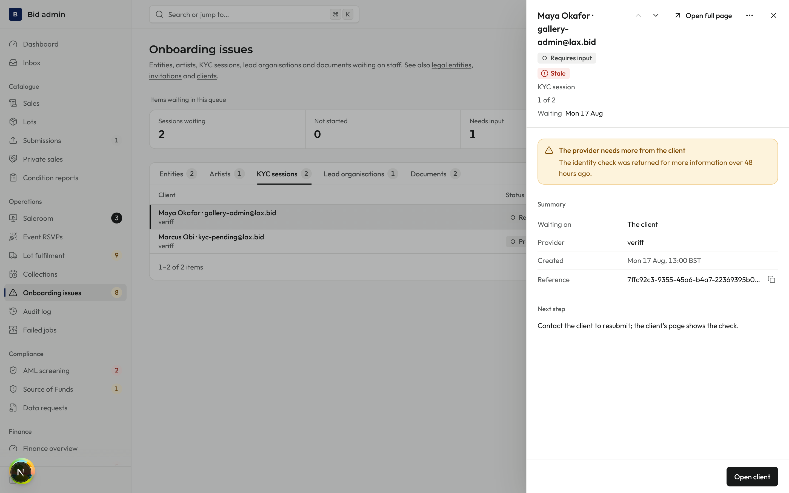 | 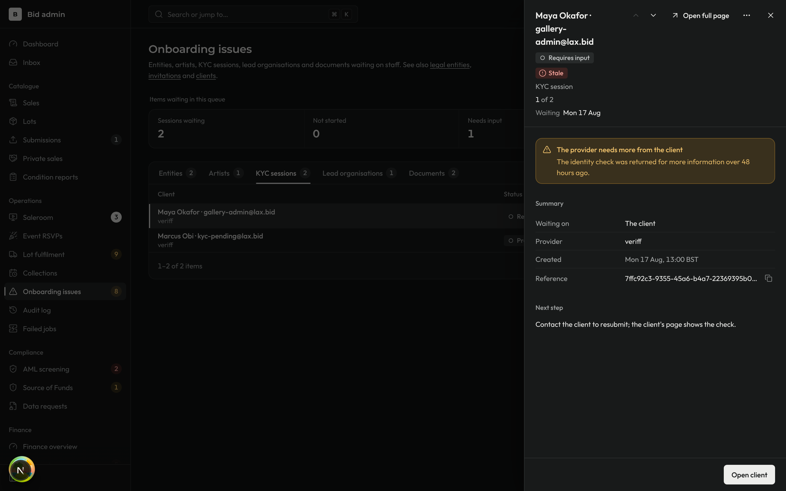 | 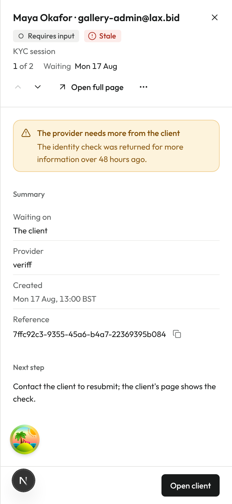 |
| Staff invitation, the panel is the record (`?invitation=`) | 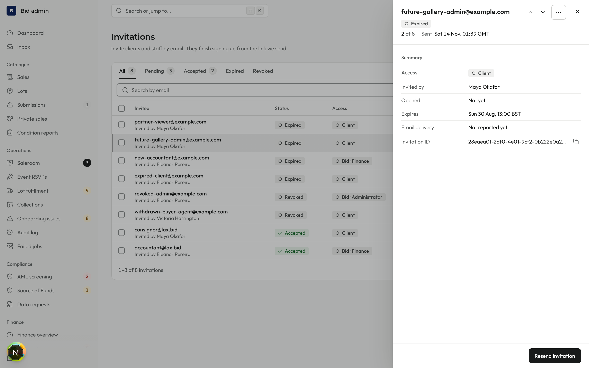 | 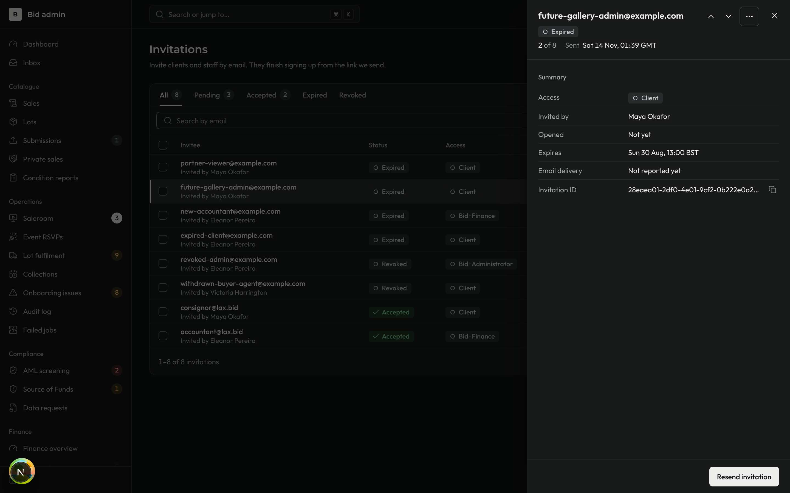 | 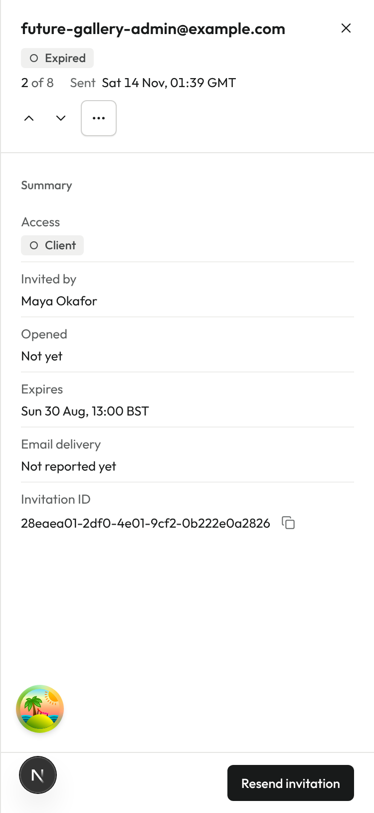 |
| Audit event, the panel is the record (`?event=`) | 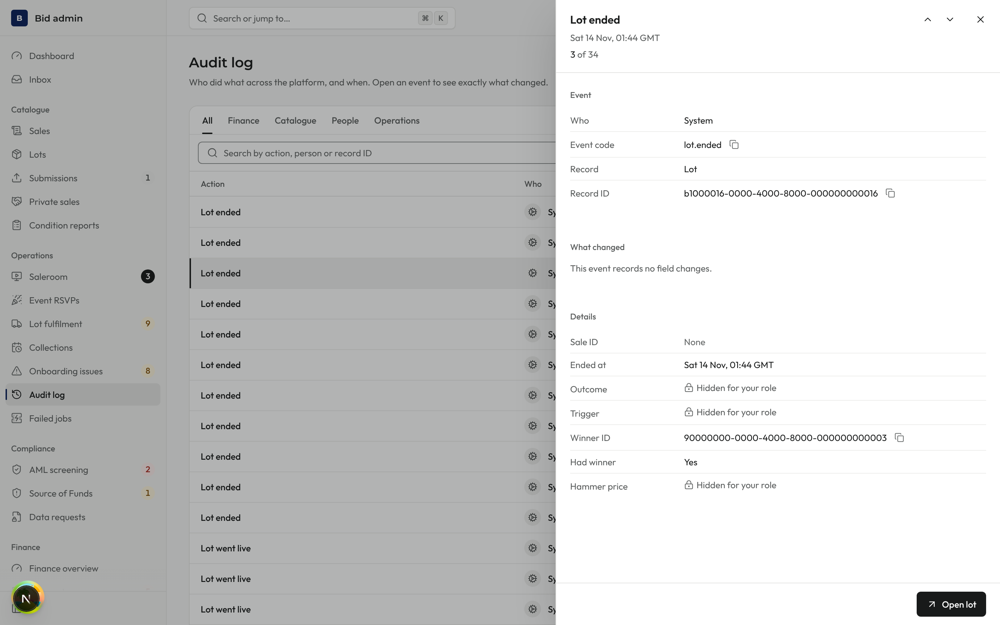 | 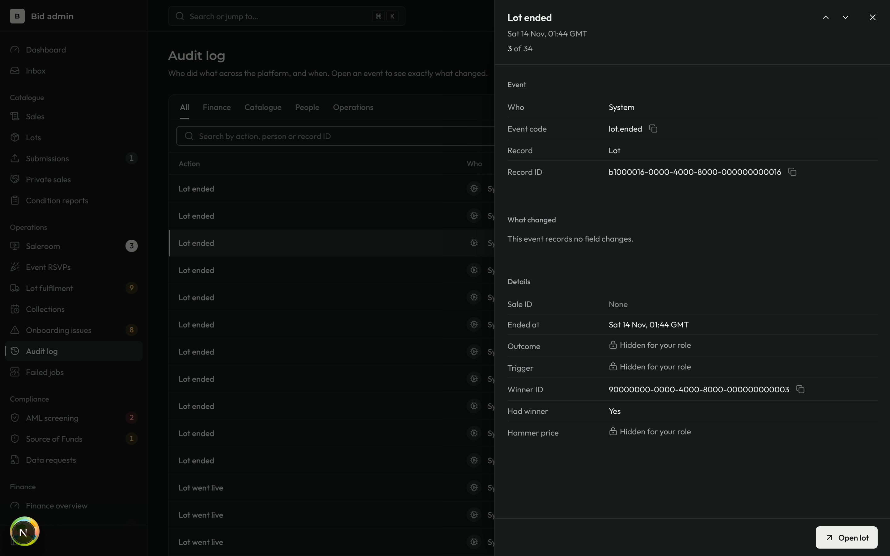 | 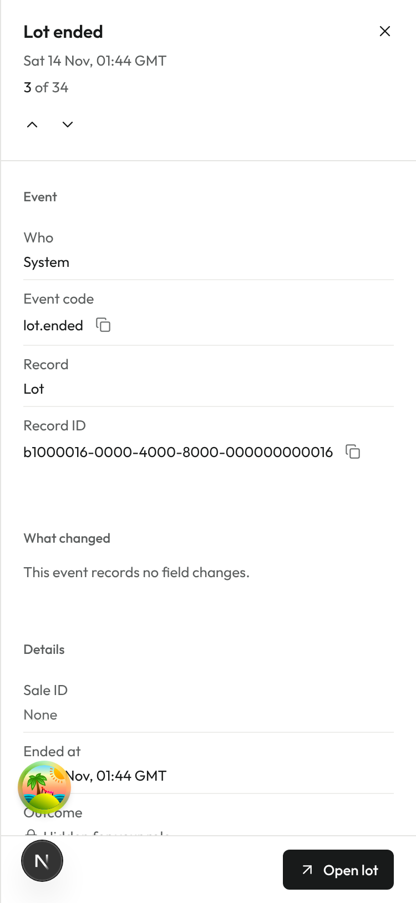 |

What to look for: the position under the title ("3 of 5"); the ↑ ↓ step buttons beside "Open full page" (or "Open lot" / "Open client" where the record has no page of its own); and, on a phone, the panel at full width with its footer pinned to the bottom.
