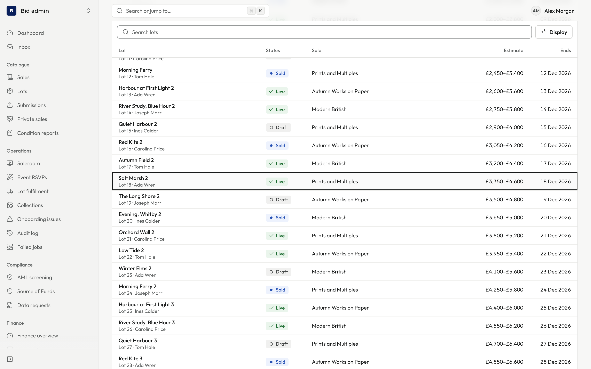
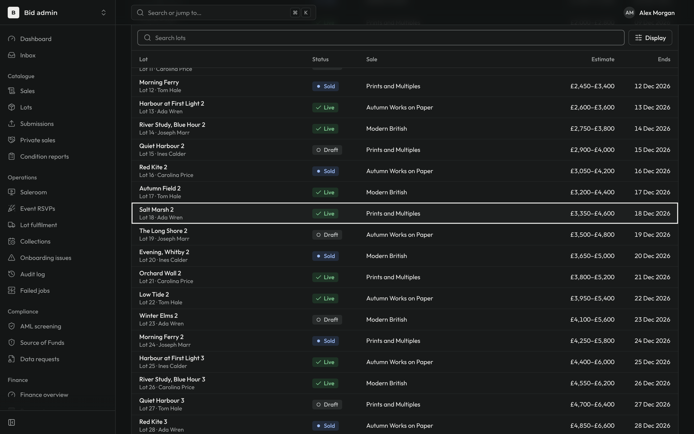
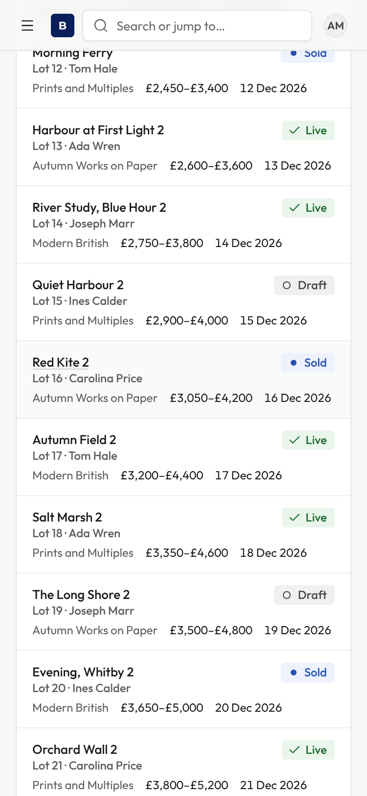
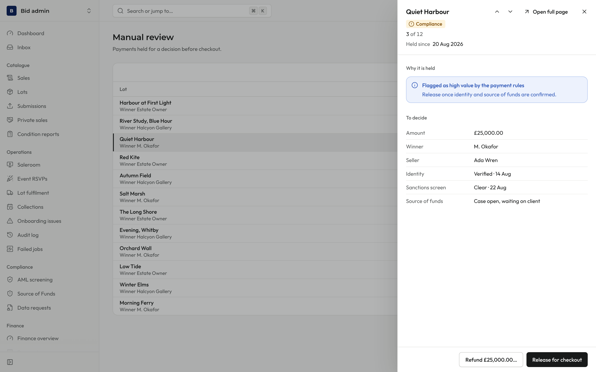
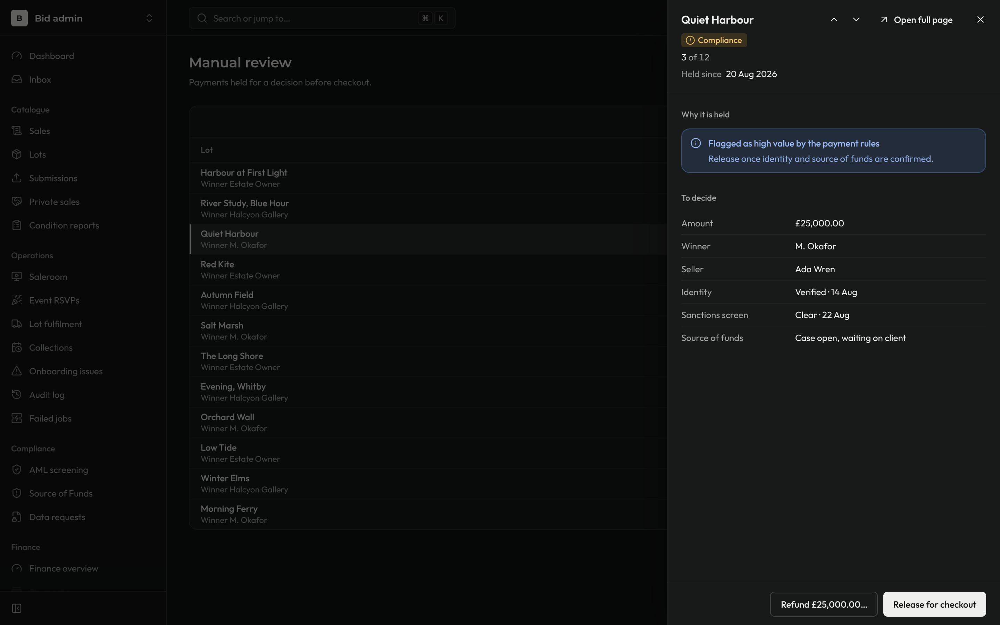
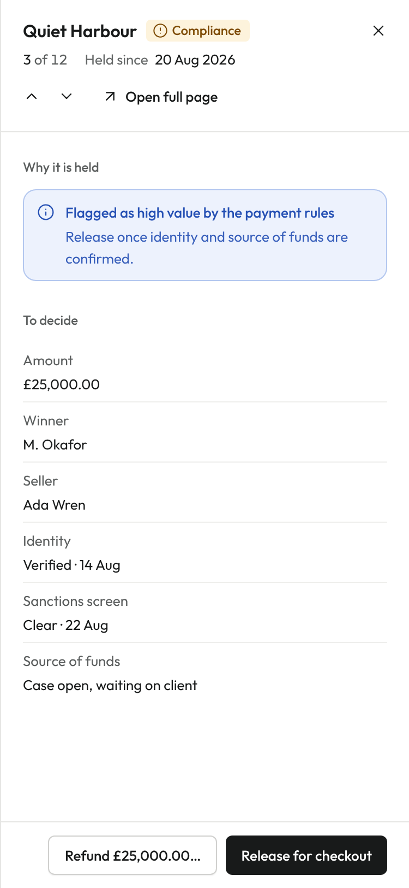

# Review notes: pull request #1358, round 1

These screenshots show "Lists: rows open their record, panels for work queues (shared parts)". They were taken on a temporary harness route under `next dev`, which is not committed. The route renders a kit `ListPage` and a queue `DetailPanel` with fixture data inside the real Bid admin frame. Captured with Playwright at 1440×900 (light and dark) and 375×812 (light), at device scale 2. Dev-only overlays (the Next.js and React Query buttons) are hidden.

## Record list after Back

Lot 18 was opened with Enter, then Back was pressed. The list returns to the same scroll position, and the row that was opened is focused and briefly tinted. The tint is colour only, so nothing on the page moves.

| Light, 1440 | Dark, 1440 |
| --- | --- |
|  |  |

On a phone, Red Kite 2 was tapped and the back gesture used. The card comes back tinted, at the same place in the list.

## Queue panel

Opened on row 2, then J pressed once. The panel shows "3 of 12", the ↑ ↓ step buttons and "Open full page" in the header. The list's row for the record shown is marked.

| Light, 1440 | Dark, 1440 |
| --- | --- |
|  |  |

## Queue panel on a phone

The panel fills the screen, with its actions in a footer that stays in view.

