# PR #1364, round 1: legal entities open their page, payouts step through a queue

From a local seeded stack (Postgres 16, db:migrate, db:roles, db:seed:dev), signed in as the seeded admin.
Desktop is 1440×900 in light and dark; phone is 375×812 in light.

## Legal entities

| | Light | Dark |
| --- | --- | --- |
| List, sorted by name (sort in the URL) | 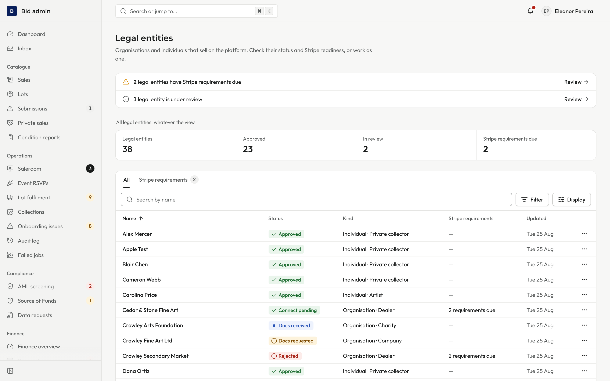 | 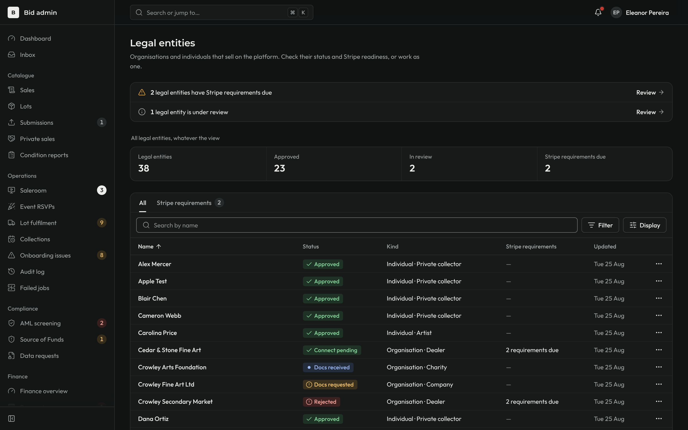 |
| Row clicked: the entity's page, "6 of 38" pager from the list | 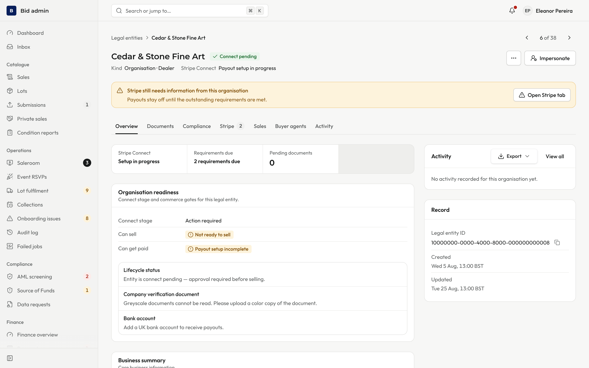 | 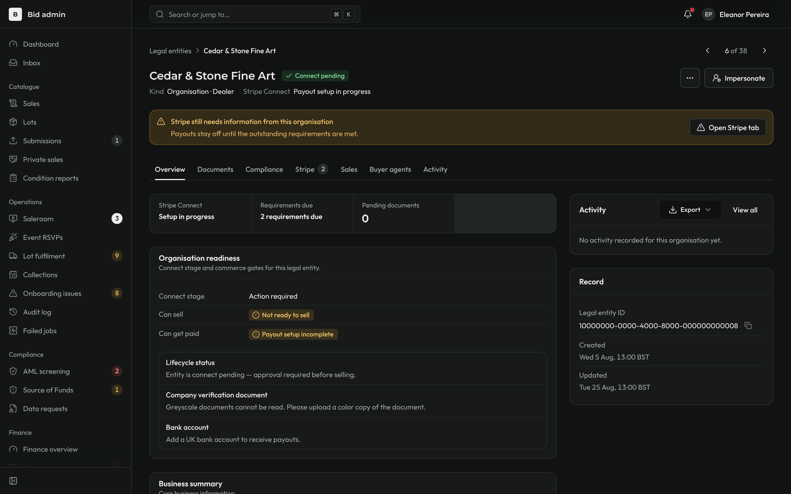 |
| Overview: readiness, and the business summary with Documents | 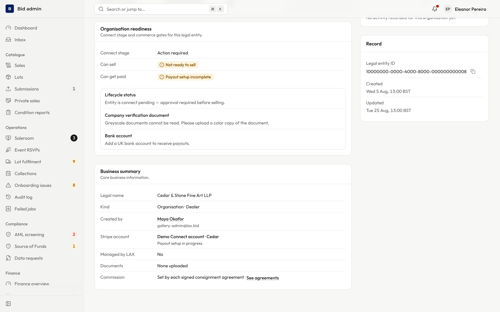 | 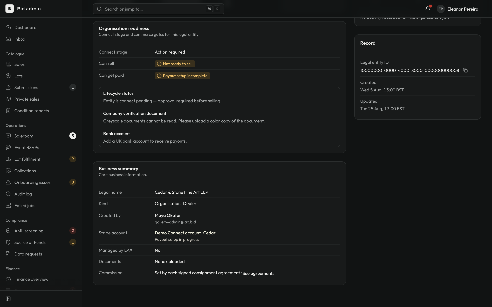 |

The readiness facts the old panel showed (Connect stage, can sell, can get paid, blockers, Stripe Connect, requirements, LAX-managed, created by, documents, updated, ID) are all on the Overview.

## Payouts

| | Light | Dark |
| --- | --- | --- |
| List | 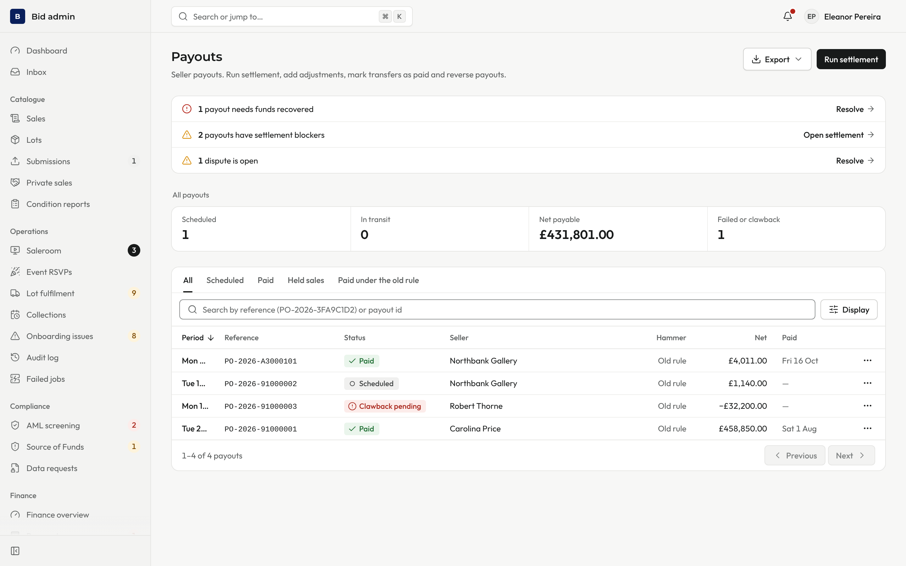 | 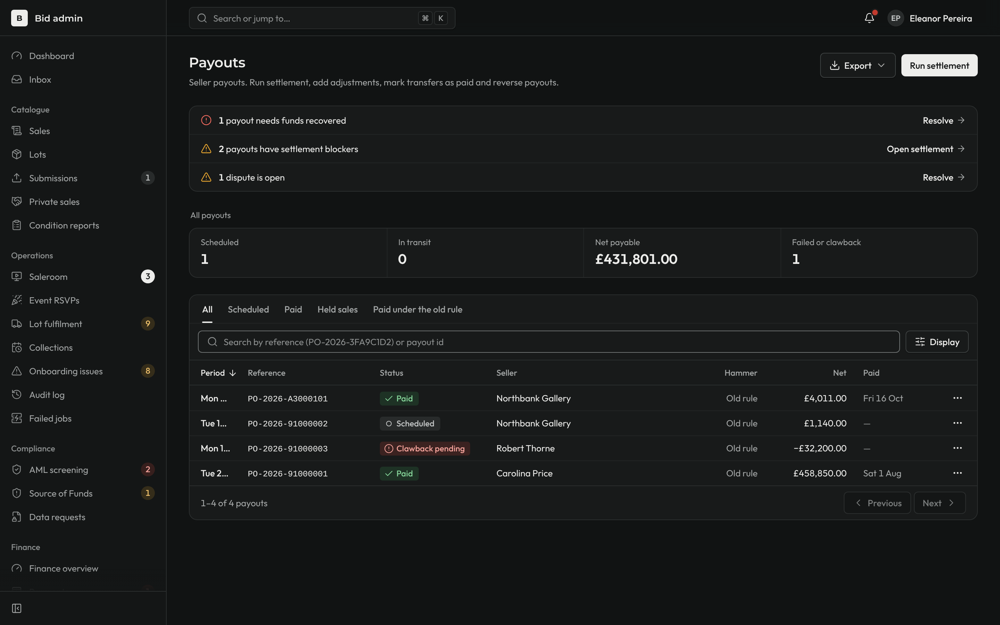 |
| First row opened, J pressed twice: "3 of 4", payout in the URL | 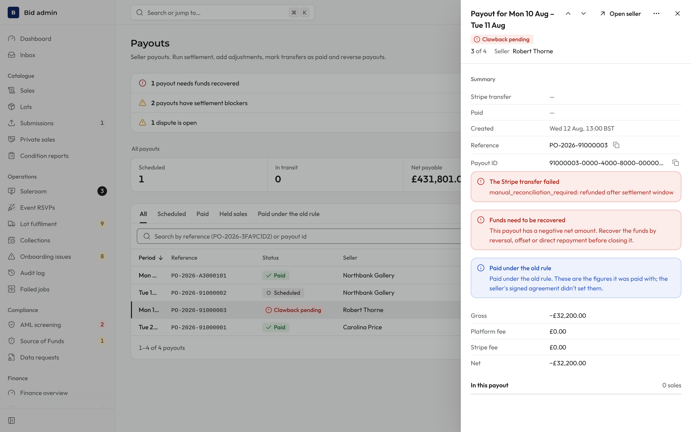 | 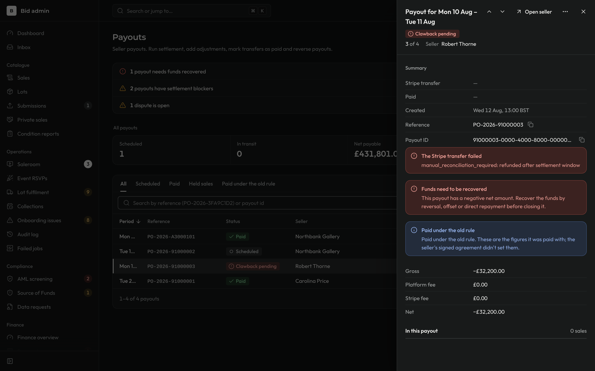 |

Phone, stepped twice with the arrow buttons: full screen panel, "3 of 4".

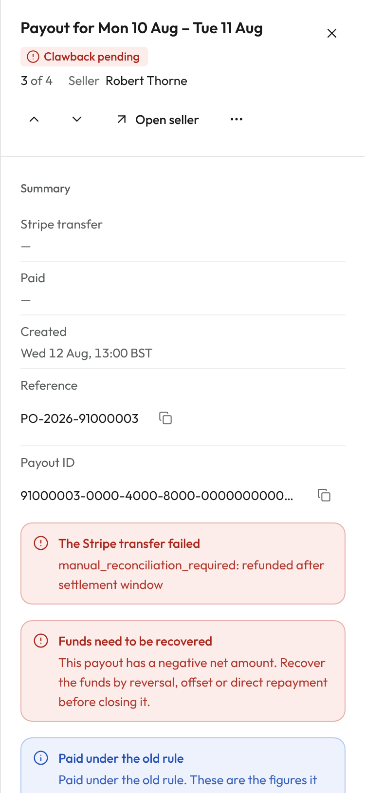

The seed has four payouts, so the queue shows "3 of 4". The clawback payout shown has no footer actions for this payout.
