# PR 1363, round 1: Bid admin client and staff rows open their page

Seeded local stack (dev seed), signed in as the seeded administrator. 1440x900 in light and dark, 375x812 light. Lot thumbnails are blank because file storage was not running locally.

| Screen | 1440 light | 1440 dark | 375 light |
|---|---|---|---|
| Clients list: rows open the client page | 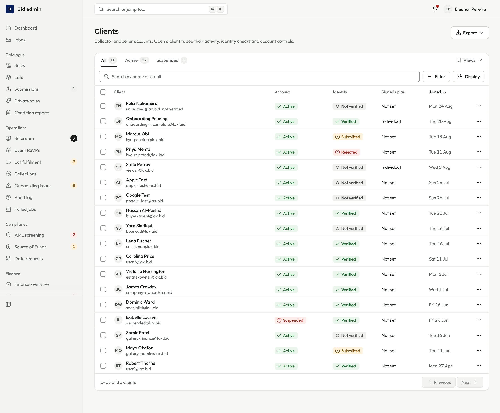 | 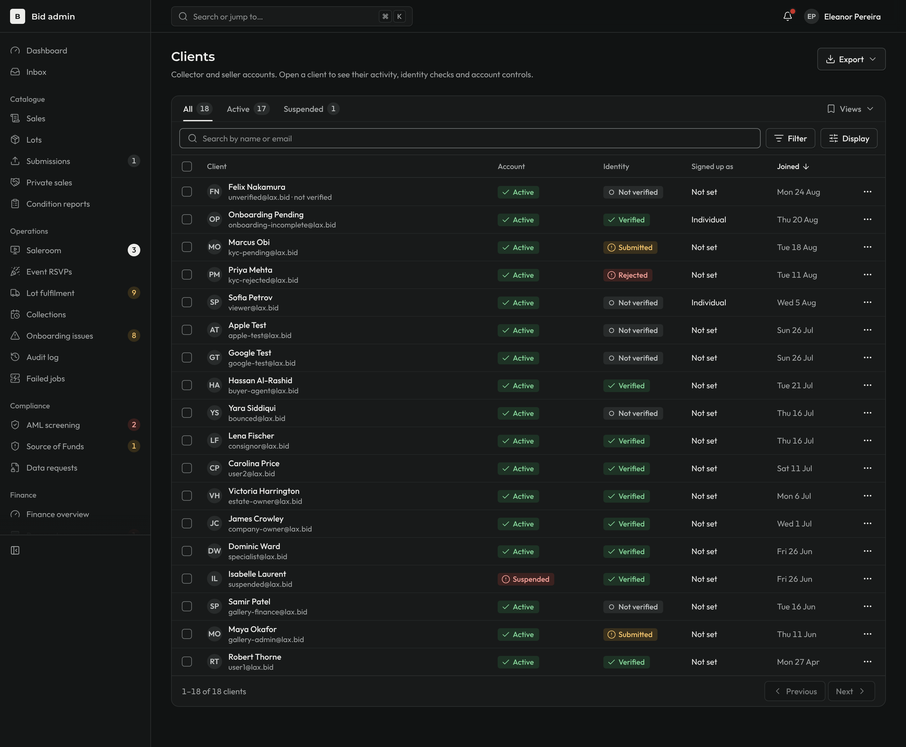 | 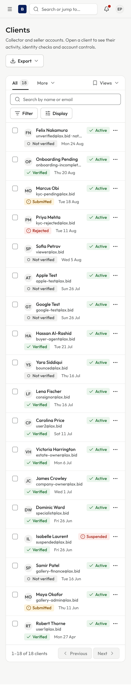 |
| Client page opened from row 4 of the list: record pager "4 of 18" | 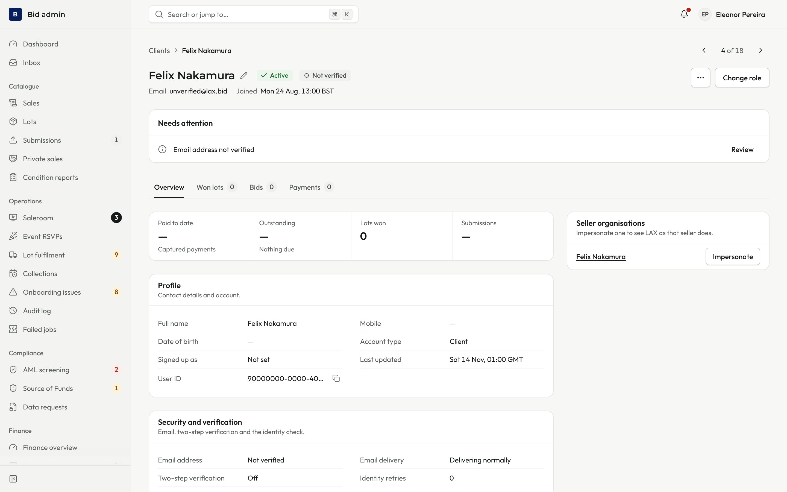 | | |
| Clients after Back: the opened row is marked (Felix Nakamura) | 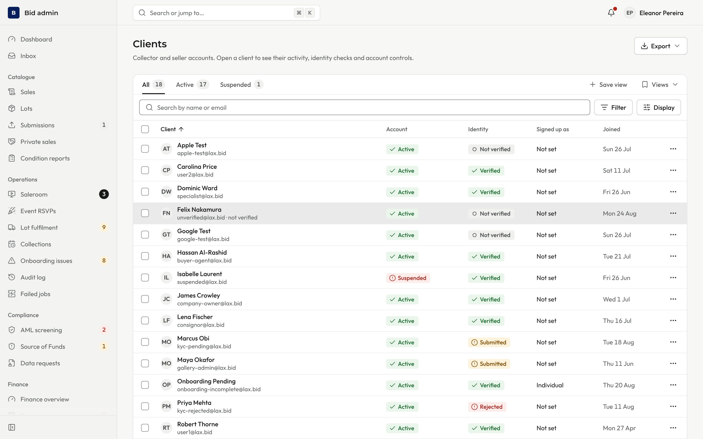 | 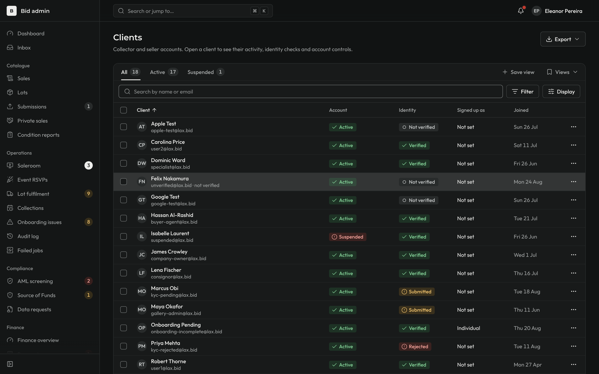 | 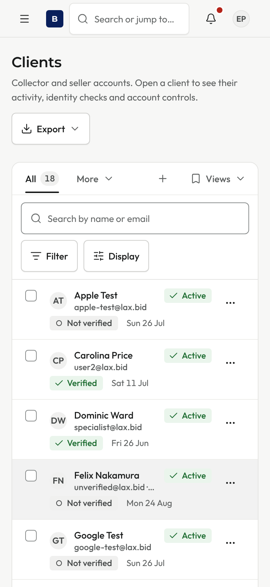 |
| Staff directory | 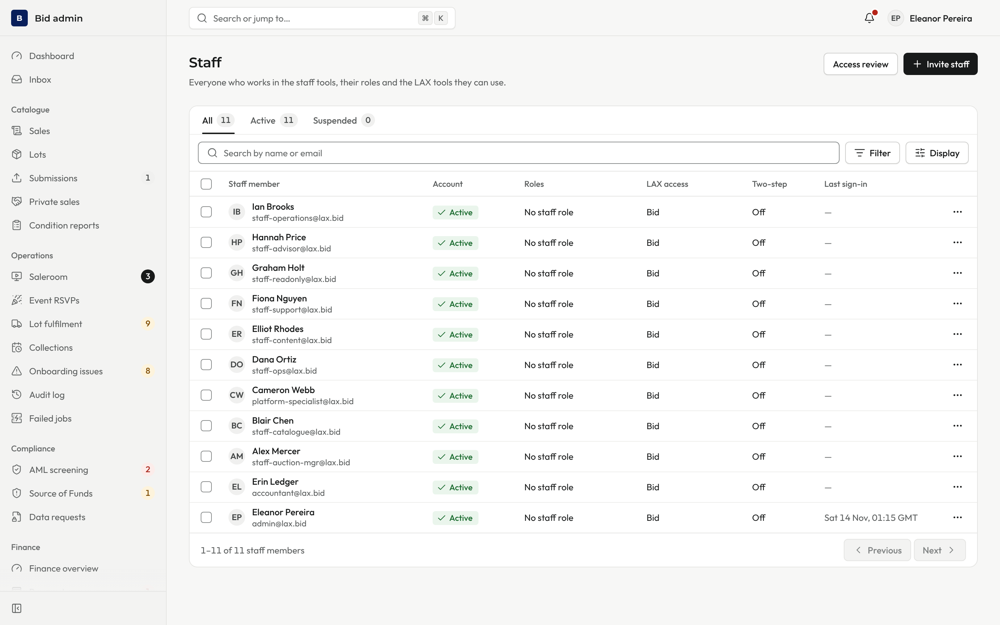 | 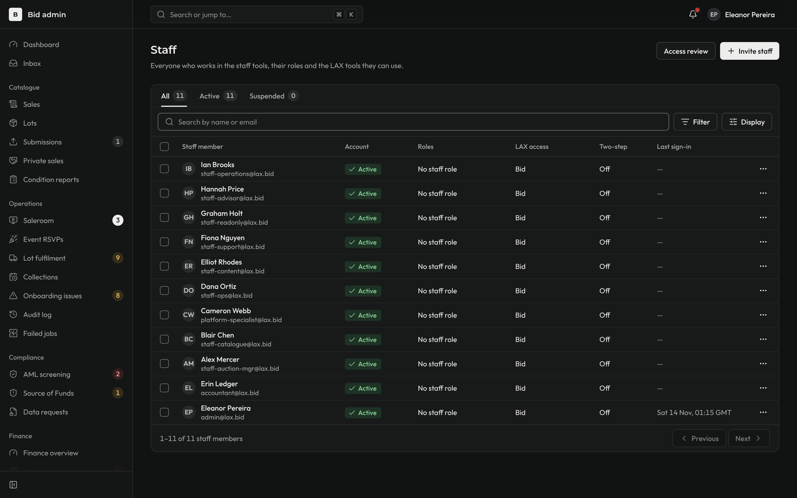 | 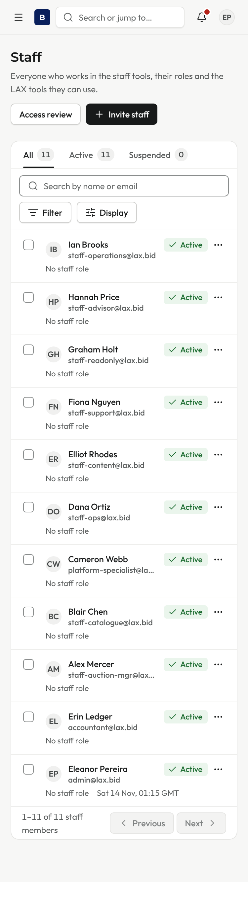 |
| Staff access review: rows open the staff page | 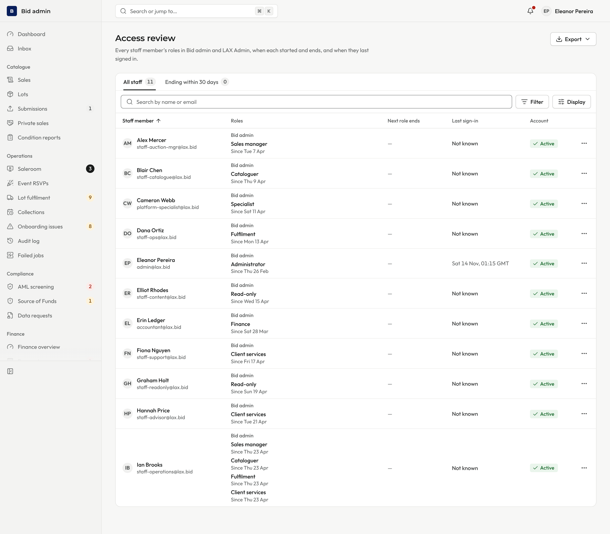 | 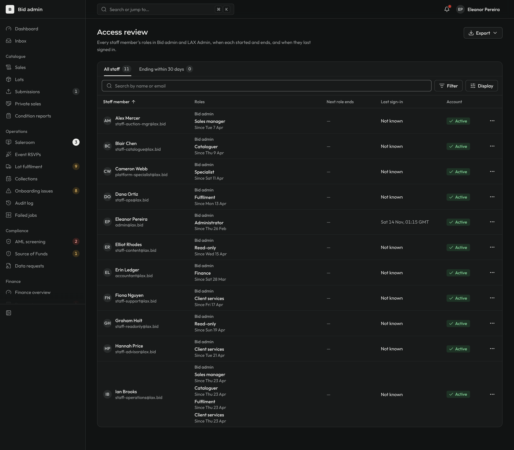 | 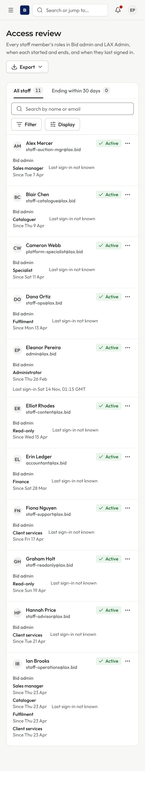 |
| Client page, Won lots tab: hovering a related row, which opens the lot | 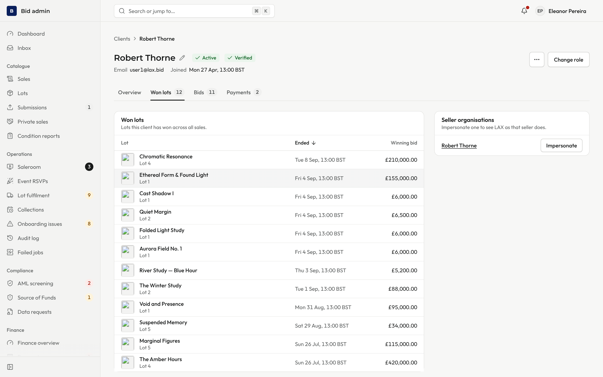 | 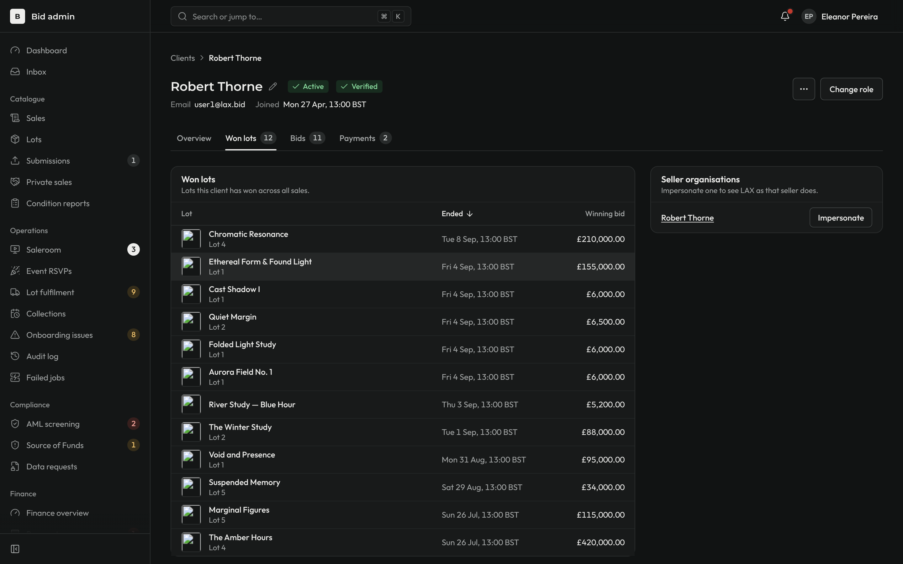 | 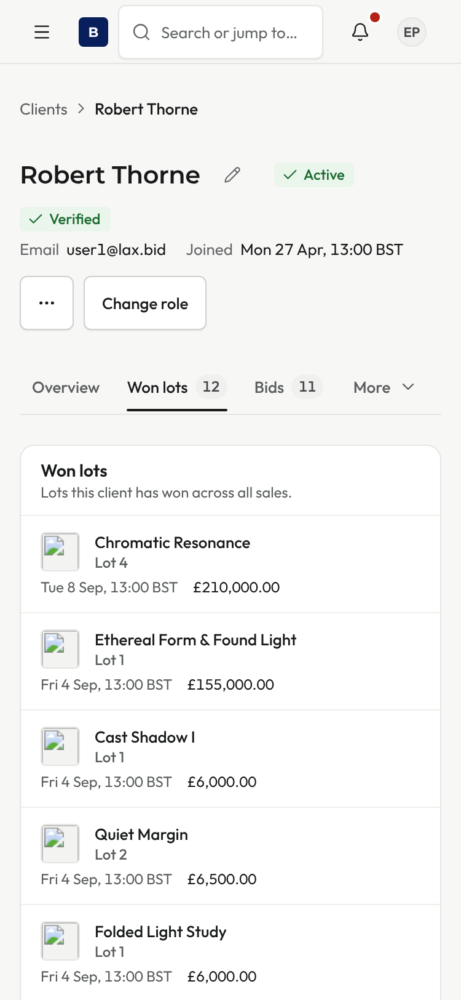 |

Note: the "after Back" shots were taken in a tab where another page was loaded first. When the list is the first page in the tab, the row is not marked on Back (shared kit issue, described in the PR).
