# PR #1368: LAX Admin work queues step through their panels (round 1)

These were taken on a local seeded stack: Postgres 16 on a throwaway port, then `db:migrate`, `db:roles`, `db:seed:dev`, shop-api `seed:catalogue` and `seed:acceptance-staff-operations`. I was signed in as the seeded shop admin, at commit `371360f`. The browser was Playwright at 1440×900 in light and dark, and 375×812 in light.

Data changes made only for these shots, in the throwaway database:
- One payout was made due, so Mark paid shows as active.
- Stock holds were added directly. Holds are behind `SHOP_THIRD_PARTY_ENABLED` locally, and two of them were released while testing.

The round "N" at the bottom left is the Next.js dev-mode indicator.

| Queue | 1440 light | 1440 dark | 375 light (full-screen panel) |
|---|---|---|---|
| Fulfilment: "3 of 5", Next step, Open order | 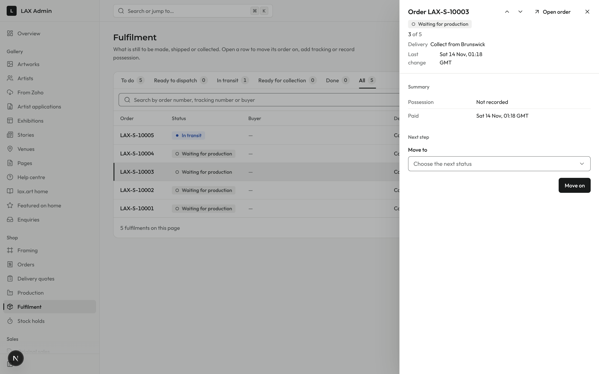 | 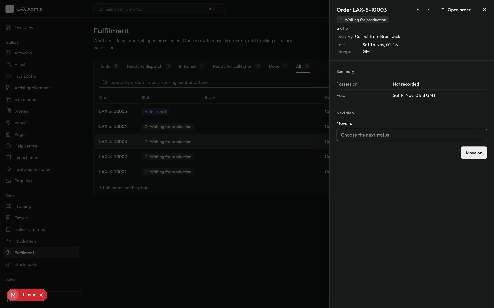 | 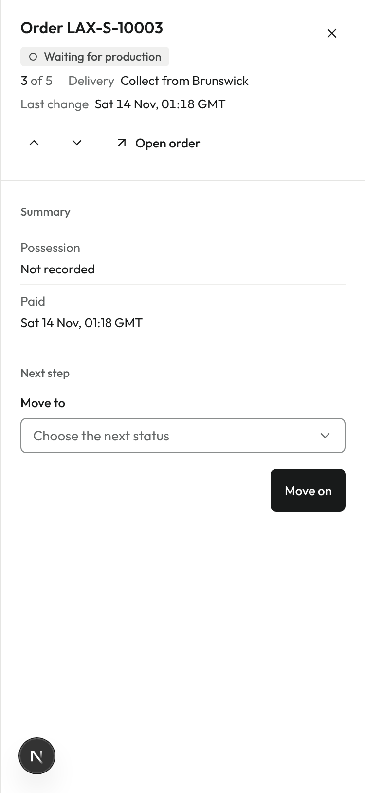 |
| Payouts: "1 of 2", Mark £650.00 paid in the footer |  | 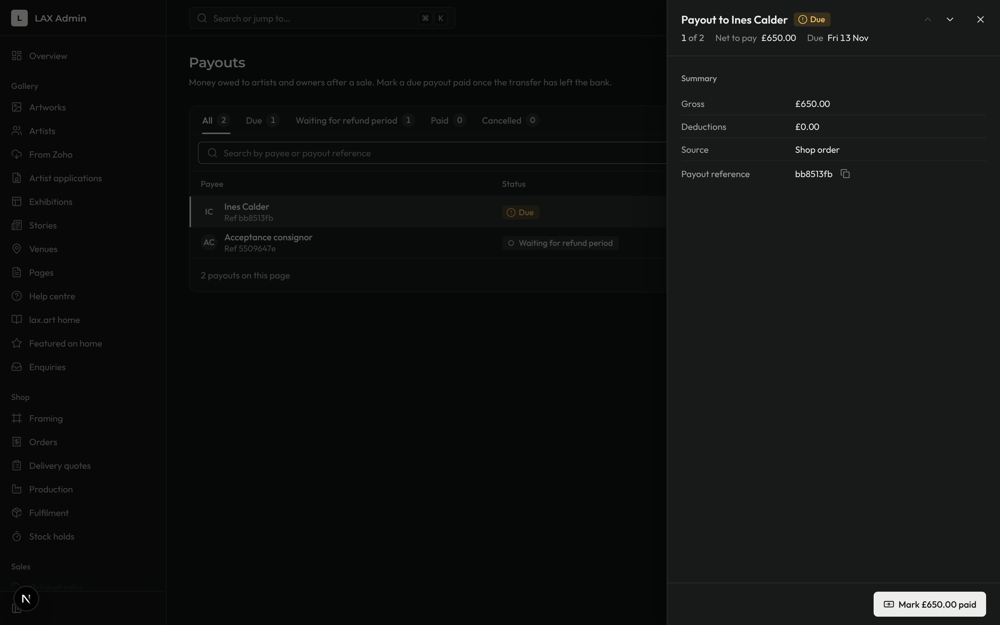 | 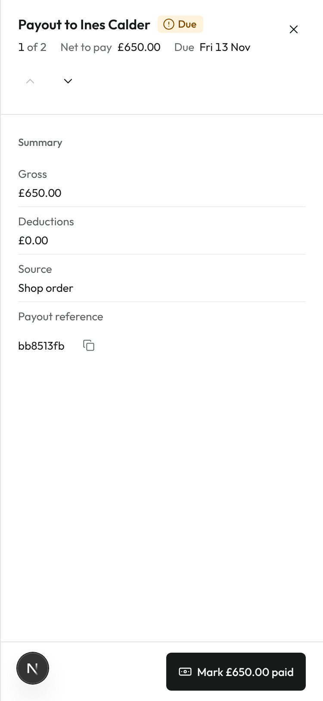 |
| Stock holds: an active hold with Release hold | 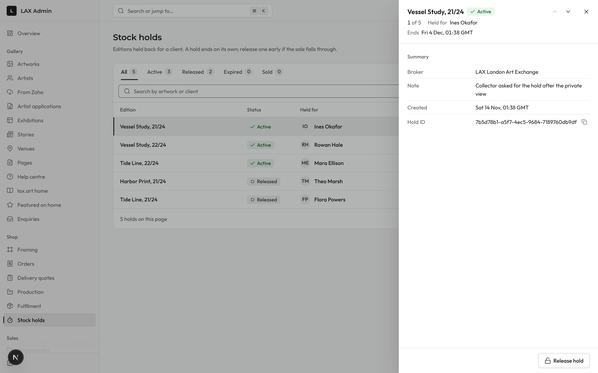 | 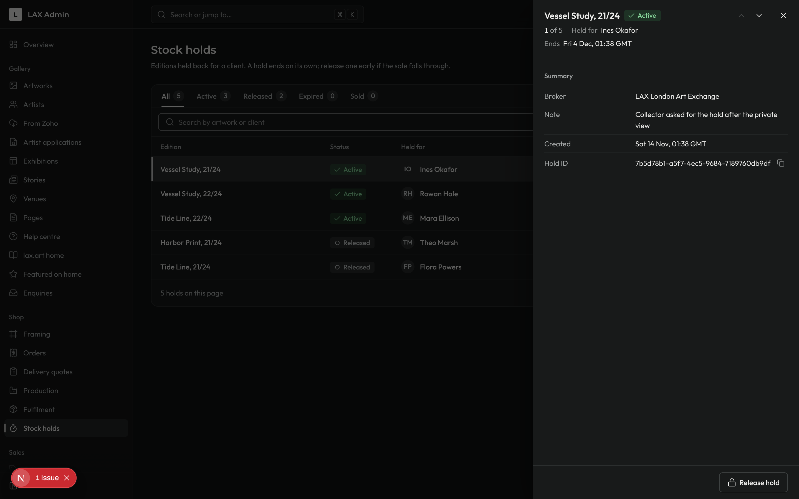 | 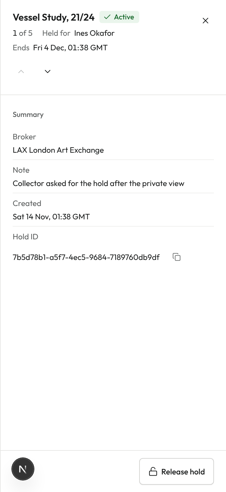 |
| Audit log: an event, "2 of 27" | 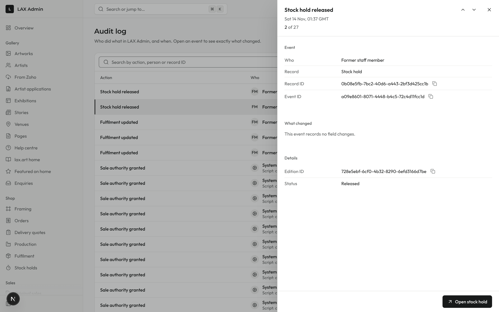 | 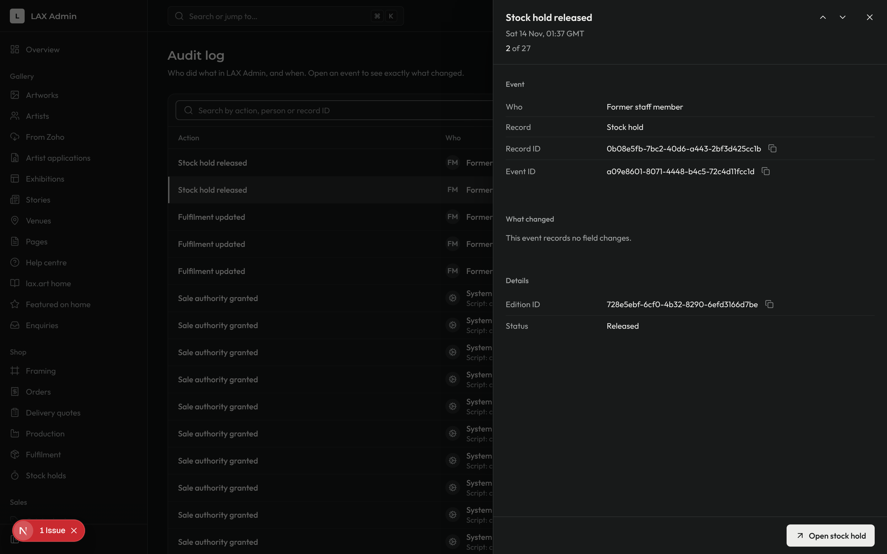 | 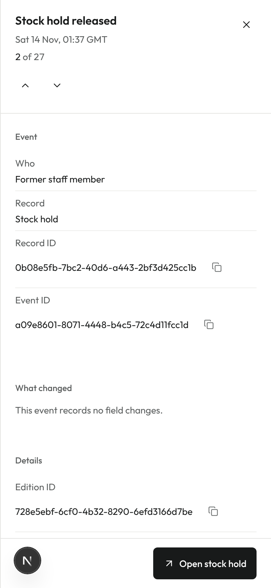 |

Each panel's address is in the browser's URL, for example `/fulfilment?view=all&fulfilment=…`. On a phone the panel fills the screen, its footer stays in view, and Back closes it. The local e2e journey `e2e/local/work-queues.journey.ts` checks this.
