# PR #1362 screenshots, round 1

Seeded local stack (throwaway Postgres 16 on 55432, `db:migrate`, `db:roles`, `db:seed:dev`, shop-api catalogue, demo and staff-operations seeds), signed in as the seeded administrator. For screenshots only, copies of the seeded orders (30 in total) and one dispute were added to the throwaway database. Taken with Playwright at 1440x900 (light and dark) and 375x812 (light), device scale 2.

## Orders list, sorted by total (sort now in the URL)

**1440-light**: `/orders?sort=-total`

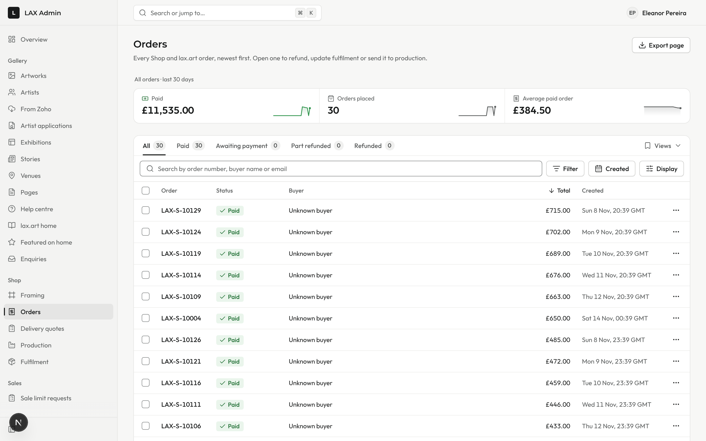

**1440-dark**: `/orders?sort=-total`

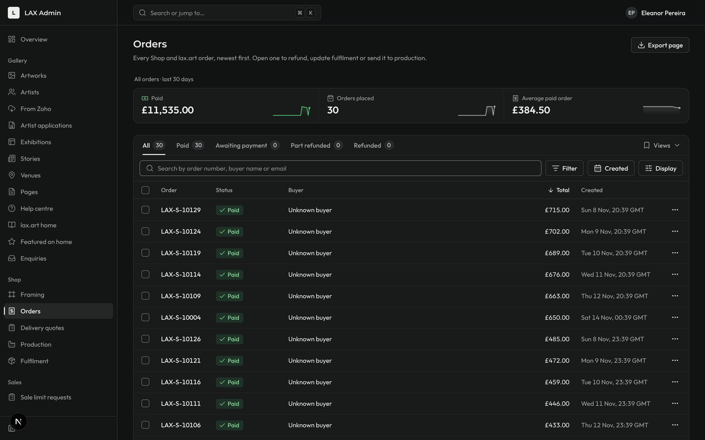

**375-light**: `/orders?sort=-total`

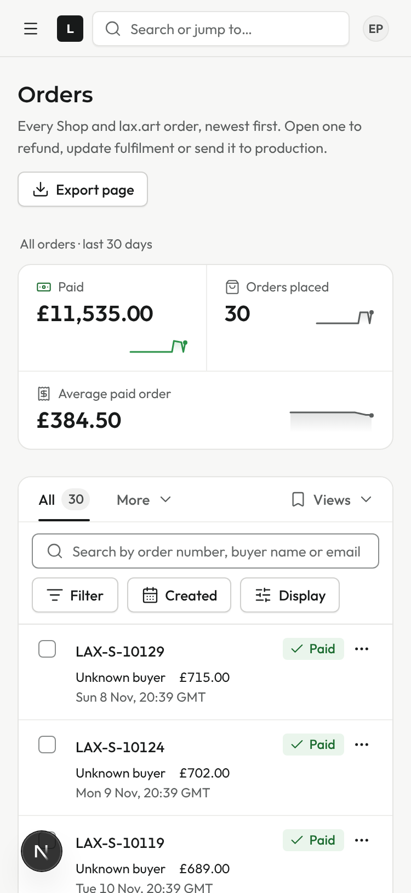

## Orders after opening LAX-S-10003 and pressing Back: same sort and scroll, row focused and marked

**1440-light**: `/orders?sort=-total`

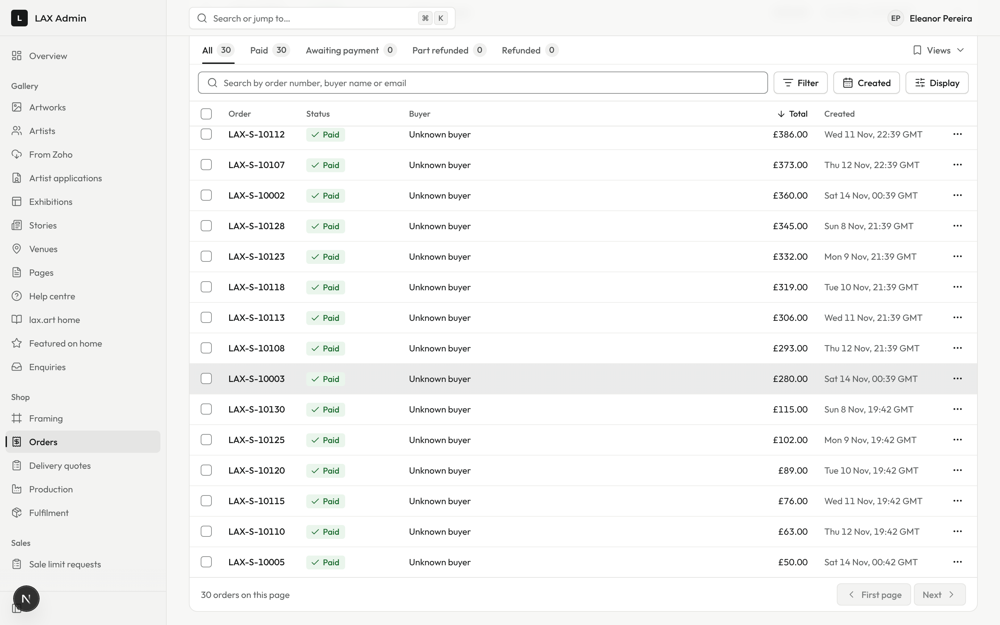

**1440-dark**: `/orders?sort=-total`

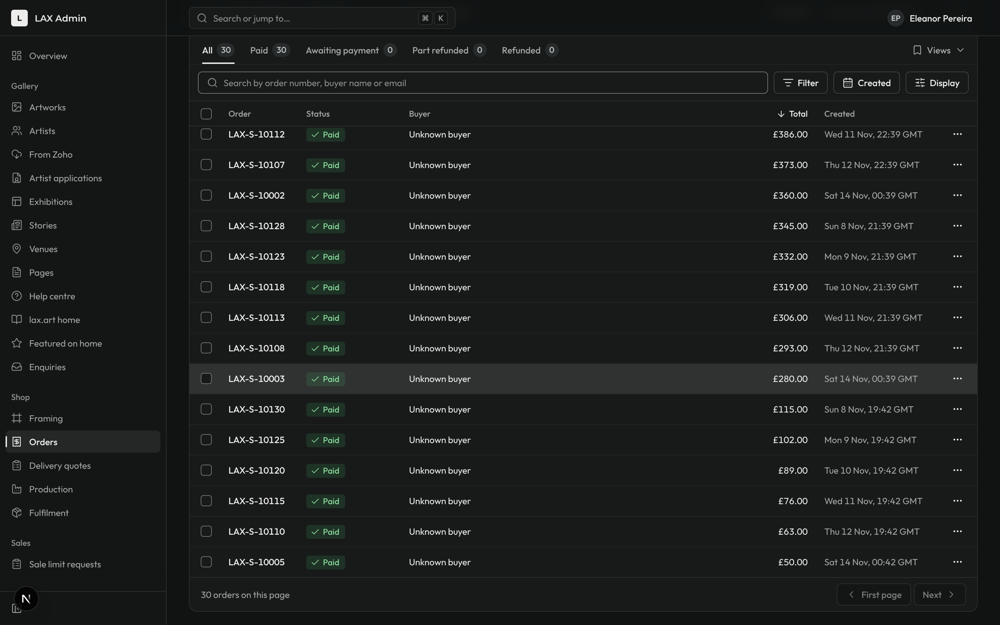

**375-light**: `/orders?sort=-total`

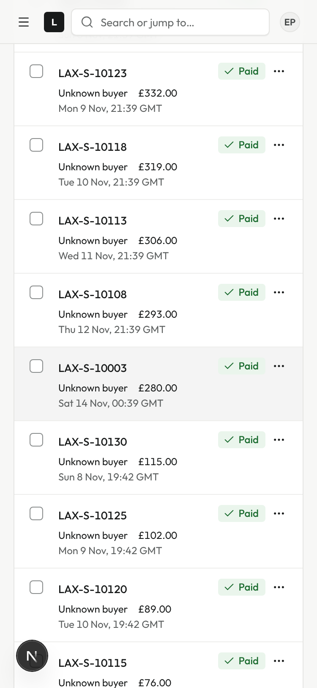

## Clients list: rows open the client page

**1440-light**: `/clients`

**1440-dark**: `/clients`

**375-light**: `/clients`

## Staff list: roles in the row, no panel; the name links to the Bid admin staff page (arrow and "opens Bid admin"); hovered on desktop

**1440-light**: `/staff`

**1440-dark**: `/staff`

**375-light**: `/staff`

## Disputes list (one local dispute added to the throwaway DB)

**1440-light**: `/disputes`

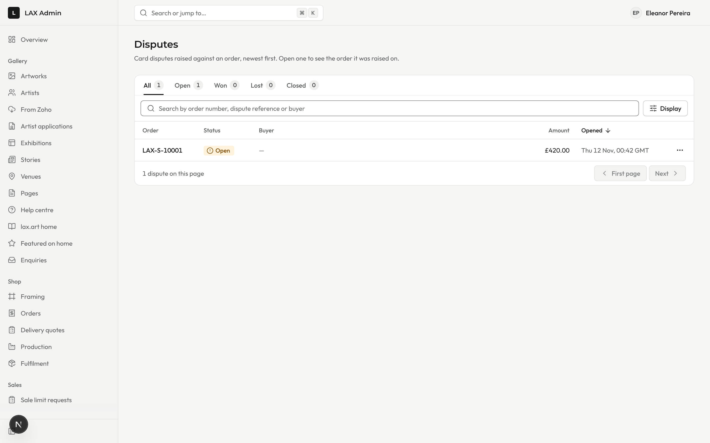

**1440-dark**: `/disputes`

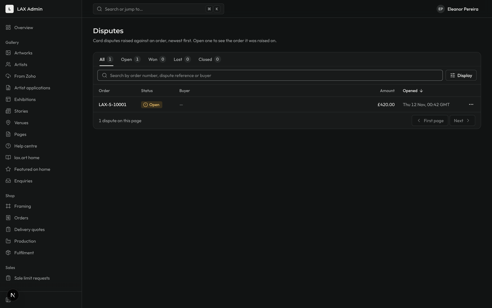

**375-light**: `/disputes`

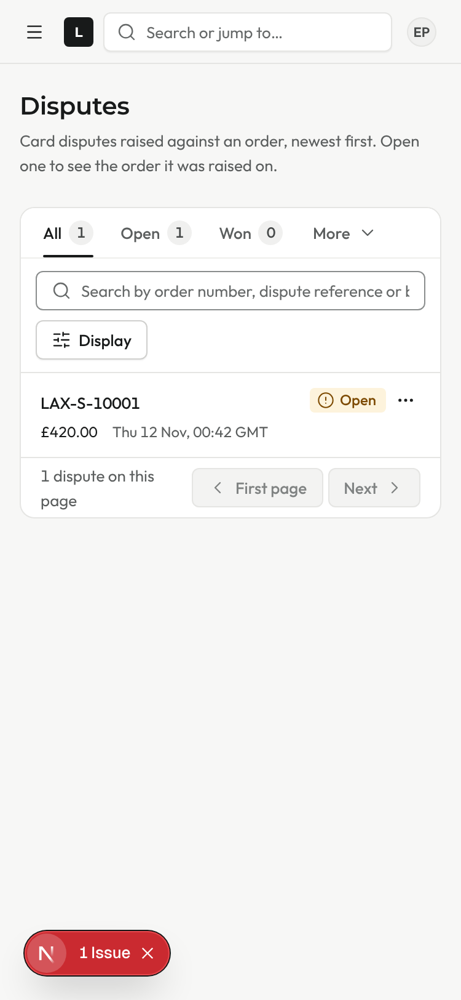

## Where a dispute row goes: its order at #payment

**1440-light**: `/orders/cc2beda2-0b79-49ab-a69b-855d1f7d39fb#payment`

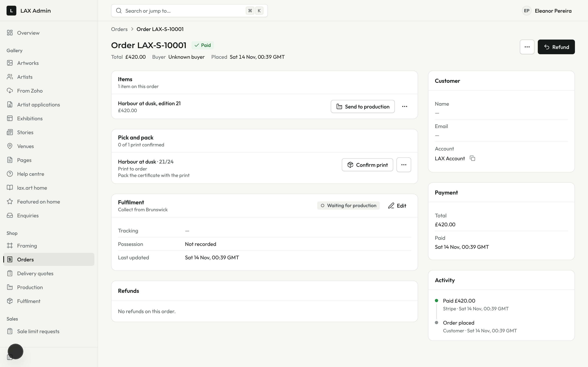

**1440-dark**: `/orders/cc2beda2-0b79-49ab-a69b-855d1f7d39fb#payment`

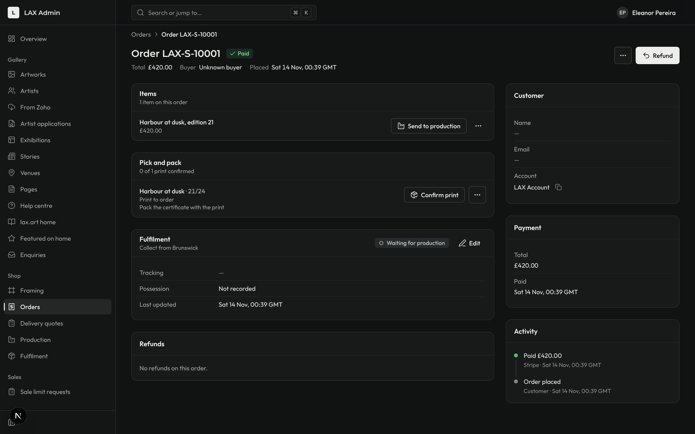

**375-light**: `/orders/cc2beda2-0b79-49ab-a69b-855d1f7d39fb#payment`

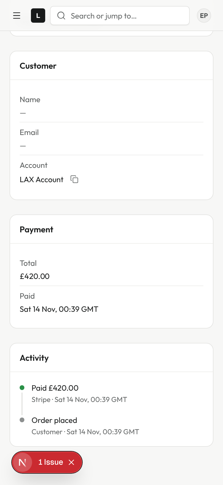
