# PR #1361, round 1: Bid admin catalogue rows open their page

Local seeded stack (Postgres 16, `db:migrate`, `db:roles`, `db:seed:dev`), `next dev`, signed in as the seeded admin. Chromium, device scale 2. "Dark" switches the page's theme class only for the capture. The round badge at the bottom left is the Next.js dev indicator, not part of the app.

| Screen | 1440×900 light | 1440×900 dark | 375×812 light |
|---|---|---|---|
| Lots list (`/admin/lots?sort=endingAsc&limit=25`) | 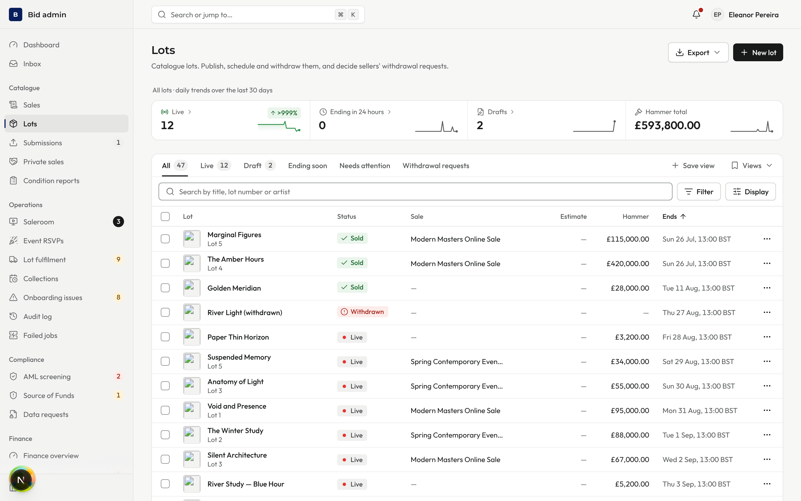 | 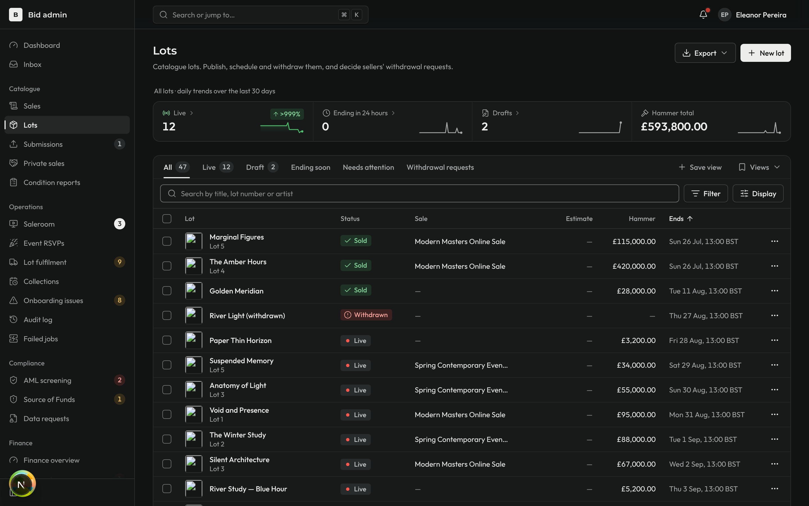 | 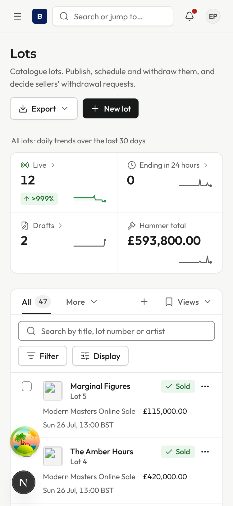 |
| Lot page opened from the list's 7th row: "7 of 25" with Previous and Next | 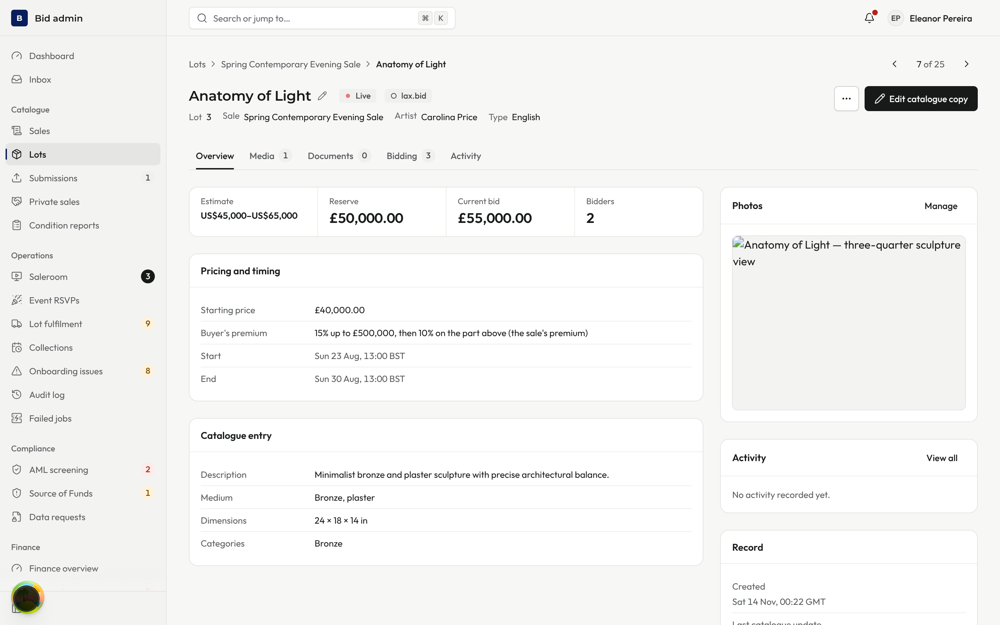 | 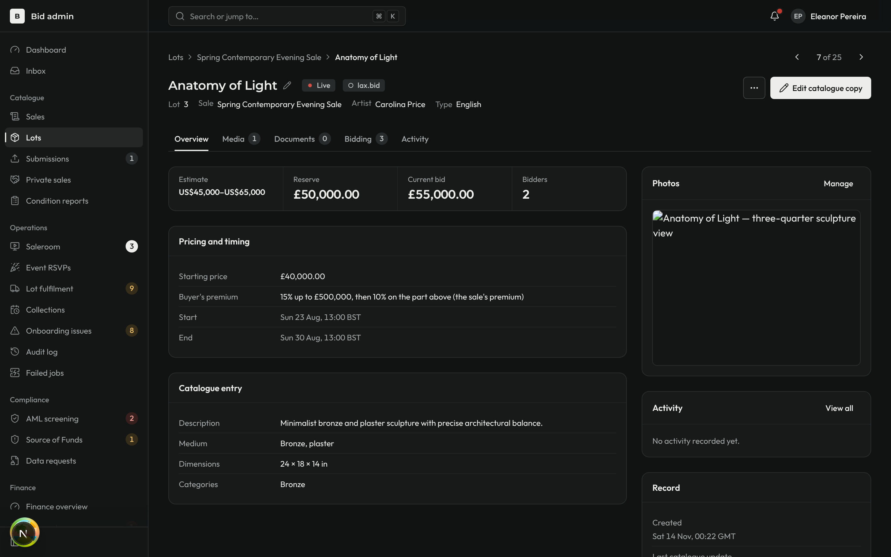 | 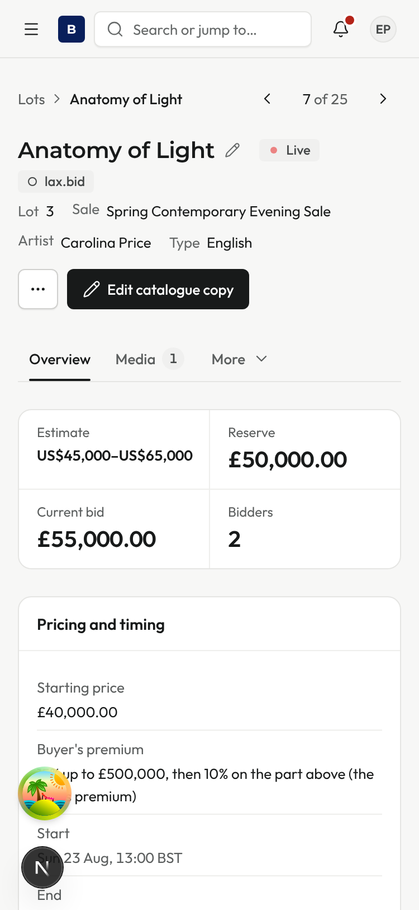 |
| Lots after Back: same URL, the opened row focused and marked (on a phone, its title link) | 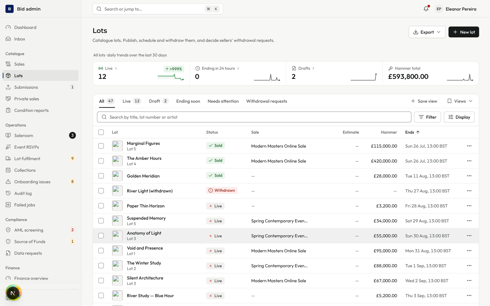 | 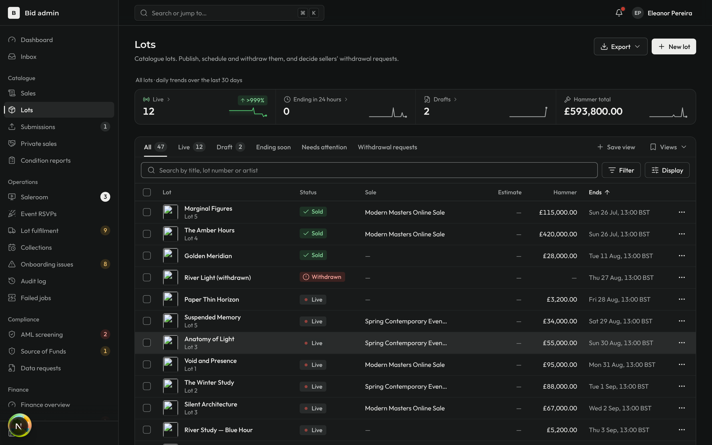 | 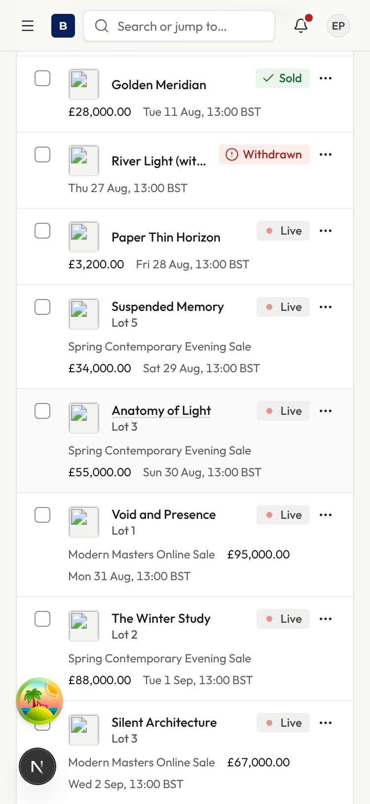 |
| Sales list (`/admin/sales`) | 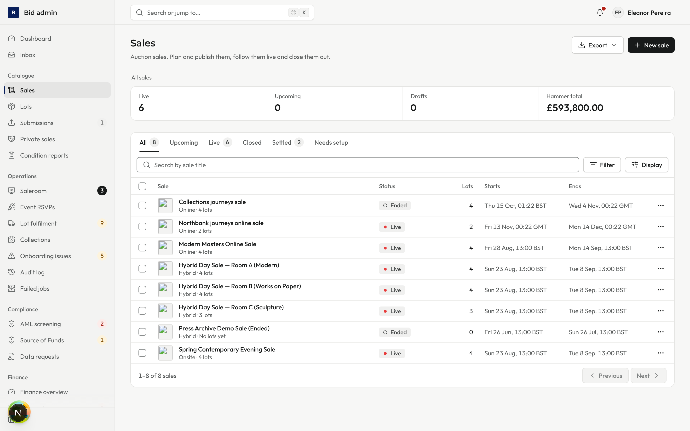 | 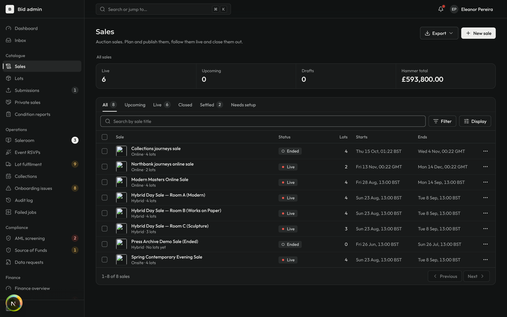 | 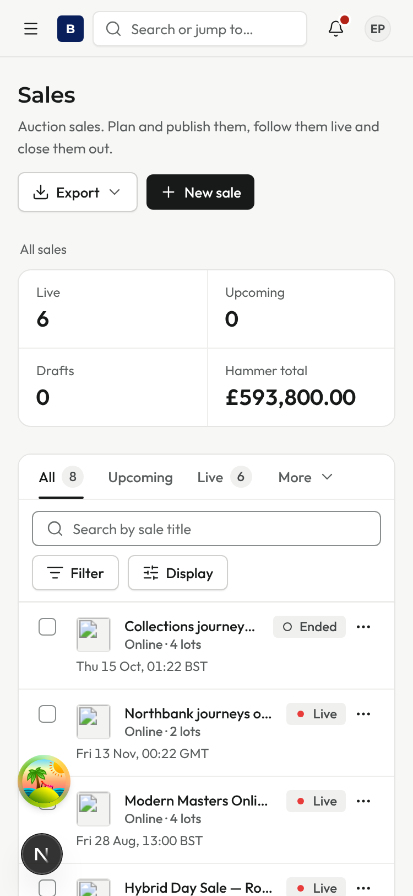 |

Notes
- Lot images are blank because file storage was not running locally.
- After Back, focus was on the opened row ("Anatomy of Light") at both desktop sizes and on its title link on the phone, and the phone's scroll position was restored (751px).
