# PR #1356: Zoho Books, Bid invoices (rehearsal): screenshots, round 1

The real `PurchaseDetail` page, inside the real organisation client layout (`ClientShell`), rendered from fixture data on a temporary, uncommitted dev route under `next dev`. All data is fixture data. Dates are shown in London time, in the shared style.

The card states below appear only once Books issues invoices for real (`test_org` or `live`). While Books is off or in dry run, the buyer sees today's LAX invoice unchanged.

| State | 1440×900 light | 1440×900 dark | 375×812 light |
| --- | --- | --- | --- |
| Preparing | 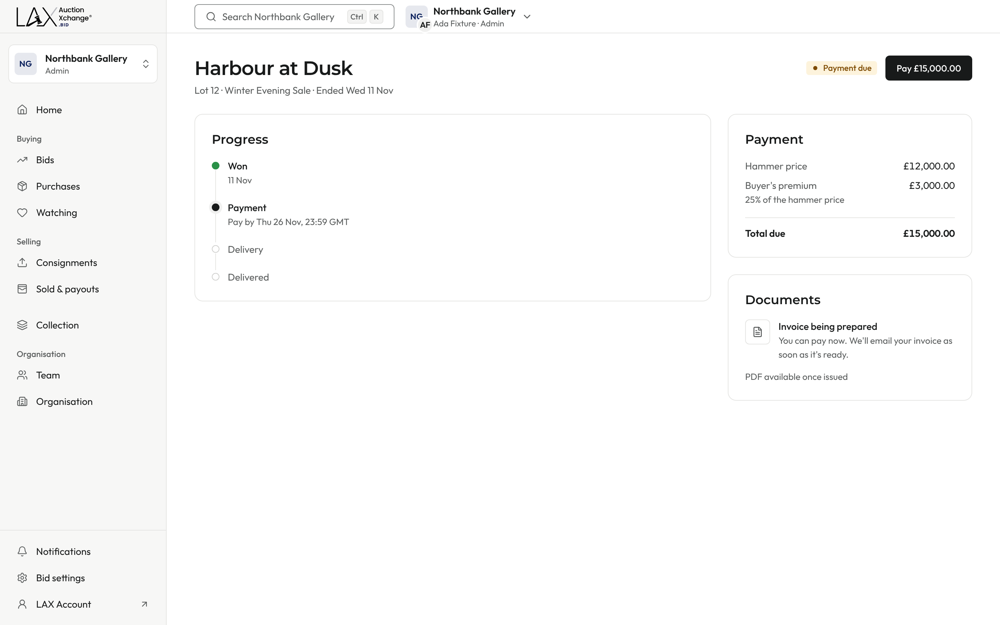 | 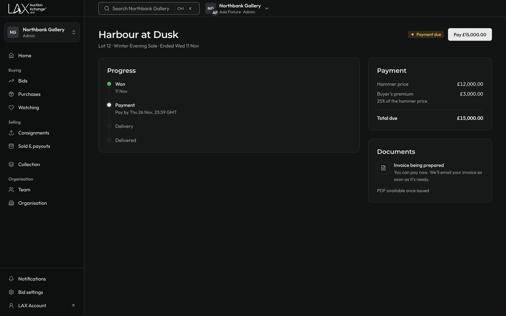 | 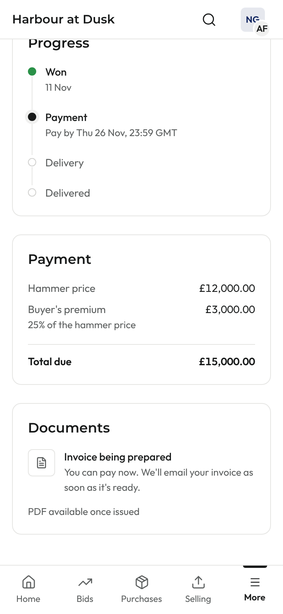 |
| Delayed (>30 min) | 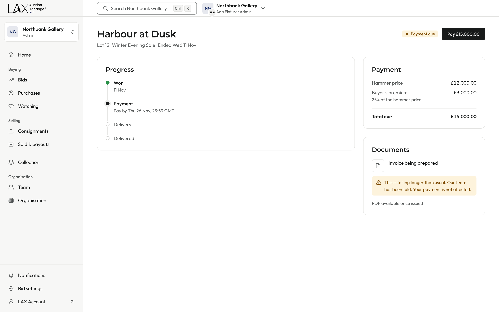 | 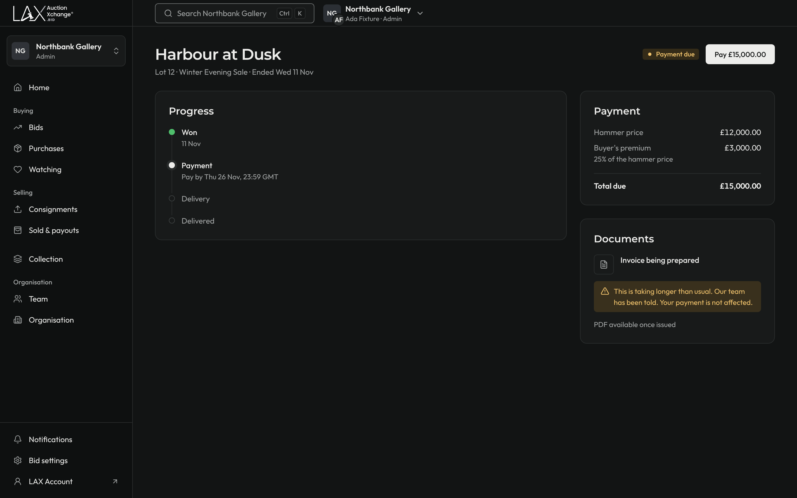 | 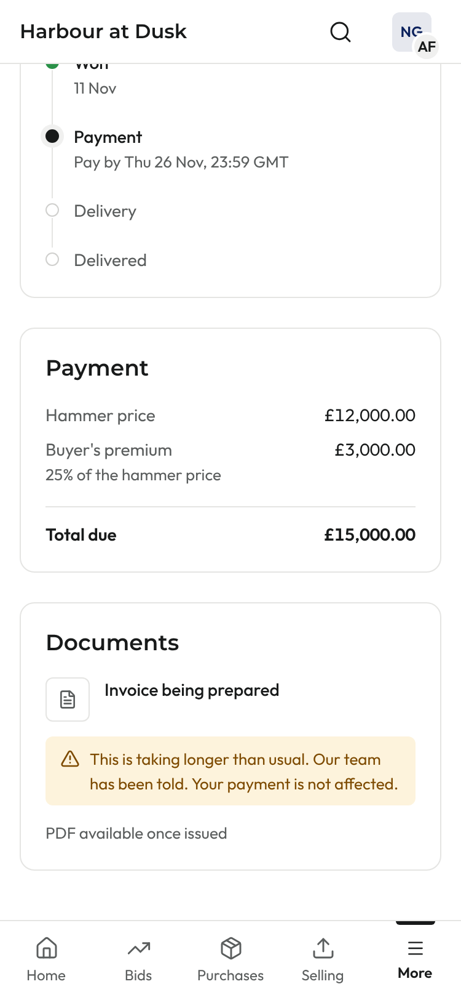 |
| Issued | 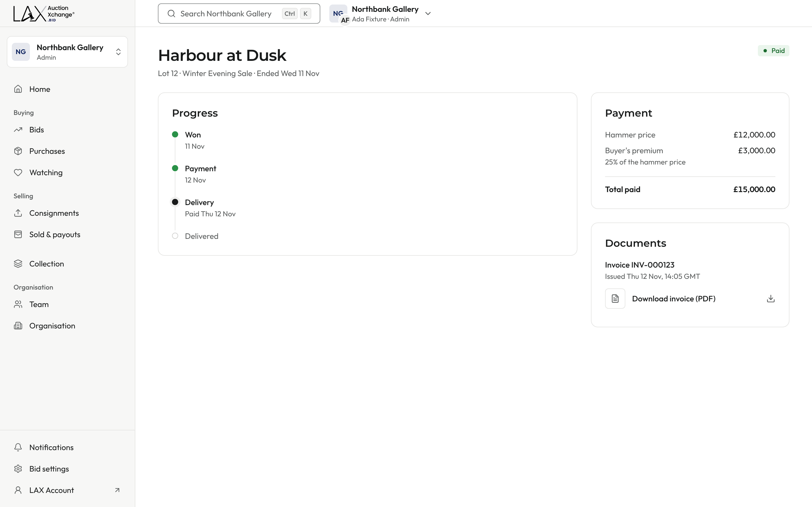 | 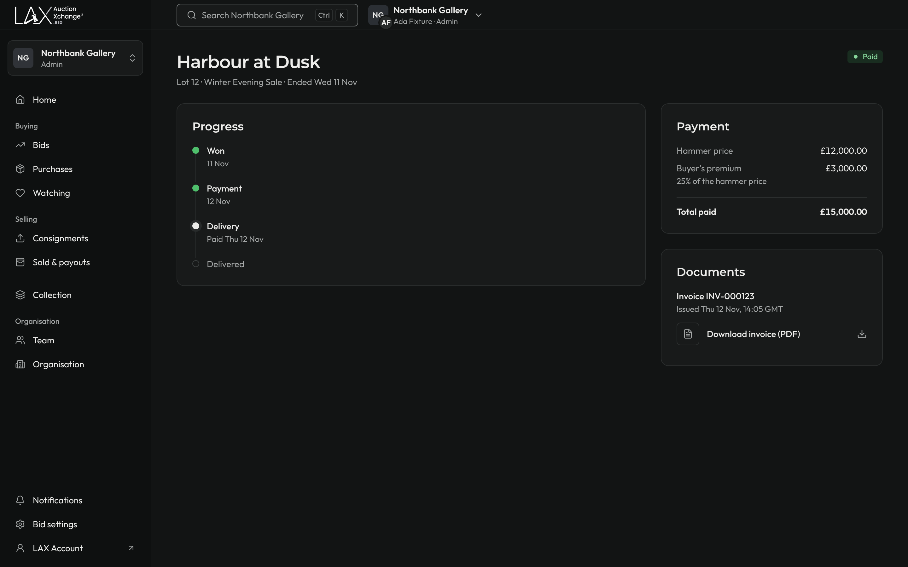 | 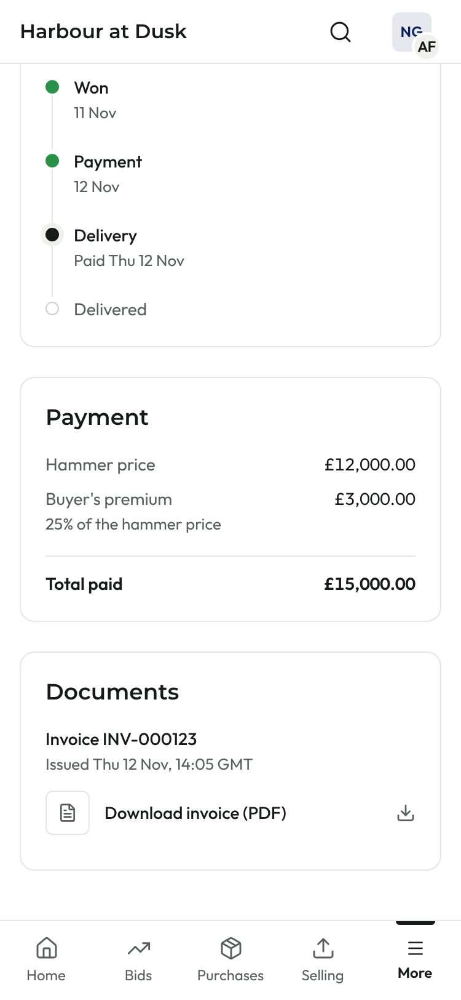 |
| Refunded in part (credit note) | 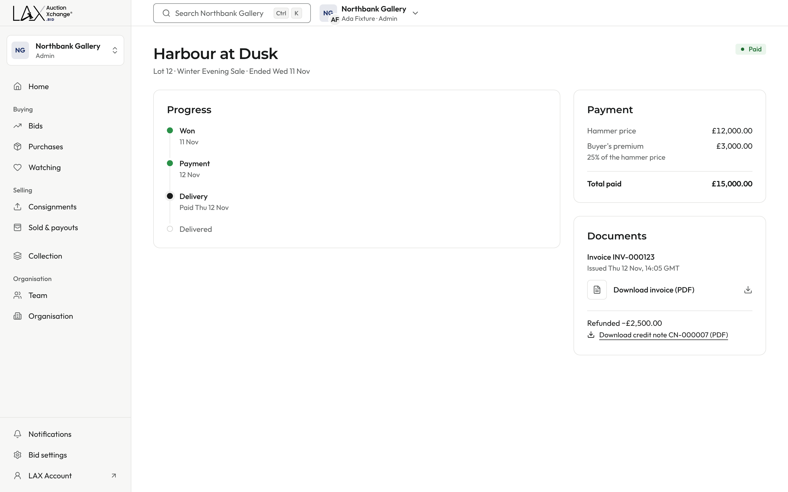 | 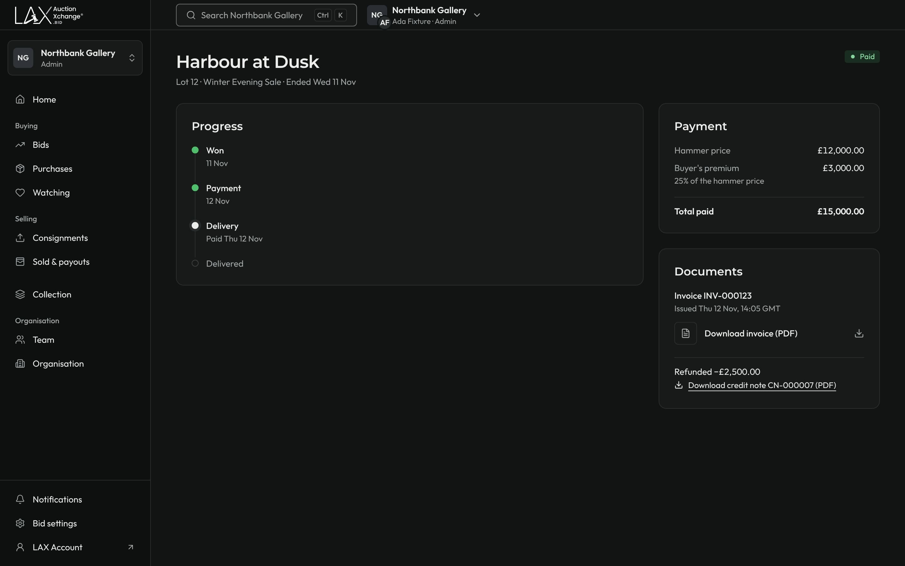 | 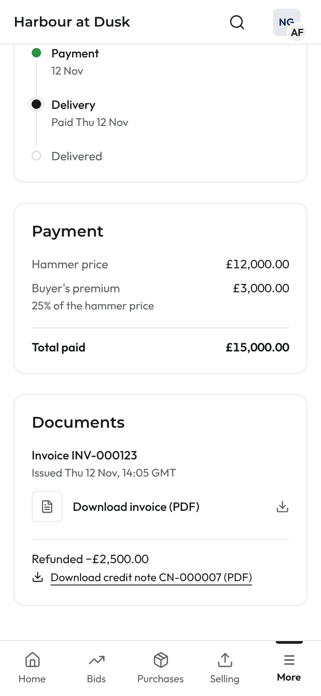 |
| Cancelled | 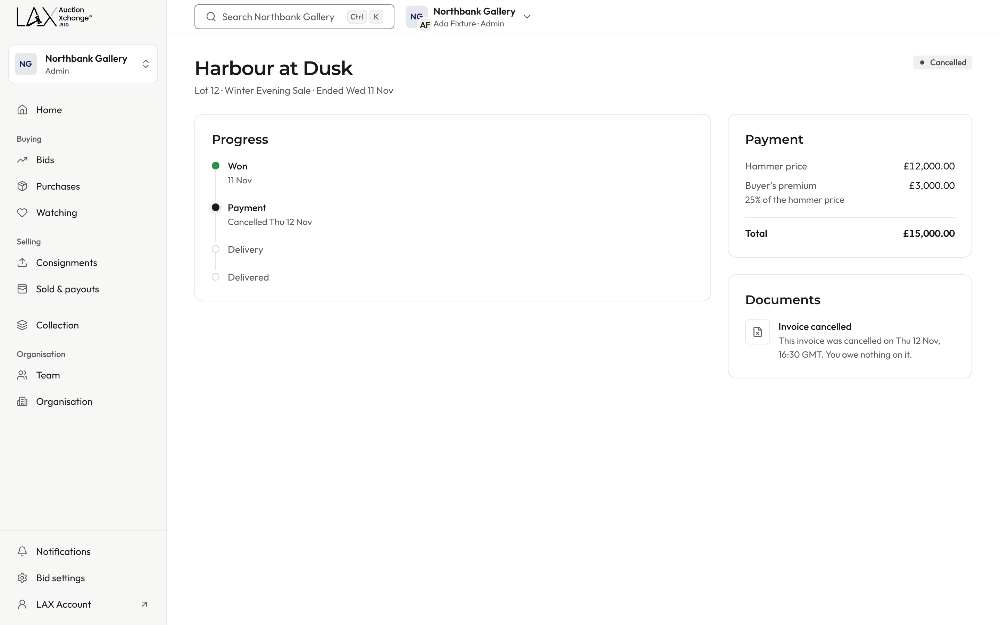 | 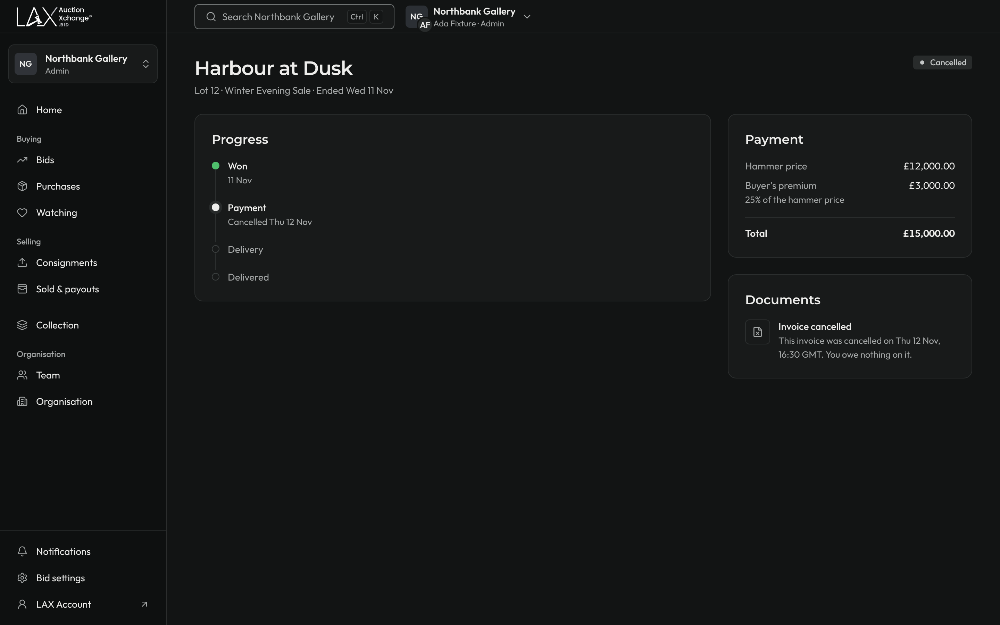 | 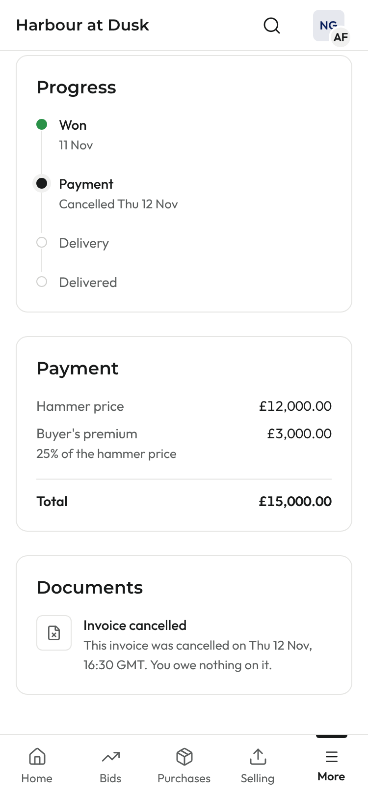 |

## "Your invoice" email

This is the real `bid-invoice-issued` template, rendered with `renderEmail`. The strip at the top was added only for this screenshot; it shows the subject and the attachment name.

| Paid | Still due |
| --- | --- |
|  | 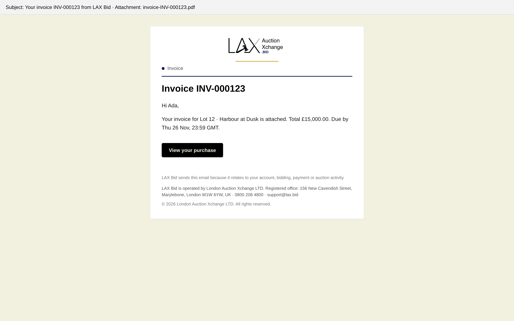 |

On mobile, each capture is scrolled to the Documents panel. Before capturing, the dev-only overlays (the Next.js indicator and the TanStack Query devtools button) were removed and the cookie banner was dismissed.
