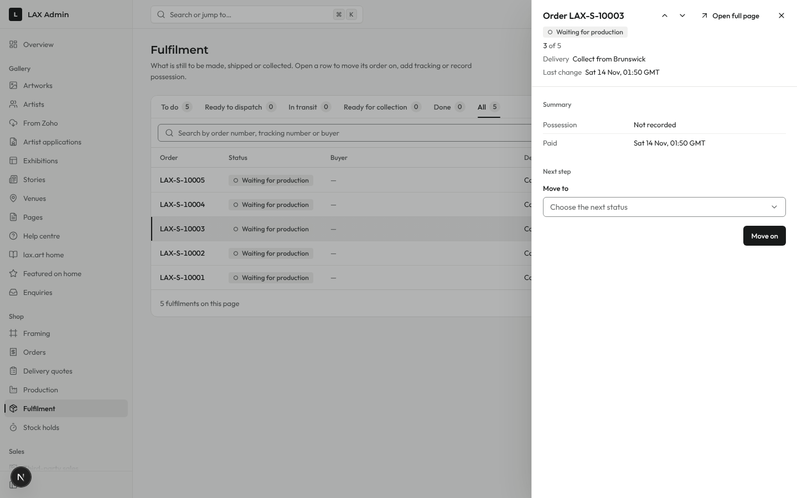
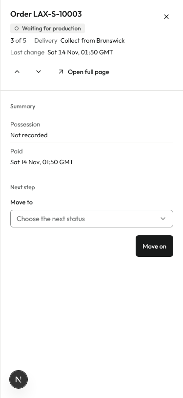

# PR #1368: LAX Admin work queues step through their panels (round 2)

Fulfilment panel after the design-conformance fix, taken on the same local seeded stack and Playwright harness as round 1 (Postgres 16, `db:migrate`, `db:roles`, `db:seed:dev`, `seed:catalogue`, `seed:acceptance-staff-operations`, signed in as the seeded shop admin). Light theme only. The round "N" at the bottom left is the Next.js dev-mode indicator.

What changed:
- The header action reads "Open full page", through the shared `DetailPanel` `fullPage` prop, in place of "Open order" (the order page is this record's full page, rule R5).
- "Last change" and its value stay on one line, at 1440 and at 375. The shared `MetaItem` no longer wraps its label or value.

| Panel | 1440 light | 375 light (full-screen panel) |
|---|---|---|
| Fulfilment: "3 of 5", Open full page, Last change on one line |  |  |

The other queue panels in this PR have no header link to their own record's page, so none needed changing. The audit panel's "Open …" link goes to a different record (the event's target) and stays in the footer.
