# PR #1346 · Sellers: show commission and VAT from the signed agreement · round 2

Re-rendered after the round 1 review, the same way as round 1: the real seller components in the client workspace layout (organisation: Northbank Gallery, owner), with fixture data through a temporary, uncommitted dev route under `next dev`, captured by Playwright at 2x scale. Only the states touched by the fixes are here.

Fixture: hammer £82,000.00 at 15% gives commission £12,300.00, VAT £2,460.00, and you receive £67,240.00. The fixture now holds the payout the paid-out row belongs to, so the Payouts tab reads 1.

Branch head at capture: `sc4-seller-wording` (2d0b40b0).

## What changed

1. **Sold & payouts on a phone.** The row now shows the two money facts together, in the desktop order and at the same weight: "£82,000.00 hammer · £67,240.00 you receive". If the line wraps, each amount stays with its label. The status badge comes after them. A figure we don't know yet reads "you receive: After payment" or "you receive: Being confirmed" beside the hammer. The phone-only "you receive" fact in the meta line is gone. `RecordRow` takes a new opt-in prop, `figuresNarrow="all"`. Every other list keeps the default.
2. **One minus sign.** The repo's money formatter (`formatDeduction`) uses U+2212 "−". This sign is now used everywhere:
   - the payout page, on desktop and phone
   - the payouts CSV, where commission and VAT on commission are now deductions like `commission_and_fees`
   - the statement PDF, which now embeds the repo's Noto Sans (already used by the invoice PDF) because the base Helvetica font has no "−"

   On the payout page, each signed amount is kept whole, so a line never ends with a minus sign.
3. **Fixture.** The tab now reads Payouts 1, which matches "paid out yesterday".

## Sold & payouts, 375

| State | 375 light | 375 dark |
|---|---|---|
| Paid out | 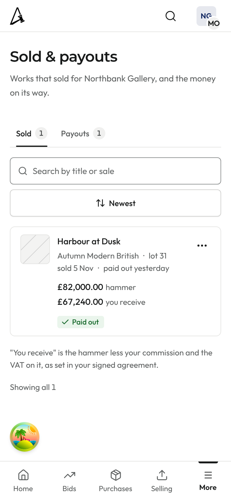 | 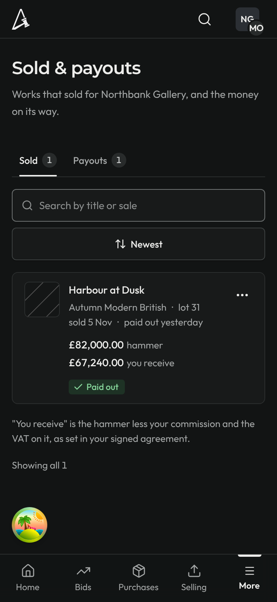 |
| Waiting for buyer (After payment) | 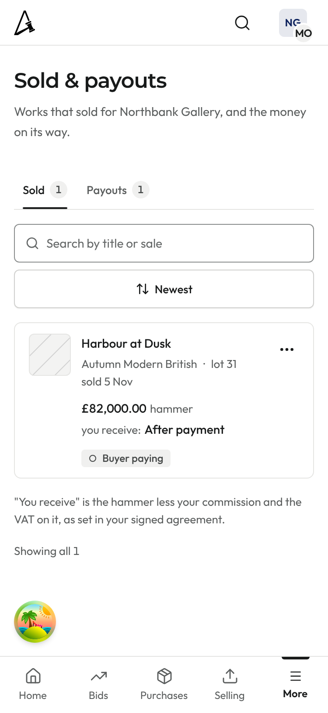 | 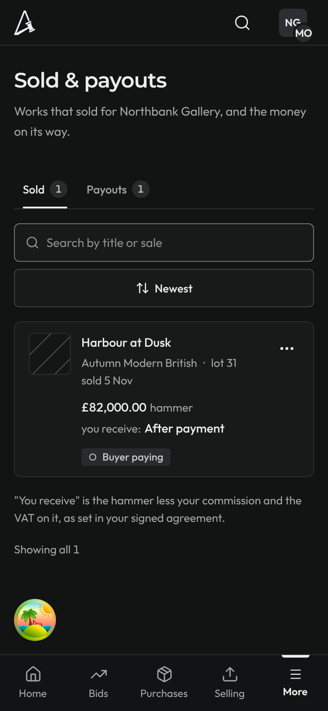 |
| Being confirmed | 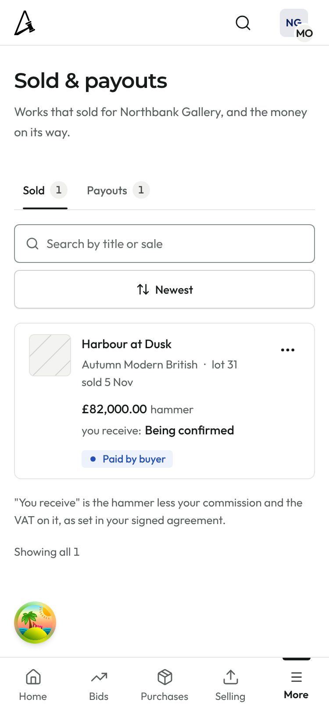 | 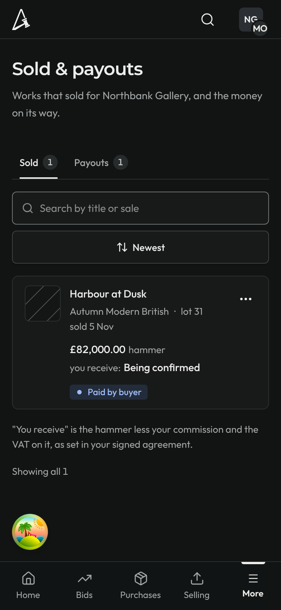 |
| Refunded after payout | 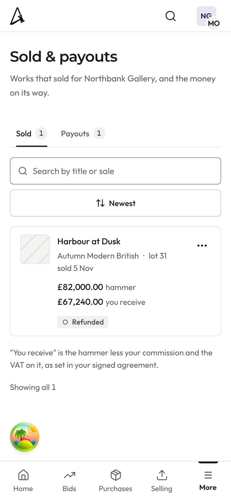 | 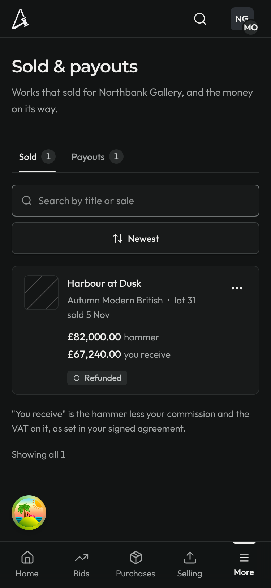 |

## Payout page

| 1440 light | 375 light | 375 dark |
|---|---|---|
| 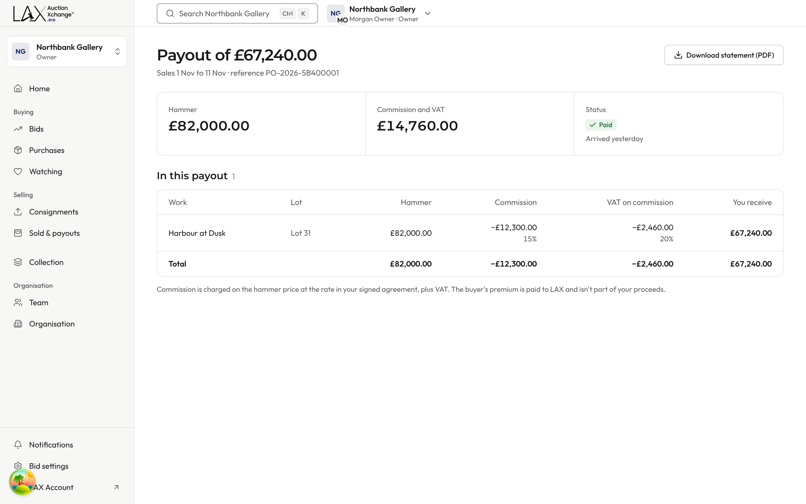 | 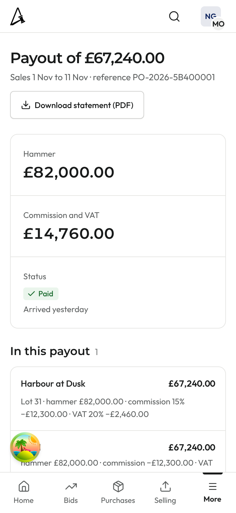 | 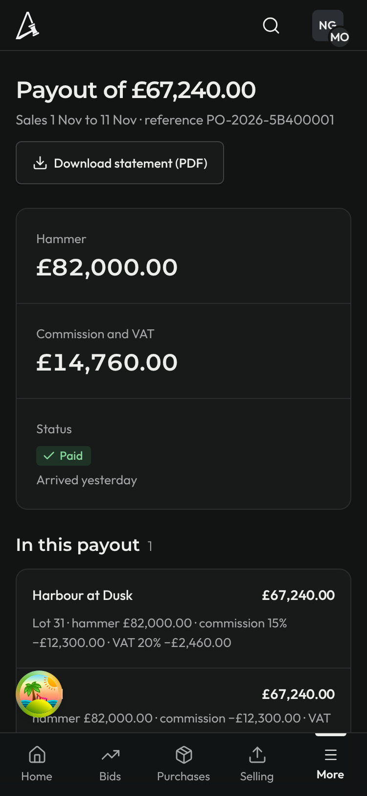 |

The phone's bottom tab bar covers the Total block in a full-page capture, so there is also a capture scrolled to the end:

| 375 light, scrolled | 375 dark, scrolled |
|---|---|
| 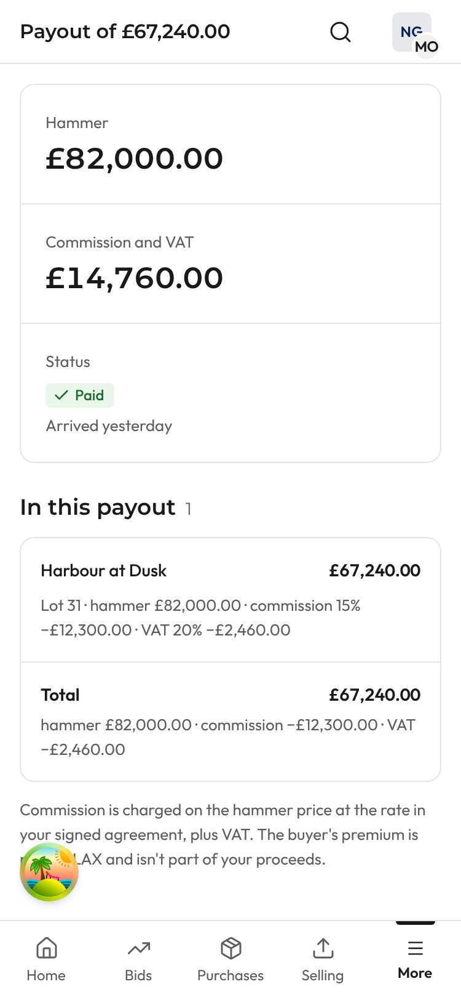 | 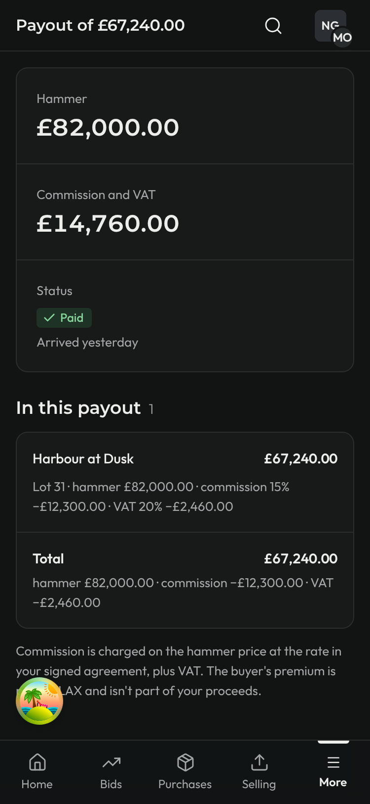 |

## Statement PDF, page 1

This is rendered from the worker's renderer with `pdftoppm`. A PDF has no dark theme. `pdffonts` lists NotoSans-Regular and NotoSans-Bold, both embedded.

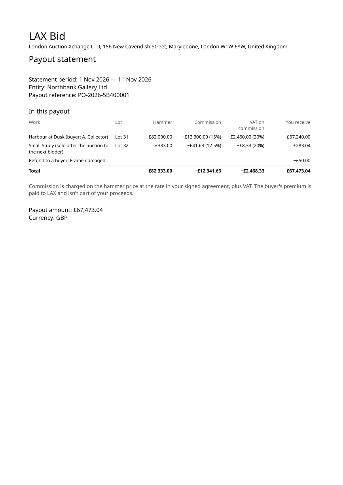

Notes:
- The cookie banner was dismissed before capture, so it no longer covers the rows.
- The round avatar near the bottom-left belongs to the dev environment. It isn't part of the page.
