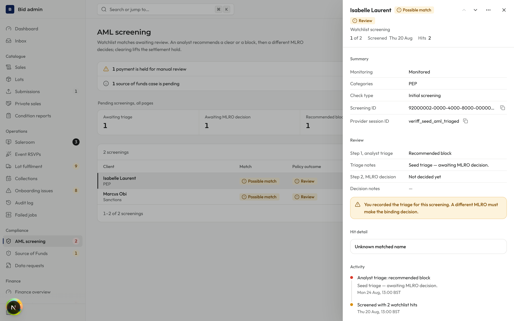
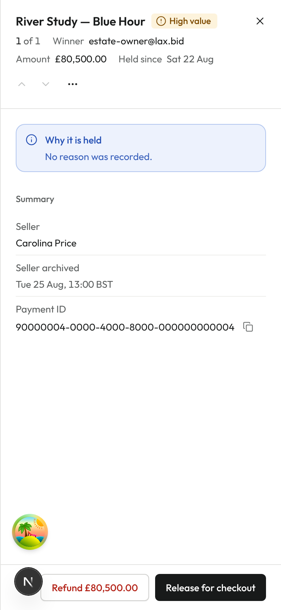
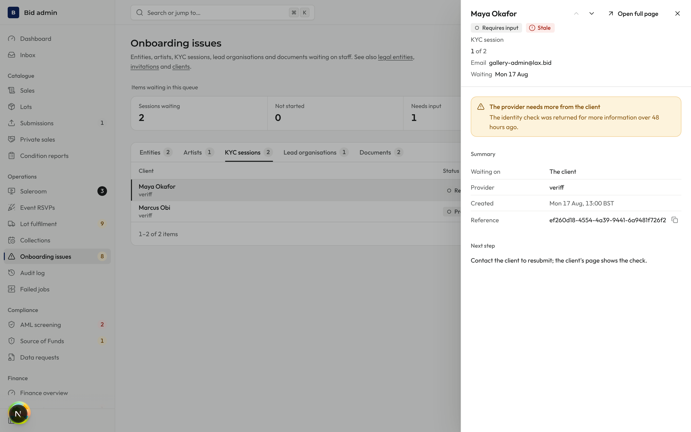
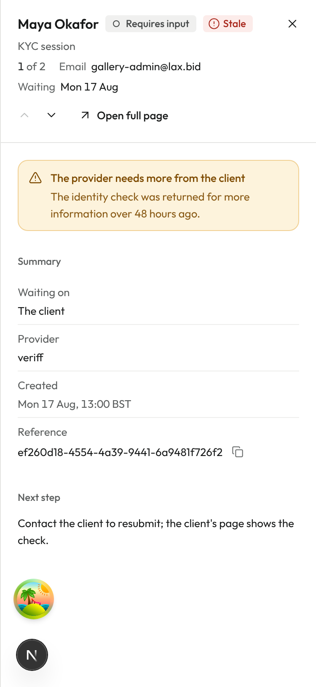

# PR #1369: Bid admin work queues, round 2 screenshots

Same local seeded stack and 2× scale as round 1, signed in as the seeded administrator, light theme. The round "N" button in the bottom-left corner is the Next.js dev-server badge; it is not part of the app. The seed holds a single manual review hold, so the position reads "1 of 1" (round 1 had four extra holds added).

What changed (design R5: the header slot reads "Open full page" and goes to the same record's page):

- AML screening and manual review: "Open client" / "Open lot" are no longer in the header. They sit in the panel's `…` menu (Open lot still only for people who may open lots). Neither record has its own page, so the header slot is empty. Same for payments, lot fulfilment and condition-report panels.
- Onboarding issue: the title is the client name (one line at 1440 and 375); the email moved to the header meta beside "Waiting". The footer "Open client" button is gone, since the header "Open full page" goes to the same client page. The work inbox footer "Open record" was removed for the same reason.

| Panel | Shot |
|---|---|
| AML screening, 1440 light: `…` menu holds Open client, header has no link |  |
| Manual review hold, 375 light: `…` menu holds Open lot |  |
| Onboarding issue, 1440 light: name title, email in meta, one "Open full page" |  |
| Onboarding issue, 375 light |  |
