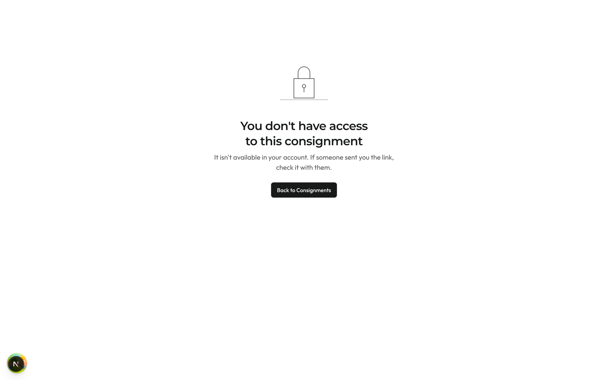
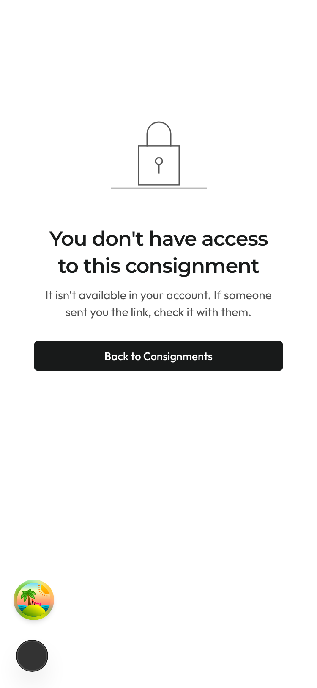
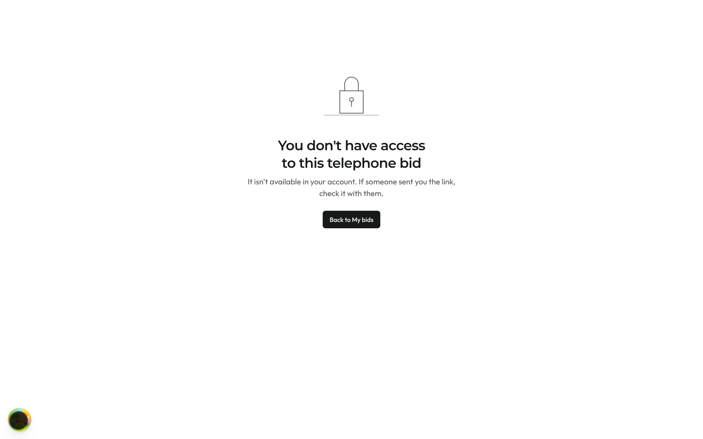
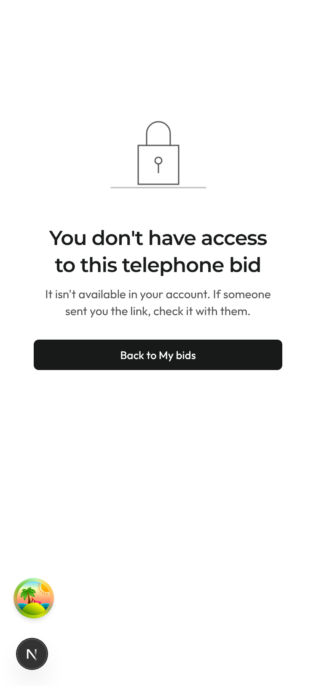
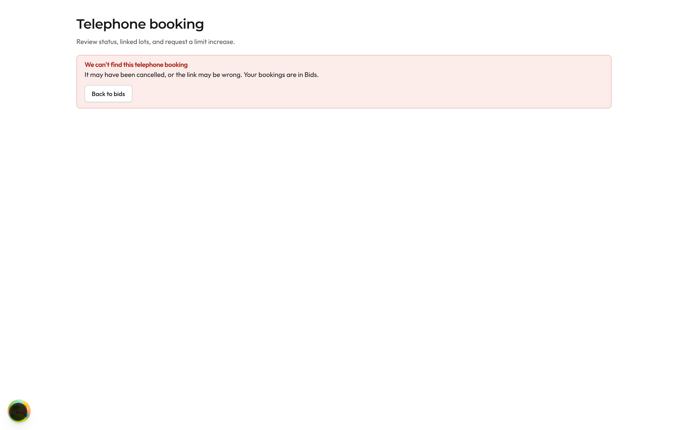
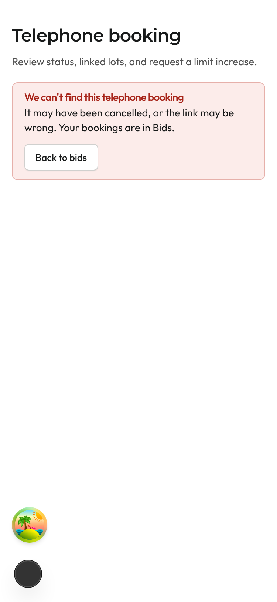

# PR #1351, round 2 screenshots

Rendered the same way as round 1: fixture data, all fictional, on a temporary dev route under `next dev` (not committed). Captured with Playwright at 1440×900 and 375×812 in light, device scale 2. The cookie banner was dismissed before each capture.

| State | 1440 light | 375 light |
|---|---|---|
| /no-access for a consignment: the button now reads "Back to Consignments" and goes to `/selling/consignments` |  |  |
| /no-access for a telephone bid: "Back to My bids" is kept for bids only |  |  |
| Telephone booking that is missing or someone else's: "We can't find this telephone booking", with Back to bids and no Try again (F4) |  |  |
