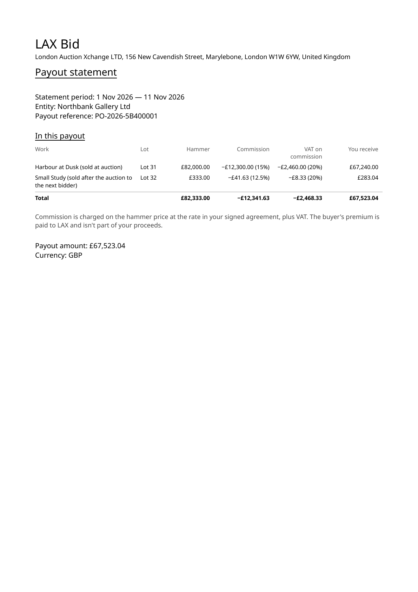
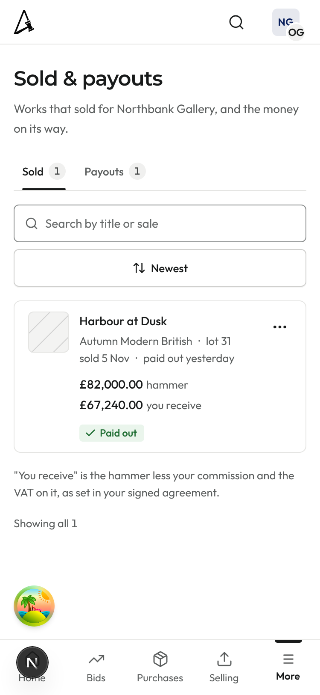
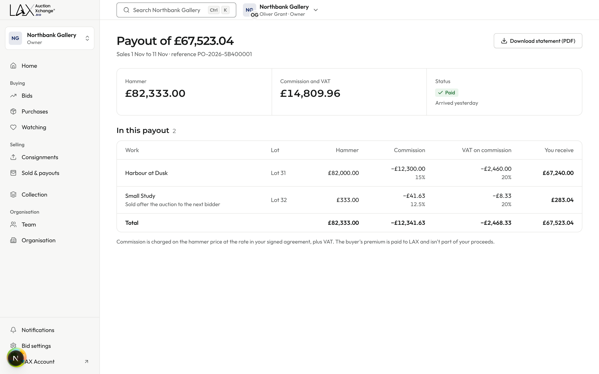

# PR #1346 · Sellers: show commission and VAT from the signed agreement · round 3

Re-rendered after the owner's decision of 13 Nov, the same way as rounds 1 and 2: the real seller components in the client workspace layout (organisation: Northbank Gallery, owner), with fixture data through a temporary, uncommitted dev route under `next dev`, captured by Playwright at 2x scale. The statement is rendered from the worker's renderer with `pdftoppm`.

Fixture: hammer £82,000.00 at 15% gives commission £12,300.00, VAT £2,460.00, and you receive £67,240.00. A second line, £333.00 at 12.5%, was sold after the auction to the next bidder.

Branch head at capture: `sc4-seller-wording` (6a907a1e).

## What changed

**Nothing a seller sees names or identifies the buyer.** LAX pays the seller itself, so the buyer's identity is not needed to complete the sale.

- **Statement PDF:** each sale now says how it sold. "Harbour at Dusk (buyer: A. Collector)" becomes "Harbour at Dusk (sold at auction)". A lot sold on after a default still reads "sold after the auction to the next bidder". The statement's query no longer reads the buyer.
- **Sold CSV:** the "Sold after the auction" column becomes "How it sold". It reads "Sold at auction" or "Sold after the auction to the next bidder".
- **Seller API:** the payout detail is built field by field, so no buyer field can reach the seller.
- **Sold & payouts, payout page, re-offer pages, seller emails:** these already showed no buyer identity, so they look the same as in round 2. The two captures below confirm it.

## Statement PDF, page 1

`pdffonts` lists NotoSans-Regular and NotoSans-Bold, both embedded.

## Sold & payouts, 375 light

## Payout page, 1440 light

Note: the round avatar near the bottom-left belongs to the dev environment. It isn't part of the page.
